# Coding2API

Wraps **CodeBuddy** (CN + international), **TRAE SOLO**, **OpenCode Zen**, **Kilo**, **Qoder**, **CodeArts** and **OfficeAce** into an OpenAI-compatible API, with a shared credential pool, unified model names and scheduling, and per-user usage stats.

> [!WARNING]
> Reverse-engineered endpoints; study and research only, not security-audited. Public deployment needs a reverse proxy, authentication and an IP allowlist.

## Features

- **OpenAI-compatible surface**: `/v1/chat/completions` (streaming / non-streaming), `/v1/responses` (Codex CLI), `/v1/messages` (Claude Code), `/v1/models` (incl. single-model lookup), `/v1/user/balance`.
- **Unified scheduling**: bare model names route by health, `model@provider` pins an upstream. Free channels first → least in-flight → expiring credits → health with tiered cooldowns → largest balance. A model-scoped limit sidelines only that model; multi-turn conversations stick to one credential and rotate only on error.
- **Expiry-aware burn**: credits expiring within the main window (default 36h) burn first, ties fall to the 7-day window. Units unify to credits.
- **Credential-gated model list**: only channels with a usable credential appear; no phantom models.
- **Shared credential pool**: admins maintain, everyone shares, encrypted at rest (`APP_SECRET`); device-code login, account switching, quota probing, daily check-in, token pre-refresh.
- **Three roles**: `admin` / `operator` / `viewer` in SQLite; one-time activation links, forced password change on first login, role change or disable revokes sessions immediately; logins and writes audited.
- **Growth center** (CodeBuddy only): travel gifts, Buddy dispatch, task rewards, streak repair/redemption, blind boxes; irreversible steps off via `GROWTH_IRREVERSIBLE_ACTIONS=false`.
- **Privacy-preserving stats**: no conversation content; 90-day detail, permanent hourly rollups; per user / channel / model / credential views; cost from OpenRouter list prices; output speed in two scopes; SSE live stream in the detail panel.
- **Upstream status aggregation**: official status pages side by side, separating "upstream outage" from "our credential / quota problem". Explanation only, never scheduling; memory only.
- **Sidebar to-dos**: count badges (re-login / exhausted, unresolved alerts, failed tasks, abnormal upstreams, pending activations, expiring keys, stale catalog), role-filtered. See [below](#sidebar-to-dos-navigation-badges).
- **Admin hardening**: login rate limiting, CSRF checks, body limits, Host allowlist.
- **Responsive tables**: below 768px one row becomes one card; column names collapse into tappable sort chips. DOM unchanged.

Protocol-level implementation (private envelopes, signing, gate spoofing) is in [`TECHNICAL.md`](TECHNICAL.md) (Chinese).

## Screenshots

Admin console (captured from a local instance; accounts and IPs masked):

| Credentials: pool overview, grouped by channel | Usage: requests, tokens, cost |
|---|---|
| 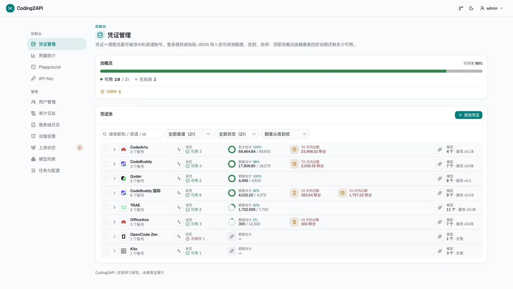 | 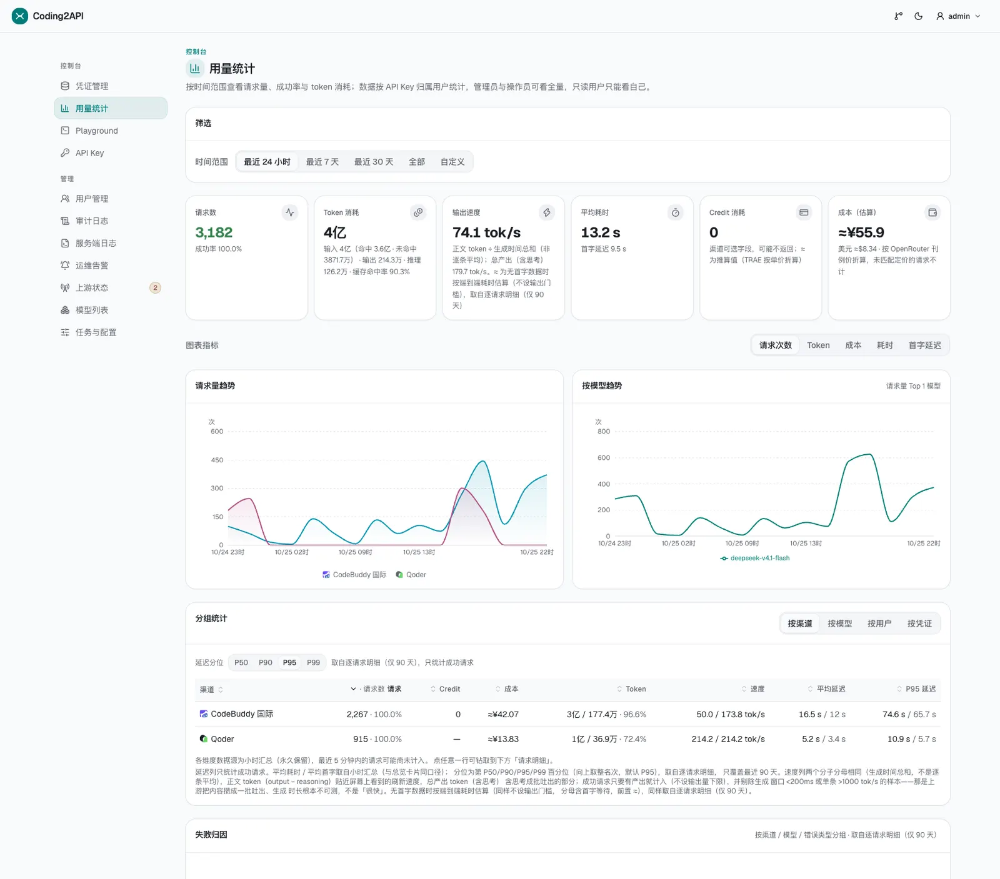 |
| **Playground: models × channels and multipliers** | **Model list: OpenRouter list prices and ability score** |
| 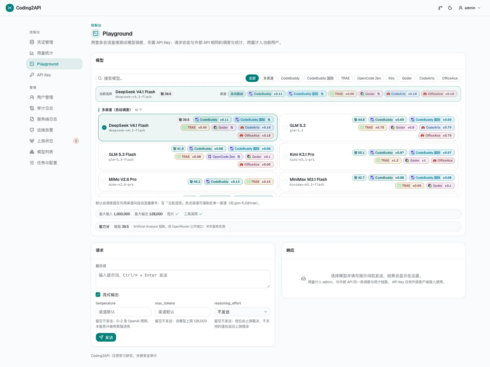 | 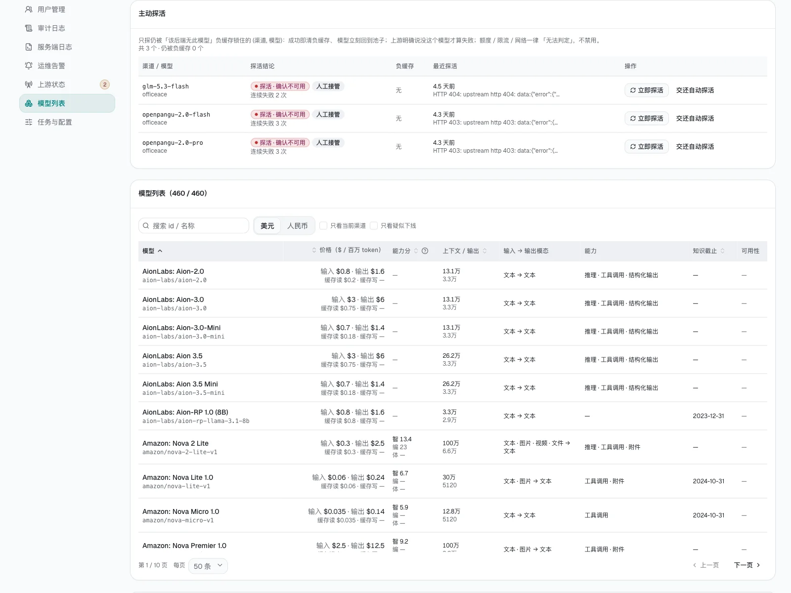 |
| **Upstream status: upstream outage vs. our problem** | **API keys: client setup and quotas** |
| 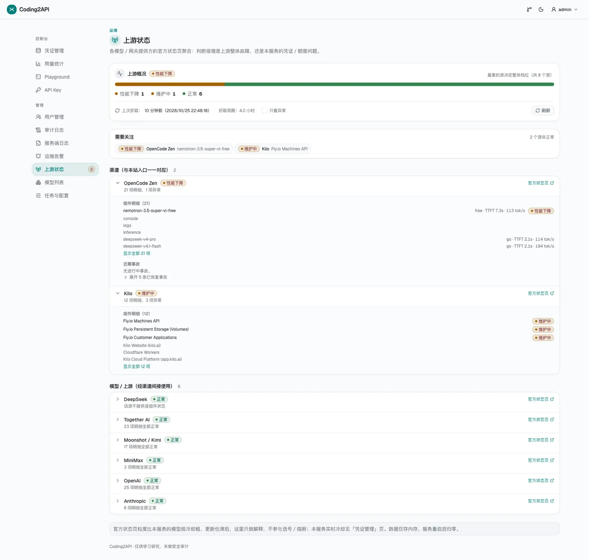 | 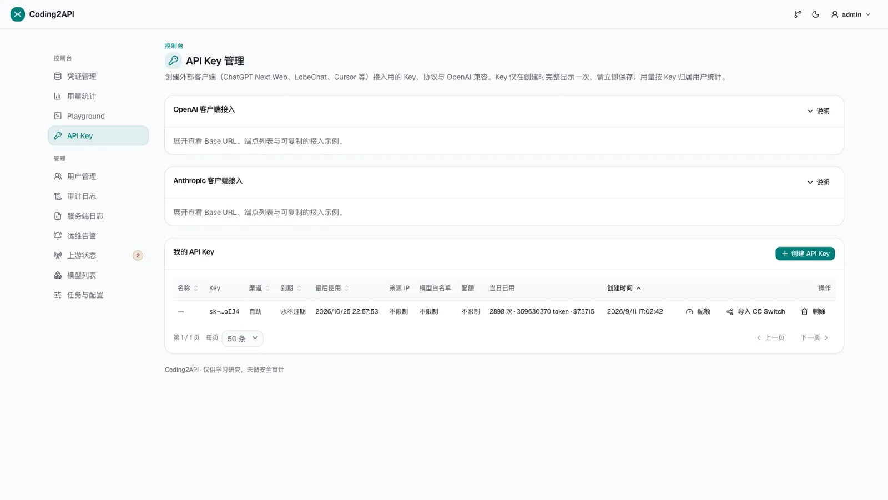 |
| **Users: three roles, one-time activation** | **Audit log: successful and failed logins** |
| 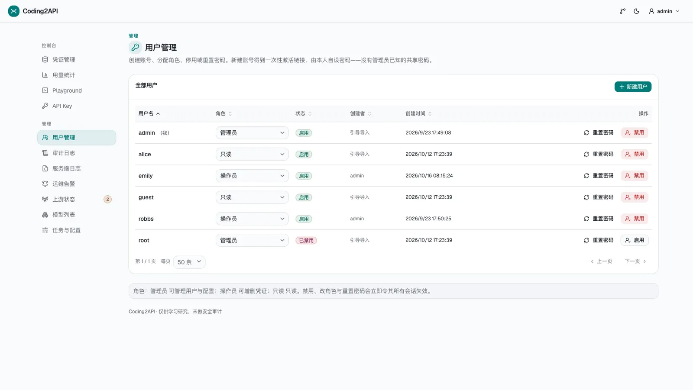 | 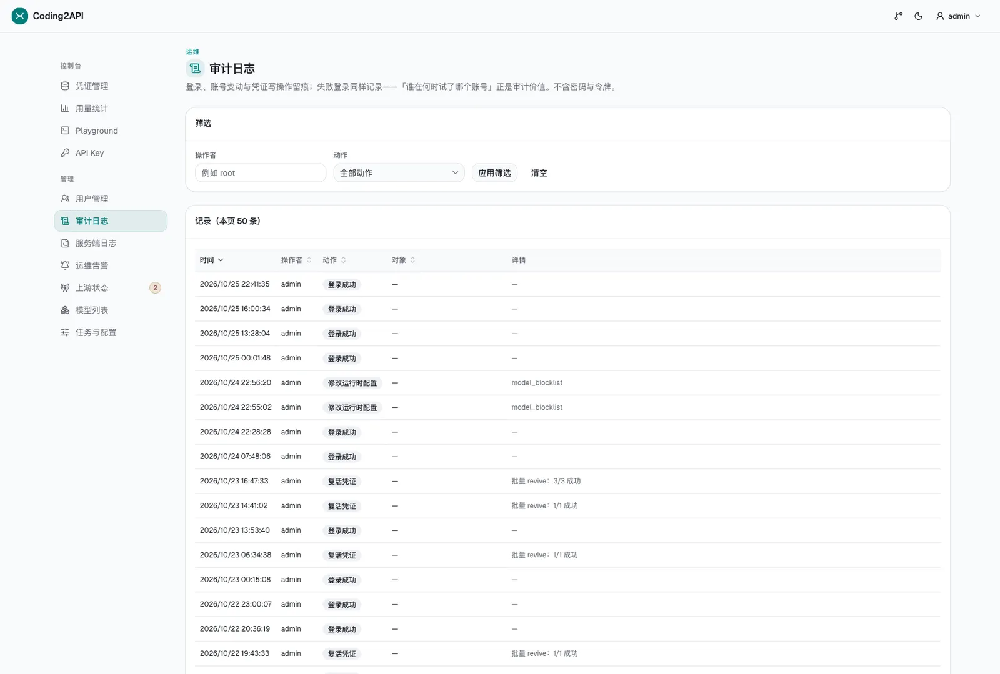 |
| **Server logs: ring buffer with redaction** | **Ops alerts: four risk rules, periodic** |
| 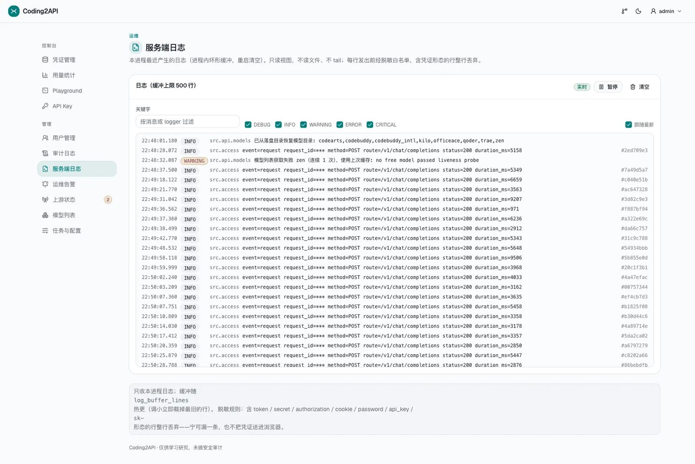 | 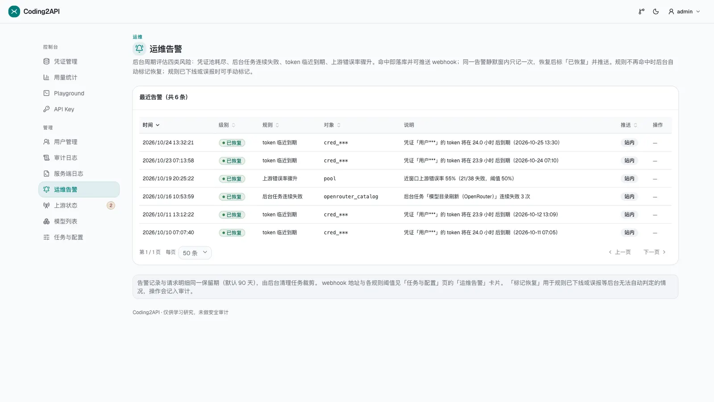 |

**Tasks & settings: 60+ hot-reloadable options, DB overrides win over `.env`**

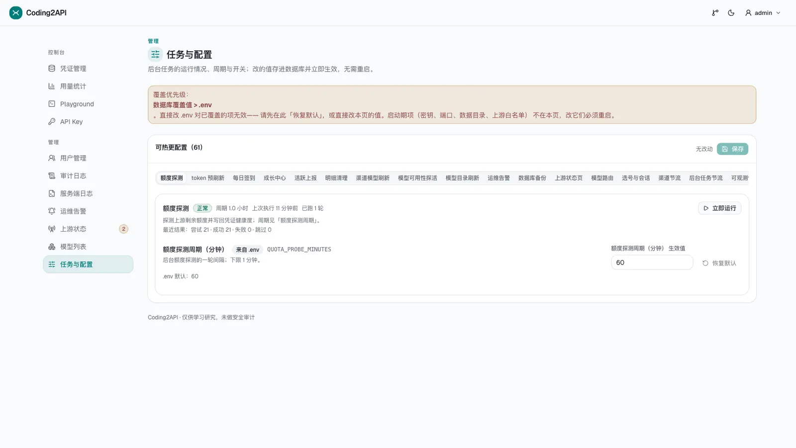

## Quick start

Requirements: Python 3.12+, [uv](https://docs.astral.sh/uv/), Node.js 24+ and pnpm 10+ (frontend build only).

```bash
uv sync
uv run python scripts/create_user.py admin --role admin   # first admin
cd web && pnpm install && pnpm build && cd ..
APP_SECRET="pick-a-random-string" \
  uv run python -m uvicorn src.main:build_app --factory --port 8000
```

Open <http://127.0.0.1:8000>. Add the rest from the *Users* page.

`scripts/create_user.py` writes directly to SQLite (`--db`, or `DATA_DIR`; default `data/coding2api.sqlite3`). An existing `secrets/users.txt` is imported once on startup (never overwritten).

Docker:

```bash
cat > .env <<'EOF'
APP_SECRET=pick-a-random-string
PUBLIC_BASE_URL=http://127.0.0.1:8000
EOF
docker compose up -d --build
docker compose exec coding2api python scripts/create_user.py admin --role admin
```

Pull the image: `docker compose pull` (or `docker pull ghcr.io/robbsluo/coding2api:v0.9.1`). Pushing a `v*` tag to main triggers `.github/workflows/publish.yml`, publishing `<tag>` and `:latest`.

## Users and roles

Accounts live in SQLite's `users` table; the *Users* page (admins only) handles management.

| Role | Can do |
|---|---|
| `admin` | User management, tasks & settings, credential read/write, all stats, audit log, server logs, upstream status, model list |
| `operator` | Credential read/write (import / delete / pause / check-in / growth / account switch), all stats, upstream status, model list |
| `viewer` | Read-only: dashboard, credential list, stats, Playground |

- **Adding users**: set username + role, get a one-time activation link (24h, shown once); the user opens `/activate` and sets their own password. No "admin knows an initial password" secret exists. Reset works the same way.
- **Role change / disable**: all session cookies for that account are invalidated immediately. Disabling is the reversible default way to "remove" someone (usage stays attributed); hard delete is CLI-only.
- **Self-service password change**: user menu → *Change password*, current password required.
- **Lockout guard**: cannot disable or demote the last active admin, nor demote or disable yourself.

CLI fallback:

```bash
python3 scripts/create_user.py alice --role admin   # interactive password
python3 scripts/create_user.py --list
python3 scripts/create_user.py alice --delete --force   # hard delete, irreversible
python3 scripts/create_user.py --db data/x.sqlite3 ...
echo "$PASSWORD" | python3 scripts/create_user.py alice --role admin --password-stdin
```

`ADMIN_USERNAMES` and `secrets/users.txt` are bootstrap-only; afterwards roles come from the DB alone.

## Audit log

The *Audit log* page (admins only) records logins and writes, filterable by actor / action and paginated: logins (success and failure), account changes, credential writes, manual alert resolution. Each row has time, actor, action, target, detail and source IP. **No passwords or token plaintext** (activation tokens store only a SHA-256 digest). Retention matches request detail (90 days).

## Server logs

The *Server logs* page (`/logs`, admins only) is a read-only live view of this process's logging: `GET /api/logs` returns recent lines, `GET /api/logs/stream` is SSE (replay then live). Level filtering, keyword search, follow-latest, pause and clear — **no write entry point**.

- This process only; it never tails a file. Under multiple processes each sees its own slice.
- **Redaction is a hard precondition**: lines matching `token` / `secret` / `authorization` / `cookie` / `password` / `api_key`, an `sk-…` shape or `Bearer <value>` are dropped whole.
- Buffer size `LOG_BUFFER_LINES` (default 500, hot-reloadable), oldest overwritten first; `0` disables the page (both endpoints 404).
- 4000 chars per line; each carries `seq`, timestamp, level, logger, `request_id`. Subscriber limit 4, beyond that 429 + `Retry-After`.

## Usage

1. **Credentials** — add credentials:
   - **CodeBuddy** (incl. international): device-code login, or paste `{"token":"..."}`.
   - **TRAE**: paste the credential JSON (`accessToken`/`uid`/`refreshToken`) or the callback URL (`apiHost` must be official).
   - **Qoder / CodeArts**: device-code / OAuth2 authorization-code login (CodeArts: paste the unreachable local callback URL back).
   - **OfficeAce**: *Log in to OfficeAce*, Huawei Cloud authorization (callback handled in the cloud).
   - **OpenCode Zen / Kilo**: nothing to add — a virtual credential is seeded at startup (re-addable from the same panel).
2. **API keys** — create an `sk-...` (plaintext shown once).
3. Call it:

```bash
curl http://127.0.0.1:8000/v1/chat/completions \
  -H "Authorization: Bearer sk-your-key" \
  -H "Content-Type: application/json" \
  -d '{"model":"glm-5.2","messages":[{"role":"user","content":"hello"}]}'
```

`model@provider` pins an upstream (`glm-5.2@trae`, `mimo-v2.5-free@zen`); bare names route automatically. Any OpenAI-compatible client connects (Base URL `http://127.0.0.1:8000/v1`). *Playground* tests with the session login, no API key.

### Three model-name fields

1. **Raw id** (`raw_id`): the key actually sent upstream, never changed. Raw ids differ per channel (Qoder `kmodel_latest` = TRAE `kimi-k3-1`) and may carry a namespace prefix (Kilo's `kilo-auto/free`).
2. **Canonical key**: free-tier markers (`-free` / `free` path segment) and namespace prefixes stripped, then slugified (`kilo-auto`). The list merges by it.
3. **Display name** (`name`): cleaned readable text, from upstream when given, otherwise derived; brand casing normalized (`DeepSeek` / `MiMo` / `GLM` / `GPT`).

Every `id` in `GET /v1/models` is the canonical key; requests translate back to the raw id (`by_provider.{channel}.raw_id`). **All three spellings are directly requestable.** Duplicate canonical keys within a channel fall back to the raw id.

**Cost and levels**: entries may carry `cost {input, output, cache_read}` (USD / 1M tokens, same price table as cost estimation) and `reasoning_efforts` (effective levels for that channel). Present only when known.

**Custom aliases** (`MODEL_ALIASES`, hot-reloadable): `alias=model@channel;alias2=model`; `@channel` optional. List and request resolution share one table; entries carry `custom_alias: true`. Collisions, missing targets, or a channel not holding the model log ERROR and skip that segment; no alias chains.

**Single-model lookup** (`GET /v1/models/{id}`): all three spellings plus custom aliases, case-insensitive, namespaced raw ids work. Missing or outside the key's allowlist → 404 (`code=model_not_found`), so a client cannot probe the pool.

**`n` only accepts 1**: the outbound shape produces a single choice; anything else is 400.

### Streaming usage and reasoning tokens

- After the finish chunk and before `data: [DONE]`, a `choices: []` usage frame is appended; nothing when the upstream reported no usage, and unreported fields are `null`.
- Reasoning tokens need `reasoning_effort`; CodeBuddy defaults to `medium` when absent (otherwise reasoning lands in the visible answer). Explicit values pass through.

### Streaming timeouts (off by default)

Upstream reads use `read=None`, so the gateway supplies its own:

- **First-event timeout** (`STREAM_FIRST_EVENT_TIMEOUT_SECONDS`, default 0): fires before any content reaches the client, so retrying on another credential is safe. Comment frames / heartbeats do not reset it.
- **Idle timeout** (`STREAM_IDLE_TIMEOUT_SECONDS`, default 0): after the first frame, the stream is closed with an error frame and **not** retried (partial output cannot be rolled back).

Both default to off on purpose: slow contexts measured 40–71s to first token. Enable per deployment (recommended 60 / 300).

### Playground advanced parameters

Optional `temperature` / `max_tokens` / `reasoning_effort`; **leaving one empty omits the key**. Client-side validation matches the backend (`temperature` ≤ 1000, `max_tokens` ≤ 4,000,000). The `reasoning_effort` control appears only for reasoning models and starts at "not sent".

## Channels

> CodeBuddy (incl. international) / TRAE / Qoder / CodeArts / OfficeAce need credentials; **OpenCode Zen and Kilo are credential-less free tiers** — one virtual placeholder row (scheduling / cooldown / stats work as usual), quota reads "free tier (no quota API)", health stays "no probe". The virtual row re-seeds on restart after deletion; use *pause* to disable permanently.

### OpenCode Zen (`zen`)

Free models at [opencode.ai/zen](https://opencode.ai), no login. The upstream list mixes unmarked paid models, so the gateway narrows by the `-free` suffix and probes each candidate, exposing only what answers anonymously (liveness cached 30 min; free models marked **x0**).

**Free-tier gate**: the upstream wants the official client (UA version, session header, `stream:true`, `tools` with `bash`/`read`). The gateway satisfies this; injected `bash`/`read` are empty shells and their calls are filtered out. UA via `ZEN_OPENCODE_VERSION`, endpoint via `ZEN_API_ENDPOINT` (inside `ZEN_ALLOWED_ENDPOINTS`). Paid models return unavailable even when pinned.

### Kilo (`kilo`)

Free models at [Kilo](https://kilo.ai) (`api.kilo.ai/api/gateway`), no login. Standard OpenAI protocol; `/models` carries `isFree`, so the gateway filters directly and **does not probe** (saves the tiny quota).

**Quota**: gateway-wide ~200 requests/hour/IP. Upstream 429 and 502/503/504 are model-scoped — only the named model cools. Endpoint via `KILO_API_ENDPOINT` (inside the allowlist).

### Qoder (`qoder`)

[Qoder](https://qoder.com), real account: *Log in to Qoder* for device-code authorization (the token never touches the browser). The upstream speaks a private COSY protocol, signed and unwrapped here; the surface stays OpenAI.

**Quota and check-in**: quota probing (`/api/v2/quota/usage`) and campaign-based daily check-in (credits accumulate). Campaigns (`/sash/api/v1/me/campaigns`), old `daily-check-in` as fallback. Campaigns **refresh daily at 10:00 (UTC+8)** (valid 30 days) and the task seals per that window. No streak count. **The international site has no check-in** (404), reported as "no such endpoint in this region".

**Endpoints and pacing**: CN by default (`openapi.qoder.com.cn` + `gateway.qoder.com.cn`); international via `QODER_API_ENDPOINT=https://openapi.qoder.sh` with the allowlist extended. `QODER_CHAT_MIN_INTERVAL` default 5, hot-updatable.

**Upstream node failures**: Qoder sometimes wraps its own node failures in a 400 (`[FAIL]node:…`). Treated as a model-scoped transient fault — only that model cools; an exhausted candidate set returns 503 (`no_healthy_credential`).

### CodeArts (`codearts`)

[Huawei Cloud CodeArts](https://codearts.huaweicloud.com), real account: *Log in to CodeArts*, authorize, then paste the **unreachable local URL** back; the server exchanges it for STS credentials (AK/SK + security_token + refresh_token + DPoP key) and stores them encrypted.

**Token refresh is rigid**: refresh_token, `client_id=codearts-agent` and the DPoP key are bound and single-use; the new refresh_token must be written back. Handled by the pre-refresh task (DPoP ES256/P-256). The window is capped at 45 minutes and must be wider than the polling interval. A revoked credential is marked "re-login required" and stops automatic retries.

**Daily check-in**: `GET /v1/ops/delivery` → `POST /v1/ops/claim` → `POST /v1/ops/confirm`. `CLAIMED` means claimed-but-unconfirmed, so both steps always run.

**Quota = credit balance**: probing hits `GET {snap}/snap-manager/v1/statistics/plugin` (the `snap-manager` prefix is mandatory; header `Agent-Type: PromptCenter`). Upstream values are credits, no conversion; sub-packages go into a popover and the plan expiry date is registered (unused credits are voided too).

**Signing / cumulative SSE / pacing**: Huawei `SDK-HMAC-SHA256` (AK/SK + `X-Security-Token`); the allowlist needs the snap engine, STS and portal. Streaming `text` is cumulative (replace semantics), reduced to incremental events. The upstream hard-limits 3 concurrent sessions per account, hence `CODEARTS_MAX_CONCURRENCY` and `CODEARTS_REQUEST_WINDOW_SECONDS`.

### OfficeAce (`officeace`)

[Huawei Cloud OfficeAce](https://www.huaweicloud.com/product/agentarts.html), real account: *Log in to OfficeAce* and finish the Huawei Cloud authorization — **the callback is handled in the cloud**, so no local port and no URL to paste. The backend polls `/v1/claw/auth/code` every 2.5s.

**Provisioning prerequisite**: the account must first sign in to the OfficeAce client and redeem an invitation code. An unprovisioned account completes the login but gets no model key; the service names the account and says it has not activated OfficeAce.

**Two credential sets, very different lifetimes**:

| Credential | Lifetime | Used for |
|---|---|---|
| `Basic model_app_key:model_app_secret` | never expires | chat forwarding |
| temporary AK/SK + `security_token` + `project_id` | ~2 hours | quota lookup, check-in |

Mixing them yields `APIG.0303 app not found`. The temporary half is renewed by the pre-refresh task; `refresh_token` is single-use and bound to `client_id=pdp5_for_agentarts` plus the DPoP key (not interchangeable with the CodeArts ticket).

The upstream is plain OpenAI protocol, with three quirks:

- **Rate limits arrive as fake 200s**: HTTP 200 + `data:{"error":…}`. Error frames flow to the engine as usual; `81111`/`81114` cool only that credential × model.
- **Model-level rejection must not kill the credential**: `81004` / `81009` arrive as 403/404; business codes are checked before status codes and classified as a model-level negative cache (cleared on success).
- **`max_tokens` is a combined reasoning + answer budget**: `≥16` gets 1024 extra headroom clamped to the model ceiling; `<16` passes through; absent stays absent.

**Credits are the main ledger**: unit `officeace_points`; `remaining`/`total` are credits. Each reward expires independently, so the quota reads "per-reward expiry".

**Daily check-in**: `POST /v1/subscription/bonus/claim` (a write — it really grants credits; body must be `` with JSON `Content-Type`). The upstream is idempotent for repeat claims on the same day. Gains are computed as a remainder delta. Sealed until the next Beijing midnight.

**No active probing / no credit estimation**: probing burns credits; the `cost_coefficient` × `tokens_per_point` relation is undocumented. Model-level rejections are handled by real requests via the `BLOCKED` negative cache.

**Signing and endpoints**: control plane `/v1/claw/*` uses `SDK-HMAC-SHA256`; the model gateway accepts only `V11-HMAC-SHA256` (wrong one → `APIG.0624` or 401). `OFFICEACE_ALLOWED_ENDPOINTS` only needs the control-plane host (the model gateway is per-account and issued by the upstream). `OFFICEACE_CHAT_MIN_INTERVAL` default 0.

**Single account, single user**: the official plan limits one user per account; no sharing.

**Switching accounts**: a *Switch account* button (`force_login=true`) clears the Huawei Cloud browser session first.

### CodeBuddy international (`codebuddy_intl`)

[www.codebuddy.ai](https://www.codebuddy.ai), same protocol as the CN site but a separate account system (separate registration and billing), hence a separate channel. Same device-code login.

Why not one channel: `CODEBUDDY_API_ENDPOINT` is a single process-wide value, so switching would send every existing CN credential to the international site. Both sites can hold credentials simultaneously with their own endpoints, pacers and login flows.

**Allowlists deliberately exclude each other**: `CODEBUDDY_INTL_ALLOWED_ENDPOINTS` defaults to the international host only; adding the CN host fails at startup (cross-site sending leaks the credential).

**Capability differences**: chat, model list, quota probing, token refresh and activity reporting are enabled; **check-in and growth center are not** (no such campaign on this channel; the growth center cannot be verified and includes irreversible actions).

**Model list probes the plan**: each credential sends one minimal request per model and keeps only usable ones; `11158` (plan not allowed) and `11102` (no such model) are dropped, `429` / 5xx / timeouts keep the model. Results cached per account for 6 hours.

**Same-name models carry no channel suffix**: models on both sites are one row attached to both channels; genuinely different models (`-x` / `-sg`) get their own rows.

**Pacing**: `CODEBUDDY_INTL_CHAT_MIN_INTERVAL` default 5s, an independent pacer, hot-updatable.

### Per-channel outbound proxy (optional)

```
PROVIDER_PROXIES="codebuddy=http://127.0.0.1:7890;qoder=socks5://127.0.0.1:1080"
```

Format `channel=proxyURL;channel2=proxyURL2`; `http/https/socks5/socks5h` supported; empty = all direct. Applies to every outbound request of that channel (chat, quota, model fetch, background tasks, OAuth). **Startup-time setting.** Unknown channel / bad scheme / missing `=` fails startup. `HTTP_PROXY` and friends are ignored (`trust_env=False`).

> Inside containers `127.0.0.1` is the container itself. Use `host.docker.internal` for a host proxy:
> `PROVIDER_PROXIES="codebuddy=http://host.docker.internal:7897"`
> compose declares `extra_hosts`. Parsing validates format only, so a wrong address does not fail startup.

## Outbound protocols

### Responses API (Codex CLI)

`POST /v1/responses` provides a Responses subset, sharing scheduling / cooldown / rotation / stats / stickiness with chat:

```bash
export CODING2API_KEY=sk-your-key
codex -c "model_providers.coding2api={ name='coding2api', base_url='http://127.0.0.1:8000/v1', wire_api='responses', env_key='CODING2API_KEY' }" \
      -c model_provider=coding2api -c model='glm-5.2' 'your task'
```

Supports text, streaming output, reasoning summaries, function tool calls and `finish_reason=length` → `response.incomplete`. `text.format` maps to chat's `response_format`. Content parts: `input_text` / `text` / `output_text` → text, `input_image` → `image_url`. **Unsupported**: `store=true`, `previous_response_id`, `input_file`, Responses-private tools — all explicit 400. `include=["reasoning.encrypted_content"]` is accepted and ignored.

### chat `response_format` validation

Only the three OpenAI shapes pass; malformed or unknown ones are explicit 400: `{"type":"text"}`, `{"type":"json_object"}`, `{"type":"json_schema","json_schema":{name, schema, description?, strict?}}` (unknown inner fields dropped). The Responses `text.format` path reuses the same validation.

### Anthropic Messages API (Claude Code)

```bash
export ANTHROPIC_BASE_URL=http://127.0.0.1:8000
export ANTHROPIC_AUTH_TOKEN=sk-your-key     # or ANTHROPIC_API_KEY (x-api-key header)
claude
```

- **Auth**: both `x-api-key` and `Authorization: Bearer`.
- **Streaming**: `message_start` → `content_block_*` → `message_delta` → `message_stop`; no `[DONE]`; thinking blocks get a `signature_delta` before `content_block_stop`.
- **Cache hits**: usage splits in two — `input_tokens` counts misses only, hits go to `cache_read_input_tokens`.
- **`count_tokens`**: estimated locally, never forwarded.
- **Images**: `image` blocks normalize to chat `image_url`; images inside `tool_result.content` are preserved.
- **Unsupported**: `document` blocks, `source.type=file`, Anthropic server tools — explicit 400.
- **`cache_control` passthrough** (on by default): landing spots match Anthropic (`system`, message content blocks, `tool_result` top level, `tool_calls` top level, `tools` top level). Structure validated only, values not interpreted. 6 of 8 channels accept it (codebuddy / codebuddy_intl / trae / qoder / codearts / kilo); zen unverified, OfficeAce not separately probed. Script `scripts/probe_cache_control.py`.

### CC Switch one-click import

The *API keys* page generates `ccswitch://` deep links (Claude Code / Codex CLI / OpenCode). Two entry points: the post-creation dialog and the per-row *Import to CC Switch* action. Links contain the plaintext key, so they are generated only on explicit user action. Requires CC Switch v4.0.10+. The endpoint form depends on `apiFormat`: Anthropic goes to the root (no `/v1`), OpenAI forms to `/v1`. No Gemini surface.

### Balance query

`GET /v1/user/balance` is DeepSeek-shaped, Bearer `sk-...`, for Cherry Studio / cc-switch. Values come from the cached quota probe, aggregated over usable credentials:

```json
{
  "is_available": true,
  "balance_infos": [{"currency": "credits", "total_balance": "60.00",
                     "granted_balance": "0.00", "topped_up_balance": "0.00"}],
  "balance_known": true,
  "providers": [{"provider": "codebuddy", "remaining": 50.0, "total": 150.0, "credentials": 2}]
}
```

`balance_known` is `false` when nothing has ever been probed (unknown, not 0).

### Pool health

- `GET /health`: `{"status":"ok"}`, for liveness probes.
- `GET /healthz`: adds pool counts and returns 503 when `ready == 0` (readiness).

Neither is authenticated and both accept `HEAD`. The five counts are mutually exclusive and sum to `total`, same as the scheduler. **Point liveness at `/health`**; use `/healthz` for readiness / alerting.

> Upgrade note: `/healthz` changed from always-200 to 503 when `ready=0`.

### Prometheus metrics (`GET /metrics`)

On by default, **unauthenticated**; `METRICS_ENABLED=false` (hot-reloadable) returns 404.

| Metric | Type | Labels | Source |
| --- | --- | --- | --- |
| `coding2api_requests_total` | counter | `provider` / `model` / `status` | `usage_hourly` |
| `coding2api_tokens_total` | counter | `provider` / `type` | `usage_hourly` |
| `coding2api_credentials` | gauge | `state` | credential pool |
| `coding2api_upstream_errors_total` | counter | `provider` / `kind` | in-process (resets on restart) |
| `coding2api_task_failures_total` | counter | `task` | in-process task state |

No `credential_id` / `api_key_id` / `username` (high cardinality). `requests_total` / `tokens_total` read the permanently retained hourly rollup and stay monotonic across restarts. Hourly rollups have no `error_type` dimension, so `kind` comes from an in-process counter.

## API key policy

- **Channel binding**: the key only picks credentials from that channel; a model owned by another channel returns 400 naming the actual owner. Empty = cross-channel.
- **Source IP allowlist**: comma-separated IPs or CIDR blocks, normalized on write (`10.0.0.1` → `10.0.0.1/32`); outside the list → 403. `X-Forwarded-For` is not trusted by default; only with `TRUST_PROXY=true`, taking the last entry.
- **Model allowlist**: comma-separated names or fnmatch globs (`glm-*,kimi-k3`), case-insensitive, `@channel` suffix ignored. Outside → 400; `/v1/models` filters too.
- **Expiry**: epoch seconds; empty = never. Expired → 401 (same wording as "key not found").
- **Quota**: six independent limits, `0` or empty = unlimited — `daily_requests` / `daily_tokens` / `daily_cost_usd` / `rpm` / `tpm` (estimated) / `max_concurrency`. Daily ones use the Beijing calendar day; rate and concurrency are in-process sliding windows. Over the limit → 429 + `quota_exceeded`, `Retry-After` points at the retry moment. A failing check always allows the request and logs a warning.
- **Self-service**: `GET /v1/usage?days=1|7|30` returns your own usage, remaining quota and current rate usage (local detail only).

## Credential pause

*Pause* removes a credential from chat traffic and skips it in daily check-in / token pre-refresh; other background tasks (quota probe, growth center, activity reporting) keep running. Useful for "no chat, keep collecting credits". *Unpause* returns it to the pool immediately. Different from *disabled*, which is the channel-driven session-invalid state requiring *revive* after re-login. Same switch at `POST /api/credentials/{id}/toggle`.

> Zen / Kilo are virtual rows; **pause is the only permanent disable** (deletion re-seeds on restart). Pausing also removes the channel from the model list.

## Credential batch operations

The credentials page offers multi-select plus a batch bar (probe / check-in / pause / unpause / revive).

- **Endpoint**: `POST /api/credentials/batch`, body `{action: "probe"|"toggle"|"checkin"|"revive", ids: [...], enabled?}`. Up to 200 ids per request, duplicates deduped.
- **Per-item isolation**: one failure never blocks the rest. Response `{action, total, succeeded, failed, results: [{id, ok, error?, detail?}]}`.
- **Pause is explicit state, not a toggle-flip**: `enabled` comes from the body, so the bar has separate *Pause* and *Unpause* buttons.
- **Revive and unpause differ**: revive clears the system hard-disable (needs re-login first); unpause sets `toggle enabled=true`.
- Only actions with existing single-item endpoints: `refresh` and `delete` are excluded.
- **Audit writes one summary row** (`toggle` / `revive`); an audit failure logs a warning and does not fail the operation.

## Credential limit guards

Optional per-credential guards, configured from the row menu. Four independent limits; all empty = unlimited. Judged before selection; background tasks keep running.

- **Reserve credits**: account remaining ≤ the value disables the whole credential. Unknown balance is never guessed.
- **Daily token cap** / **daily credit cap**: whole credential disabled when the day's total is reached.
- **Per-model token cap**: `{model: limit}` disables only that model.
- **"Day" = Beijing calendar day**, resetting at midnight.
- When every candidate is filtered out, the response is `no_healthy_credential` 503; a model-level cooldown returns `model_unavailable`.
- Written via `PUT /api/credentials/{id}/limits` (full replace; all four off deletes the row). Effective immediately. Audit action `credential.limits`.

## Per-credential in-flight cap

`MAX_INFLIGHT_PER_CREDENTIAL` (default 0 = unlimited): once a credential's concurrency reaches the cap it stops being selected.

- In-process counting (single-instance semantics).
- Leases release at request end, with a 600s TTL backstop.
- All candidates saturated → 503, same as the limit guards.
- Hot-reloadable.
- **The count doubles as the load key**: ordered after "free first" and before expiring credits, so concurrency spreads to idle credentials.

## Credential pool: filtering and grouping

- **Filter bar**: search (nickname / channel / id) × channel × state × tag, all AND, front-end only. Shows "N of total after filter" and a *Clear* action. The tag dropdown renders only when tags exist. Tags do not participate in text search.
- **Tags**: comma-separated, up to 16, each ≤ 24 chars. Used for filtering and display only, never scheduling. Two shown per row, the rest collapse to `+N`.
- **Group sort**: reorders channel groups only, never rows within a group. Default by total quota descending, switchable to fixed channel order. Free tiers without a quota API sink to the bottom.
- **Grouping by channel**: each header is a compact dashboard — icon + channel + account count, models (count + lowest rate, paid models only; "all free" only when the whole group is free; custom aliases are not separate models), state distribution, quota total, expiring credits (one block per 1.5 days in the main window; the 7-day window only when larger). Collapsed by default; filtering auto-expands matches. Click the header to collapse / expand.
- **Column headers follow the expanded area**: headers render inside each expanded group and stick on scroll, sharing one sort state. The *Growth* column appears only for CodeBuddy; other channels keep an empty placeholder to preserve column widths.
- **Long lists scroll**: table height 70vh, sticky headers and the action button stay visible.

Quota numbers are underlined with a dotted line; hover shows the period semantics for that row.

## Model list loading

`GET /v1/models` and the Playground dropdown merge only channels with a **currently usable credential** (at least one not paused, not session-invalid). Cooling credentials still count. Display order: CodeBuddy, TRAE, Qoder, CodeArts, OfficeAce first, then alphabetical within a group; multi-channel models take the highest-priority channel.

**Request routing trusts this cache**: when the catalog proves ownership, only those channels are candidates; if all are unavailable the response is 503 instead of trying each channel. Models absent from the catalog still route across all candidates; explicit pinning and key channel binding are unaffected.

### Catalog snapshot and startup

Besides the in-process TTL cache (300s), every successful fetch writes `DATA_DIR/model_catalog.json` and reads it back synchronously at startup, so ownership is ready the moment the process restarts. A corrupt or >7-day-old snapshot just loses the cache. A `MODEL_CATALOG_MINUTES` background task keeps it fresh.

Playground and `/v1/models` use stale-while-revalidate: cached lists return immediately and refresh in the background; only a channel with no cache at all waits synchronously. Repeated failures back off at 2^(n-1)×TTL (capped at 2 hours), logging WARNING on the first failure only.

### Admin *Model list* page

(`GET /api/model-catalog`, admin / operator) read-only view of the OpenRouter public catalog: list prices, context / output limits, modalities, capabilities, knowledge cutoff, and the three Artificial Analysis indices (not measured here, no sorting). Each row carries an `available` flag; a default-off *only current channels* switch narrows locally.

**Suspected-offline view**: `GET /api/models/availability` (operator) aggregates `upstream_blocked` / `model_not_found` / `invalid_request` failures over last N days (default 7, 1–30) by `(channel, model)`. *Add to blocklist* appends to `model_blocklist` via settings endpoint + audit row.

**Floating aliases take the newest snapshot score**: OpenRouter attaches both a floating alias and dated snapshots to one model, declaring them one release via `canonical_slug`. This gateway runs reasoning on by default, matching the Max variant, so it takes the newest snapshot in the family; ids with an explicit date stamp keep their own score. Families derive only from canonicals carrying `-YYYYMMDD`.

### Active probing and manual takeover

The probe panel (`GET /api/models/probes`, operator) only probes `(channel, model)` pairs still locked by the `blocked` negative cache.

Three outcomes:

- **Success** → clears that channel's `blocked` cache immediately (the only early-recovery path).
- **`failed`** (upstream says `BLOCKED` / `INVALID`) → keeps the cache and increments consecutive failures.
- **`inconclusive`** (quota, rate limit, network, timeout, empty stream, any exception) → never disables, and resets the consecutive counter.

Probing is fully isolated from production: it calls `provider.stream_chat` directly, writes no `usage_events`, touches no cooldown table, changes no health. Results go to the separate `model_probes` table. The panel hides models matched by `MODEL_BLOCKLIST`.

**Dead models also drop out of the model list**: while `failed` and still cache-locked, that `(channel, model)` pair is hidden; when the cache expires it returns automatically.

**Manual takeover** (`POST /api/models/probes/manual`): skips automatic probing for that row without touching the cache. Use *Probe now* to recover immediately. Background interval `MODEL_PROBE_MINUTES` (default 0 = off).

### Admin *Upstream status* page

(`GET /api/upstream-status`, admin / operator) aggregates official status pages to answer "is the upstream down, or is it my credential / quota".

- **Sources**: OpenCode Zen (per-model TTFT / tps), Kilo, Moonshot / Kimi, MiniMax, OpenAI, Anthropic, Together AI, DeepSeek. Grouped by `scope`: `channel` first, `model` after.
- **Six normalized levels**: `operational` / `degraded` / `partial` / `major` / `maintenance` / `unknown`. The overall level is the worst source, with `unknown` last.
- **Explanation only, never decisions**; not part of scheduling or circuit breaking.
- **Memory only**; a background task (`UPSTREAM_STATUS_MINUTES`, default 5) fetches, and a single failing source only marks its own row.
- **Conclusion first, detail after**: a summary bar on top, then two scope groups with abnormal sources expanded; a *needs attention* strip hoists non-normal sources. Component detail beyond 6 items truncates (abnormal items first).
- **Not covered**: sources that only offer HTML (Groq, Tencent Cloud, Alibaba Cloud, Huawei Cloud, SiliconFlow, Qoder, Zhipu, TRAE).

### Token expiry visibility

The **token remaining** column shows how long the access token lasts, red below `TOKEN_EXPIRY_WARNING_SECONDS` (default 1 hour). Prefers the upstream `expires_at`, falls back to JWT `exp`; neither → `—`, never a guessed local TTL.

## Sidebar to-dos (navigation badges)

The sidebar is on every page. Several to-dos you would only notice by visiting a page show as count badges, fed by one aggregate endpoint `GET /api/nav-badges`, polled every 60s.

| Entry | Threshold | Badge |
|---|---|---|
| Credentials | operator+ | credentials with `disabled` or `health < 0` |
| Alerts | admin | unresolved alerts |
| Tasks & settings | admin | tasks whose last run failed |
| Upstream status | operator+ | abnormal sources (incl. maintenance) |
| Users | admin | accounts with an activation token |
| API keys | everyone (own only) | keys expired or expiring within 7 days |
| Model list | operator+ | stale snapshot (boolean text) |

- **Role-filtered**: the backend sends only keys the role may see; a missing key means no permission (not 0). The credential badge is withheld from viewers.
- **Counts only to-dos**: e.g. the alerts page `total` includes resolved history, the badge does not; tasks use "last run failed", not "consecutive failures ≥ threshold".
- **Credential badge ≠ `/healthz` ready count**: the latter ignores health, so an out-of-quota credential still counts as `ready`.
- **Alert badges self-heal**: `AlertTask` rebuilds its unresolved set from the DB at startup.
- **Stale catalog**: never fetched is not stale; stale means 2× `OPENROUTER_CATALOG_MINUTES` without a refresh.

## Stats

### Scope

Default range is **the last 24 hours** (also 7 days / 30 days / all / custom). Custom takes two `datetime-local` inputs (browser-local timezone), one side may be empty; a start not earlier than the end voids the window with a message. Every stats endpoint accepts `until` (epoch seconds, half-open `[since, until)`).

**Failure types** = controlled enum: exhausted model-level cooldown → `model_unavailable`; genuinely empty pool → `no_healthy_credential`; upstream explicitly says "no such model" → `model_not_found` (kept apart from `invalid_request`: one means the model was withdrawn, the other means the request was malformed) — same outbound code, different stats meaning.

**Request ID**: every response carries `X-Request-ID`. A valid inbound value is reused, otherwise one is generated; allowed charset `[A-Za-z0-9._:-]`, length 1–128. It lands in `usage_events.request_id` and shows on hover in the detail time column. **Never forwarded upstream** (outbound header semantics differ per channel).

**Credit**: CodeBuddy is the upstream truth; TRAE is derived from official unit prices and marked `≈` (table in `src/provider/trae/pricing.py`; unlisted models are not derived). Backfill history with `scripts/backfill_trae_credit.py`.

**Cost (estimated, ≈)**: tokens × public list price, not the real charge. Prices come from the OpenRouter public catalog: `(input − cached) × input + cached × cache price + output × output price`, converted with the `USD_CNY_RATE` in effect at write time.

- **Fixed at write time**: cost is computed when the detail row is written and never recalculated. Pre-release rows are `NULL`; backfill with `scripts/backfill_cost.py --apply`.
- **No match, no cost**: local names match OpenRouter `id` / display name exactly (ambiguous matches are skipped); aggregate shows `—`, so cost is a lower bound. Channel-specific ids map to the base model only through explicit equivalence rules (verified ids only, no generic date/suffix stripping).

**Cache hit rate**: cached ÷ input tokens (1 decimal). `—` when unreported or input is 0. Group and detail tables show it next to tokens.

**Output speed (tok/s)**: total tokens ÷ total generation time, not an average of per-request ratios. Same denominator, different numerators: **visible speed** uses `output_tokens - reasoning_tokens`, **total output speed** includes reasoning. The UI shows `visible / total`. Only successful requests routed here that produced ≥ 1 token. Generation time = `latency_ms - ttfb_ms`; windows under 200 ms or single samples over 1000 tok/s are dropped as unmeasurable. `ttfb_ms` of `NULL` is excluded from the primary scope; when a row or group has no primary sample, it falls back to end-to-end time (prefixed `≈`). No samples at all → `—`.

Aggregate speed can only be computed from per-request detail, so it covers the last 90 days (the overview card too; other cards read the hourly rollup). The detail table shows each request's own speed without the fallback; rows without a generation window show `—`. Speed columns sort via `sort=tps_visible` / `sort=tps`.

### Credit record

The arrow after the quota number expands the change ledger, recording the **net change between two quota probes**, not an action attribution: check-in, growth and chat all change the balance and the upstream logs nothing, so the UI always says "net change". First probe only sets a baseline; unchanged balances are not recorded; an unknown balance is recorded without a delta; 90-day retention.

**Split by ledger**: rows carry `ledger` (`pool` / `credits`). CodeArts uses `credits`, others `pool`. Endpoint `GET /api/credentials/{id}/credit-events?ledger=` (default `pool`). The two ledgers differ in magnitude and meaning and must be read separately.

### Grouping and re-rollup

Four tabs (channel / model / user / credential) share one table (channel / requests / credit / cost / tokens / speed / average latency / P95 latency). Endpoints `GET /api/stats/by-provider|by-model|by-user|by-credential`. Default sort by requests descending; merged columns open a sub-column menu. **Latency percentile switches between P50 / P90 / P95 / P99** (default P95, nearest-rank, n = samples with a value). User and credential views are admin/operator only.

**Scope differences**: channel / model / user read the hourly rollup (permanent, last 5 minutes not yet counted); credential reads the detail table (90 days only).

**Two latency scopes**: successful requests only. Average latency = `latency_sum ÷ successes` (hourly rollup); percentile latency comes from per-request detail (90 days). `NULL` `ttfb_ms` ranks independently in each column. No samples → `—`.

**Failure attribution**: a panel below the group table, `GET /api/stats/errors` (operator+), aggregates `ok=0` detail by `(channel, model, error_type)` with failure count, **unrescued count** and last failure time (descending, `limit` ≤ 5000). **The failure count is per-attempt**: every upstream rejection lands a row even when a retry on another credential succeeds; a failure row whose `request_id` also has a success row for the **same user** counts as rescued, and `unrescued = failures − rescued` is the **number of failure attempts that were never rescued** (a request failing twice counts twice; this is not the number of lost requests). A hard credential failure (DEAD, e.g. 401) also lands a `credential_unavailable` row, counted as rescued if a retry succeeds elsewhere; the terminal row is not duplicated once rotation is exhausted. Clicking a row drills into the detail with *failed only* (`GET /api/stats/events?ok=0`). Rendered for admin/operator only. `/metrics` `upstream_errors_total` still uses the in-process counter; the two are not merged.

**Row drill-down**: clicking a group row filters the detail by that row (channel / model / credential; the user dimension uses scope), stacking conditions. `GET /api/stats/events` accepts `provider` / `model` / `credential_id` (AND) and `ok=0`.

**Merged detail columns**: tokens, latency, speed and channel / credential each merge into one column with a readable default and a hover breakdown. The time column splits into two lines (time / date). Clicking a merged header opens a sub-column sort menu (`sort=cache_rate` / `tps_visible` / `tps` / `provider` / `credential`).

**CSV export**: `GET /api/stats/events?format=csv` (admin / operator only), honoring the current range and drill-down filters. UTF-8 BOM, `\r\n`, ISO 8601 timestamps (UTC), and text cells starting with `= + - @` get a leading quote to prevent formula injection. Capped at 10000 rows with `X-Export-Truncated: 1`.

**Live stream (SSE)**: `GET /api/stats/events/stream` shows requests that just landed within the current filter. Events are broadcast by the in-process `LiveEventHub` after `StatsCollector.record` commits; the UI keeps the latest 50.

- Same scope and filters as `/api/stats/events`; changing filters reconnects.
- The broadcast payload has no credential nickname; only admin/operator connections get `credential_name` filled in server-side.
- Bounded buffer of 200 per subscriber (oldest dropped); 8 concurrent subscribers, beyond that 429.
- 15s comment frames keep the connection alive; `Cache-Control: no-store` + `X-Accel-Buffering: no`.

If history looks small, recompute with `python3 scripts/rollup_hourly.py --apply` (preview by default, backs up first, idempotent).

### List sorting

Click a header to sort: first click uses the column's natural direction (numeric descending, text ascending), clicking again flips. Sorting happens server-side; list endpoints accept `sort` (allowlisted key) and `order` (`asc` / `desc`). Unknown `sort` or invalid `order` falls back to the default without an error.

Applies to `/api/credentials`, `/api/users`, `/api/api-keys`, `/api/audit`, `/api/alerts`, `/api/model-catalog`, `/api/credentials/{id}/credit-events`, `/api/credentials/{id}/accounts`, `/api/stats/by-*`, `/api/stats/events`.

### Pagination

Shared pagination: `page N / M`, 20 / 50 / 100 per page (default 50). Flat lists paginate server-side — endpoints accept `limit` + `offset` and return the filtered `total`. `/api/model-catalog` sorts in memory because its sort keys include derived fields, and also accepts `q` and `only_available`.

Grouped tables (credentials by channel, stats group table) are not paginated.

## Background tasks

Twelve task types — quota probe, token pre-refresh, daily check-in, growth center, activity reporting, detail cleanup, database backup, channel model refresh, model catalog refresh, operations alerts, upstream status, model probing — scheduled by `TaskRunner`, failures isolated. The *Tasks & settings* page shows last run time, result and error (refreshed every 30s); runtime state lives only in this process.

Each card has *Run now* (admin + CSRF): it bypasses the time window but not the on/off switch; if already running it returns `busy=true` without queueing.

**Channel model refresh** (`MODEL_CATALOG_MINUTES`, default 30) is a safety net so models update even with no traffic.

**Growth center** is CodeBuddy-only. Default period 60 minutes (`GROWTH_INTERVAL_MINUTES`). Irreversible actions are gated by `GROWTH_IRREVERSIBLE_ACTIONS=false`.

### Activity reporting (optional, off by default)

With `ACTIVITY_REPORT_ENABLED=true`, each account gets one `chat_request_send` event per day in the `ACTIVITY_REPORT_HOUR` (default 10) window to keep the streak alive. Unrelated to credits or scheduling. Applies to CodeBuddy and the international site.

> **Risk**: the official terms forbid scripted tampering with activity data; penalties include disqualification and clawing back gifts. Off by default — assess the account risk first. Breaks as soon as the upstream changes. A missing `userId` makes the upstream silently discard the event; empty OAuth `user_id` falls back to the JWT `sub`, and skips when still missing.

### Operations alerts

Four rules are evaluated periodically and written to `alert_events` (the *Alerts* page, admin-only):

| Rule | Trigger |
|---|---|
| `pool_empty` | ready count below `ALERT_POOL_READY_MIN` |
| `task_failed` | a task fails `ALERT_TASK_FAILURES` times consecutively |
| `token_expiring` | token lifetime within `ALERT_TOKEN_EXPIRY_HOURS` |
| `error_rate` | failure share reaches `ALERT_ERROR_RATE_THRESHOLD` with enough samples |

- **Silence window**: one row / push per `(rule, target)` per window.
- **Hysteresis**: alerts fire after N consecutive hits and resolve after M consecutive misses. Resolution stamps `resolved_at` on every unresolved row for that `(rule, target)` and emits a `status="resolved"` webhook.
- **Restart self-heal**: hysteresis counters are in-process; the unresolved set is rebuilt from the DB.
- **Manual resolution**: *Mark resolved* (admin + CSRF + audit) marks that row only.
- **Retention**: same as request detail (90 days).

### Database backup and restore

**Automatic** (`BACKUP_INTERVAL_MINUTES`, default daily) writes a consistent snapshot into `DATA_DIR/backups/`, keeping the newest `BACKUP_KEEP` (default 7).

- Uses `VACUUM INTO`, not a file copy (WAL would lose uncheckpointed transactions).
- Runs `PRAGMA integrity_check` immediately and deletes a bad snapshot. Files `0600`, directory `0700`.
- Failures only log; the service keeps running.

Manual backup:

```bash
python3 scripts/backup_db.py                 # into DATA_DIR/backups/, keep 7
python3 scripts/backup_db.py --keep 14       # keep 14 (0 = never prune)
python3 scripts/backup_db.py --out /path/dir
```

Restore (**stop the service first**):

```bash
python3 scripts/restore_db.py data/backups/coding2api-20261014-030000.sqlite3            # preview: verify only
python3 scripts/restore_db.py data/backups/coding2api-20261014-030000.sqlite3 --apply    # verify → safety copy → atomic replace
```

The flow: verify integrity → take a `.pre-restore-<timestamp>` copy → replace atomically → remove stale `-wal`/`-shm`. **Restart afterwards.**

## Configuration

Full list in `src/config.py` (authoritative); every item is wired through `docker-compose.yml`. Inside containers use `HOST`/`PORT` to change the listen address.

| Variable | Default | Notes |
|---|---|---|
| `APP_SECRET` | **required** | Credential encryption key, ≥16 chars; losing it voids every credential. Low-entropy values rejected |
| `ADMIN_USERNAMES` | empty | Bootstrap only: promoted to `admin` on first start |
| `USERS_FILE` | `secrets/users.txt` | Bootstrap only: legacy user file imported once |
| `PUBLIC_BASE_URL` | `http://127.0.0.1:8000` | Browser-reachable address; TRAE login callback; HSTS when https. Does not decide the session cookie `Secure` flag |
| `DATA_DIR` | `./data` | SQLite and runtime data |
| `DEFAULT_MODEL` | `deepseek-v4.1-flash` | Used when the model is empty / `auto` |
| `QUOTA_PROBE_MINUTES` | `60` | Quota probe period (min 1) |
| `REFRESH_INTERVAL_MINUTES` | `30` | Token pre-refresh poll period (min 5) |
| `MODEL_CATALOG_MINUTES` | `30` | Channel model refresh period (min 5) |
| `OPENROUTER_CATALOG_MINUTES` | `1440` | Model catalog refresh period (min 60) |
| `OPENROUTER_MODELS_URL` | `https://openrouter.ai/api/v1/models` | Catalog source (anonymous); restart required |
| `USD_CNY_RATE` | `6.70` | Cost estimation rate; hot-reloadable, affects new rows only |
| `GROWTH_INTERVAL_MINUTES` | `60` | Growth center period (min 5) |
| `GROWTH_IRREVERSIBLE_ACTIONS` | `true` | Allow lottery / streak redemption / blind boxes / makeup cards |
| `ACTIVITY_REPORT_ENABLED` | `false` | Activity reporting, off by default |
| `ACTIVITY_REPORT_HOUR` | `10` | Local hour window for activity reporting |
| `CHECKIN_TIMES` | `""` | Check-in times `HH:MM`, comma-separated; empty = every 10 minutes. Hot-reloadable |
| `CHECKIN_JITTER_MINUTES` | `0` | Jitter before the time point. Hot-reloadable |
| `LOG_BUFFER_LINES` | `500` | Server log buffer lines; `0` disables the page. Hot-reloadable |
| `ALERT_ENABLED` | `true` | Operations alerts on/off |
| `ALERT_WEBHOOK_URL` | empty | Webhooks, comma-separated (≤16, http(s) only, internal / loopback rejected), signed with `X-Coding2API-Signature` |
| `ALERT_INTERVAL_MINUTES` | `5` | Alert evaluation period |
| `ALERT_SILENCE_MINUTES` | `30` | Silence window per `(rule, target)`; `0` disables |
| `ALERT_FOR_TICKS` | `1` | Hits before firing |
| `ALERT_CLEAR_TICKS` | `2` | Misses before resolving |
| `ALERT_POOL_READY_MIN` | `1` | Pool-empty threshold; `0` disables |
| `ALERT_TASK_FAILURES` | `3` | Consecutive task failures; `0` disables |
| `ALERT_TOKEN_EXPIRY_HOURS` | `24` | Token remaining hours; `0` disables |
| `ALERT_ERROR_RATE_THRESHOLD` | `0.5` | Error rate threshold; `0` disables |
| `ALERT_ERROR_RATE_MIN_REQUESTS` | `20` | Minimum samples |
| `ALERT_ERROR_RATE_WINDOW_MINUTES` | `15` | Error rate window |
| `BACKUP_INTERVAL_MINUTES` | `1440` | Backup period (min 60) |
| `BACKUP_KEEP` | `7` | Snapshots retained; `0` = never prune |
| `UPSTREAM_STATUS_ENABLED` | `true` | Upstream status page on/off |
| `UPSTREAM_STATUS_MINUTES` | `5` | Fetch period (min 1) |
| `UPSTREAM_STATUS_TIMEOUT_SECONDS` | `10.0` | Per-source HTTP timeout |
| `MODEL_PROBE_MINUTES` | `0` | Probe period (`0` = off). Only cache-locked `(channel, model)` pairs; success clears the cache, everything else never disables. Hot-reloadable |
| `QUOTA_EXPIRY_WINDOW_SECONDS` | `129600` | Main expiry window; `≤0` disables |
| `QUOTA_EXPIRY_SECONDARY_WINDOW_SECONDS` | `604800` | Secondary window; `≤0` disables |
| `CONVERSATION_STICKY_SECONDS` | `3600` | Stickiness TTL. Priority: body key > header > message-prefix fingerprint; pin wins. `≤0` disables |
| `MODEL_BLOCKLIST` | `custom_model_*,*sub*agent*,summary,browser_use_*,file_search_agent,default,seed-code-pro-*,sagitta,aquila,glm-4.*,glm-5,glm-5-turbo,glm-5.0*,glm-5.1,glm-5v-*,kimi-k2.5,kimi-k2.6,kimi-k2-thinking,minimax-m2.5,deepseek-v3-*,hunyuan-*,hy3*,deepseek-v4-*,qwen3.7-*,auto,nemotron-3-*,glm-5.2*,nemotron-3*,lfm2*,north-mini-code,openrouter-models-router,fast,balanced,deep,primary,hy4-preview,inkling-small,minimax-m2.7,kimi-k2.*,minimax-m3,gpt-5.4,gpt-5.5,laguna*,qwen3-vl-235b,seed-2.1*,xing4.0-29b-a4,glyph-cluster,qwen3.8-flash,seed-evolving` | Model list blocklist (fnmatch, display only), matched against normalized spellings |
| `MODEL_FALLBACK_GROUPS` | `""` | Cross-channel fallback groups: `name=member1,member2;…`. Empty = off |
| `ALLOWED_HOSTS` | empty | Host allowlist against DNS rebinding |
| `ALLOW_TEST_HOST` | `false` | Allow `testserver`; tests only |
| `TRUST_PROXY` | `false` | Trust `X-Forwarded-For`; only behind exactly one trusted proxy |
| `ENABLE_DOCS` | `false` | Expose `/docs` and `/openapi.json` |
| `DUMP_REQUEST_BODIES` | `false` | Dump raw `/v1` bodies (contains conversations; diagnostics only) |
| `LOG_LEVEL` | `INFO` | Log level; audit logging is INFO and disappears at WARNING |
| `HOST` / `PORT` | `127.0.0.1` / `8000` | Listen address and port (compose defaults to `0.0.0.0`); `PORT` also sets the host mapping |
| `CODEBUDDY_API_ENDPOINT` | `https://copilot.tencent.com` | Upstream address; update the allowlist too |
| `CODEBUDDY_ALLOWED_ENDPOINTS` | both official sites (see compose) | Allowlist; real tokens only go to listed hosts |
| `CODEBUDDY_INTL_API_ENDPOINT` | `https://www.codebuddy.ai` | International address |
| `CODEBUDDY_INTL_ALLOWED_ENDPOINTS` | `https://www.codebuddy.ai` | International allowlist, deliberately excluding the CN host |
| `ZEN_API_ENDPOINT` | `https://opencode.ai` | Zen upstream |
| `ZEN_ALLOWED_ENDPOINTS` | `https://opencode.ai` | Zen allowlist |
| `ZEN_OPENCODE_VERSION` | `1.18.0` | Gate-spoofing UA version (below threshold → 426) |
| `KILO_API_ENDPOINT` | `https://api.kilo.ai/api/gateway` | Kilo upstream |
| `KILO_ALLOWED_ENDPOINTS` | same | Kilo allowlist |
| `QODER_API_ENDPOINT` | `https://openapi.qoder.com.cn` | Qoder openapi (quota / login); international `https://openapi.qoder.sh` |
| `QODER_GATEWAY_ENDPOINT` | `https://gateway.qoder.com.cn` | Qoder inference gateway; international `https://api1.qoder.sh` |
| `QODER_ALLOWED_ENDPOINTS` | CN + international (see compose) | Qoder allowlist |
| `CODEARTS_API_ENDPOINT` | `https://snap-access.cn-north-4.myhuaweicloud.com` | CodeArts snap engine |
| `CODEARTS_ALLOWED_ENDPOINTS` | snap + STS + portal (see compose) | CodeArts allowlist |
| `OFFICEACE_API_ENDPOINT` | `https://agentarts.cn-southwest-2.myhuaweicloud.com` | OfficeAce control plane |
| `OFFICEACE_ALLOWED_ENDPOINTS` | the control-plane host only | Control plane only (the model gateway is issued upstream) |
| `OFFICEACE_CHAT_MIN_INTERVAL` | `0` | OfficeAce chat pacing |
| `PROVIDER_PROXIES` | `""` | Per-channel outbound proxy; startup-time |
| `CODEBUDDY_CHAT_MIN_INTERVAL` | `5` | CB chat pacing (per-credential buckets) |
| `CODEBUDDY_INTL_CHAT_MIN_INTERVAL` | `5` | CB international pacing, independent |
| `ZEN_CHAT_MIN_INTERVAL` | `0` | Zen pacing |
| `KILO_CHAT_MIN_INTERVAL` | `0` | Kilo pacing |
| `QODER_CHAT_MIN_INTERVAL` | `5` | Qoder pacing |
| `CODEARTS_CHAT_MIN_INTERVAL` | `5` | CodeArts pacing |
| `CODEARTS_MAX_CONCURRENCY` | `3` | CodeArts in-flight cap per account; `0` disables |
| `CODEARTS_REQUEST_WINDOW_SECONDS` | `60` | CodeArts sliding window; `0` disables |
| `CODEBUDDY_SANITIZE_CHANNEL_MARKERS` | `true` | Replace "spoofed official client" fingerprints in outbound text (upstream 11128 risk control) |
| `REFRESH_SKEW_HOURS` | `24` | Pre-refresh window before expiry; short-lived channels cap it themselves |
| `TOKEN_EXPIRY_WARNING_SECONDS` | `3600` | Token expiry warning threshold; `≤0` disables. Display only |
| `PACER_MIN_SECONDS` / `PACER_MAX_SECONDS` | `5` / `20` | Global pacer random wait range |
| `AUTO_CONTINUE_MAX` | `10` | Auto-continue attempts on `finish_reason=length`; `0` disables |
| `CONTEXT_COMPRESS_ENABLED` | `true` | Trim long conversations to the model input limit |
| `CONTEXT_COMPRESS_RESERVE_TOKENS` | `4096` | Output tokens reserved in the compression budget |
| `CONTEXT_COMPRESS_MIN_KEEP_MESSAGES` | `4` | Recent messages always kept |
| `CONTEXT_COMPRESS_SAFETY_RATIO` | `0.95` | Budget share of the model limit |
| `UPSTREAM_COMPLETE_TIMEOUT_SECONDS` | `600` | Non-streaming aggregate timeout; `≤0` disables |
| `STREAM_FIRST_EVENT_TIMEOUT_SECONDS` | `0` | First-event timeout (retryable before any frame). **Keep off by default**, recommended 60. Hot-reloadable |
| `STREAM_IDLE_TIMEOUT_SECONDS` | `0` | Idle timeout (closes, never retries), recommended 300. Hot-reloadable |
| `SHORT_COOLDOWN_WAIT_SECONDS` | `0` | Wait when the whole pool is in short cooldown; `0` = fail fast. Hot-reloadable |
| `NONSTREAM_KEEPALIVE_SECONDS` | `0` | Non-streaming responses switch to chunked with whitespace heartbeats after N seconds (leading whitespace is legal JSON); `0` = off, only needed behind a CDN, recommended 15. Hot-reloadable |
| `MODEL_ALIASES` | `""` | Custom aliases; empty = off. Hot-reloadable |
| `MAX_INFLIGHT_PER_CREDENTIAL` | `0` | Per-account in-flight cap; `0` = unlimited. 600s TTL backstop |
| `METRICS_ENABLED` | `true` | Expose `/metrics` (unauthenticated). Hot-reloadable |
| `REQUEST_LOG_ENABLED` | `true` | Request-level logfmt logging; no query / body / username. Hot-reloadable |
| `FORCE_DISABLE_THINKING` | `false` | Strip reasoning from responses only. Hot-reloadable |
| `REASONING_EFFORT_MAP` | `""` | Outbound level mapping `channel=from:to;*=from:to`; `none` deletes the key. Hot-reloadable |
| `ANTHROPIC_THINKING_EFFORTS` | `""` | Anthropic `thinking.budget_tokens` → upstream `reasoning_effort`. Hot-reloadable |

### Runtime settings (*Tasks & settings* page)

The **60** items marked hot-reloadable above can be changed there without touching `.env` or restarting (the page lists them all).

Key points: **DB override beats `.env`** — once overridden, `.env` no longer applies to that item; the page marks it "DB override" and *Restore default* deletes the row. Values live in `runtime_settings` (plain key/value), so new hot settings need no migration; unknown keys and invalid types / out-of-range values are rejected before writing. Startup-time items (`APP_SECRET` / `PORT` / `DATA_DIR` / `USERS_FILE` / `OPENROUTER_MODELS_URL` / upstream allowlists) are not hot. Endpoints `GET /api/settings` and `PUT /api/settings` (admin + CSRF); `null` restores the default. The page also shows task runtime state (`GET /api/tasks`, in-process, refreshed every 30s).

## Deployment notes

- **Mount ownership**: the container runs as uid 1001 (`appuser`), so `./data` and `./secrets` must be writable / readable:

  ```bash
  mkdir -p data secrets && sudo chown -R 1001:1001 data secrets
  ```

- **Timezone**: the image defaults to `TZ=Asia/Shanghai`; `.env` `TZ` is passed through. Check-in and quota cycles depend on "today at 9", so keep it aligned with the host.
- **Port**: in compose `PORT` sets both the container listen port and the host mapping.
- **Rebuild after code changes**: `docker compose up -d` without `--build` reuses the local image and runs old code. Use `docker compose up -d --build` after changing `src/` or the frontend.

### Restart the backend after upgrading

**Changes under `src/` require a process restart**, otherwise you get "new frontend + old backend": pages load but new endpoints 404. The frontend does not need a restart (the backend reads `web/dist` per request); the backend does.

```bash
docker compose up -d --force-recreate   # Docker / compose
sudo systemctl restart coding2api       # systemd
```

Confirm the upgrade:

```bash
sqlite3 data/coding2api.sqlite3 "PRAGMA user_version; SELECT username, role, enabled FROM users;"
curl -s -o /dev/null -w '%{http_code}\n' http://127.0.0.1:8000/api/users   # expect 401; 404 = old backend
```

### Frontend assets on the same port

The backend serves the built frontend at `/` (reading from disk per request), so **frontend-only changes just need a build and a refresh**. `localhost:5173` is the Vite dev server; both can coexist.

```bash
./scripts/build-web.sh            # build only when stale
./scripts/build-web.sh --force    # unconditional rebuild
```

> **`web/.npmrc` must not be deleted**: it disables `auto-install-peers` (otherwise `@lobehub/icons` drags in `@lobehub/ui` / `antd`). The setting is coupled to `settings.autoInstallPeers` in the lockfile, so the `Dockerfile` must `COPY web/.npmrc` or `--frozen-lockfile` fails with `ERR_PNPM_LOCKFILE_CONFIG_MISMATCH`.

> **Deployment notes for this machine**: process management, paths and tool versions are in `docs/local-environment.md` (gitignored).

## Public entry point (VPS + frp reverse tunnel)

Behind CGNAT there is no inbound address, so the public entry must be an outbound tunnel. Cloudflare Tunnel's free tier routes mainland traffic via Los Angeles (measured 1.1–2.4s, ~60% loss); "offshore VPS entry + frp back to origin" gets to 80–150ms. Inbound only — outbound to upstreams still uses `PROVIDER_PROXIES`.

```
client ──443/TLS──> VPS(nginx) ──frp tunnel──> home Mac:8000
```

Artifacts in `deploy/frp/`, `deploy/nginx/`, `deploy/systemd/frps.service`, `deploy/launchd/com.coding2api.frpc.plist` (frp v0.71.1 TOML).

VPS side:

```bash
sudo apt install -y nginx certbot python3-certbot-nginx
sudo install -m 755 frps /usr/local/bin/frps          # from the frp release archive
sudo useradd --system --no-create-home --shell /usr/sbin/nologin frps
sudo install -d -m 755 /etc/frp && sudo install -m 644 deploy/frp/frps.toml /etc/frp/
openssl rand -hex 32 | sudo tee /etc/frp/frps-token >/dev/null
sudo chmod 600 /etc/frp/frps-token && sudo chown frps:frps /etc/frp/frps-token
sudo install -m 644 deploy/systemd/frps.service /etc/systemd/system/
sudo systemctl daemon-reload && sudo systemctl enable --now frps
sed 's/__TUNNEL_DOMAIN__/ai-api.example.com/g' deploy/nginx/coding2api.conf \
    | sudo tee /etc/nginx/sites-available/coding2api.conf >/dev/null
sudo ln -sf /etc/nginx/sites-available/coding2api.conf /etc/nginx/sites-enabled/
sudo nginx -t && sudo systemctl reload nginx
sudo certbot --nginx -d ai-api.example.com
```

Point the DNS A record at the VPS public IP; an offshore VPS needs no ICP filing.

Home Mac side:

```bash
brew install frp
./scripts/install-frpc.sh --server <VPS public address> --token <same token>
launchctl print gui/$(id -u)/com.coding2api.frpc | grep -E 'state|pid'
./scripts/install-frpc.sh --uninstall
```

`frpc.toml` reads `{{ .Envs.FRP_SERVER_ADDR }}`; address and token come from the plist, and the token lives in `secrets/frpc-token` (600, gitignored).

Three `.env` values to update:

| Variable | Value | If missed |
|---|---|---|
| `ALLOWED_HOSTS` | add the tunnel domain | every tunnel request returns 400 `invalid host header` |
| `PUBLIC_BASE_URL` | `https://<tunnel domain>` | wrong TRAE callback base, no HSTS |
| `HOST` | keep `127.0.0.1` | the tunnel only needs to reach loopback |

`TRUST_PROXY`: with exactly one nginx hop on the VPS you may set `true` so key `allowed_ips` sees real client IPs. Keep `false` if LAN direct access must stay safe.

## Logs

The app writes **stdout / stderr** only, never files, and does not rotate.

| Deployment | Where logs go | Rotation | Action |
|---|---|---|---|
| Docker / compose | `docker logs coding2api` | json-file (10m × 5) | none |
| Linux (systemd) | `journalctl -u coding2api` | journald | none |
| Linux (non-systemd) | redirected to files | `logrotate` | `sudo cp deploy/logrotate/coding2api /etc/logrotate.d/` |
| Bare process | terminal stderr | none | redirect and rotate yourself |

Level via `LOG_LEVEL` (default `INFO`). **Audit logging is INFO** and disappears at `WARNING`.

### Request-level structured log

Every business request (`/api/*`, `/v1/*`, `/authorize`) writes one logfmt line:

```
event=request request_id=9f2c… method=POST route=/v1/chat/completions status=200 duration_ms=1234
```

- `route` is the route template (`/api/credentials/{credential_id}`); unmatched requests fall back to a sanitized raw path.
- No query string, request body, response body, headers or username; identity is recovered via `request_id` into `usage_events`.
- `request_id` matches the `X-Request-ID` response header.
- `5xx` logs WARNING, everything else INFO.
- Static assets and probes (`/health`, `/healthz`, `/metrics`) are skipped.
- uvicorn's access log is disabled.
- Switch `REQUEST_LOG_ENABLED` (default `true`, hot-reloadable).

> `data/dumps/` (written by `DUMP_REQUEST_BODIES=true`) is outside the docker log system; the app keeps at most 200 files.

## Development

```bash
# Backend: lint + tests (100% line/branch coverage gate)
uv run ruff check src tests scripts
uv run pytest -q --cov=src --cov-report=term --cov-fail-under=100

# Frontend
cd web
pnpm exec tsc --noEmit
pnpm exec vitest run
pnpm build
```

## Documentation

| Document | Contents |
|---|---|
| [`PROPOSAL.md`](PROPOSAL.md) | Goals and non-goals, upstream feasibility, architecture, data model, security boundary |
| [`TECHNICAL.md`](TECHNICAL.md) | Stack, module specs, provider protocols, request sequence, test strategy |
| [`diagrams/coding2api-architecture.html`](diagrams/coding2api-architecture.html) | Architecture diagram |
| [`diagrams/coding2api-request-sequence.html`](diagrams/coding2api-request-sequence.html) | Main request sequence |
| [`diagrams/coding2api-credential-lifecycle.html`](diagrams/coding2api-credential-lifecycle.html) | Credential scheduling state machine |

## License

MIT, see [LICENSE](LICENSE). Upstream attributions in [NOTICE](NOTICE).
