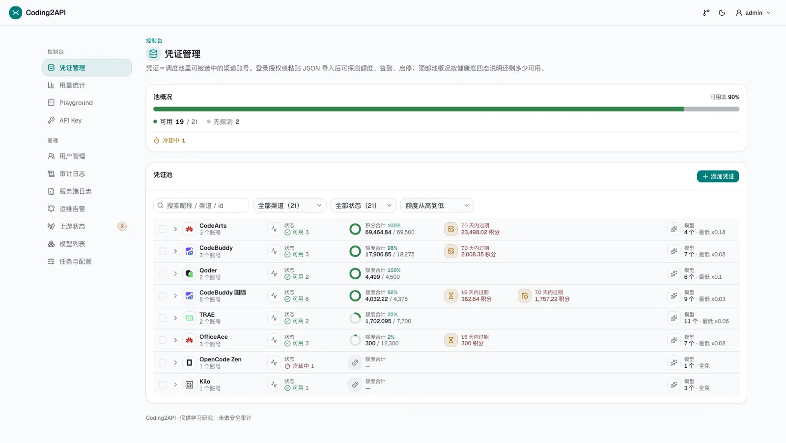
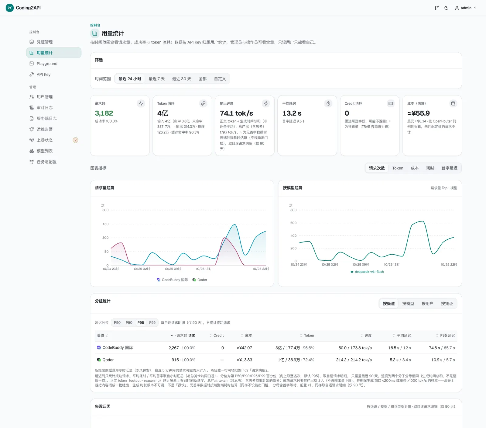
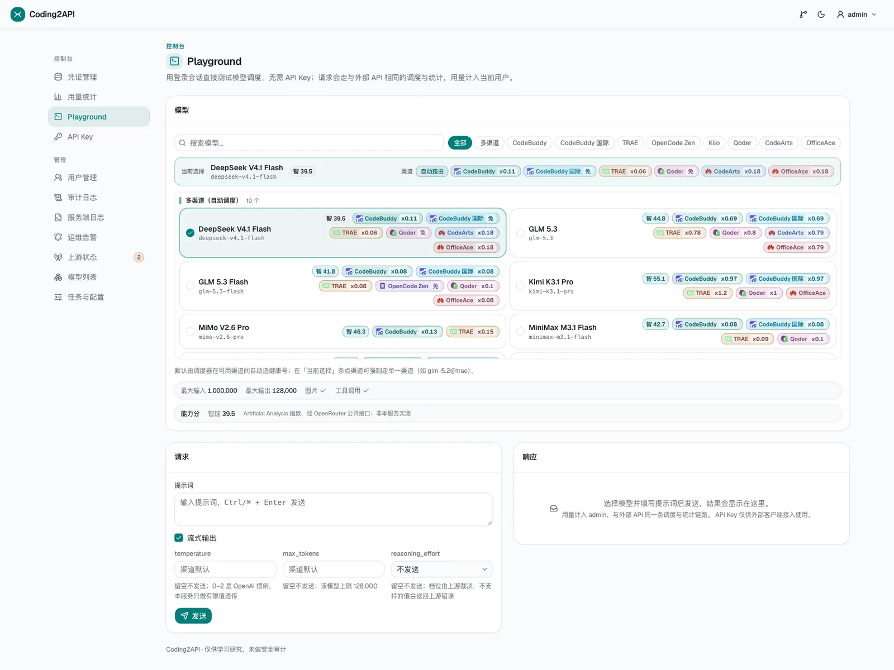
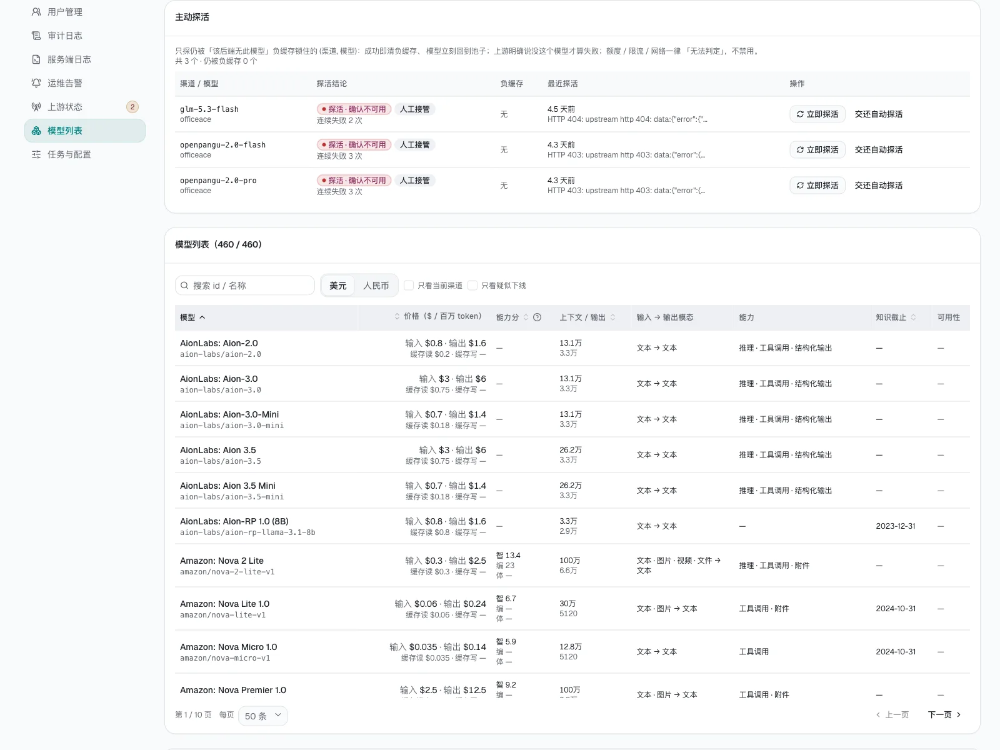
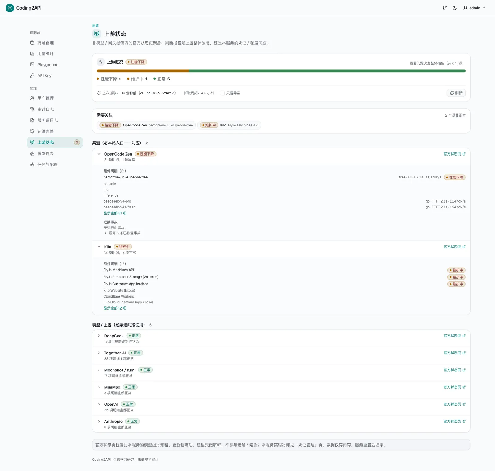
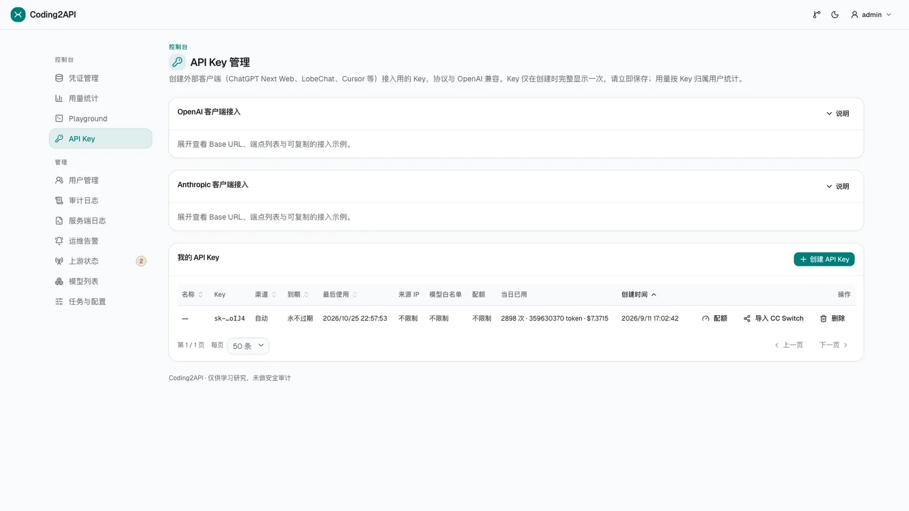
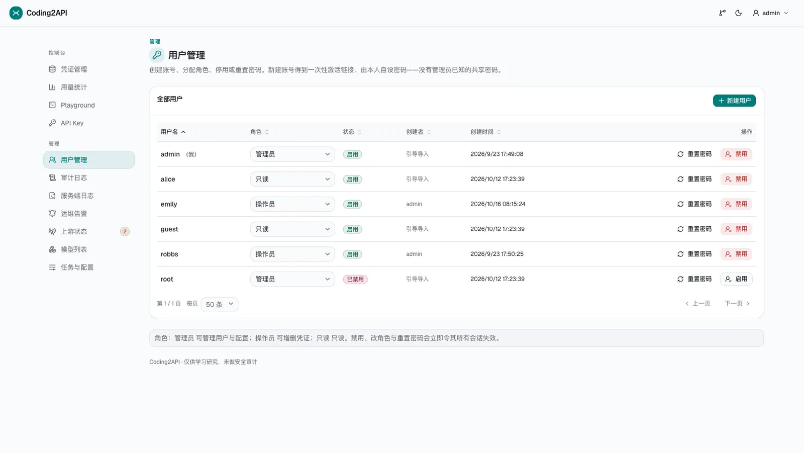
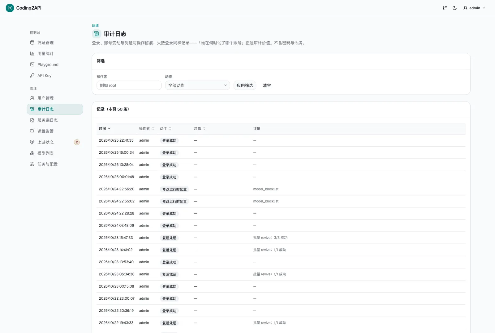

# Coding2API

[](https://github.com/RobbsLuo/Coding2API/actions/workflows/ci.yml)
[](https://github.com/RobbsLuo/Coding2API/releases)
[](LICENSE)
[](https://github.com/RobbsLuo/Coding2API/pkgs/container/coding2api)

Ten upstream channels — **CodeBuddy** (China + international, two separate channels), **TRAE SOLO**, **OpenCode Zen**, **Kilo**, **Qoder**, **CodeArts**, **OfficeAce**, **Raccoon**, **Lingxi** — plus an optional **generic OpenAI-compatible upstream**, exposed as an OpenAI-compatible API: shared credential pool, unified model names and scheduling, per-user usage accounting.

> [!WARNING]
> Reverse-engineered endpoints, for study and research only, no security audit. Public deployment needs a reverse proxy + auth + IP allowlist.

## Features

- **Multi-protocol outbound**: `/v1/chat/completions` (stream / non-stream), `/v1/responses` (Codex CLI), `/v1/messages` (Claude Code), `/v1beta/models/{m}:generateContent` (Gemini SDK), `/v1/models`, `/v1/user/balance`, built-in retrieval `/v1/tools/search` + `/v1/fetch`.
- **Unified scheduling**: flat names pick a credential by health, `model@channel` forces one. Order: free channels → fewest in-flight → expiring quota → health + tiered cooldown → higher balance. Credential **weight** (`-1000..1000`) only reorders within the same health tier; catalog `x0` entries are calibrated by real charges from the last 24h. Model-level rate limits avoid only that model; multi-turn conversations stick to one credential until an error.
- **Expiring quota first**: the primary window (default 36h) burns quota about to expire, ties broken by the 7-day window; units are credits throughout.
- **Model list loaded from credentials**: only channels with a usable credential appear → no ghost models. The catalog is snapshotted to disk and ready on restart.
- **Shared credential pool**: admin-maintained, shared by all users, encrypted with `APP_SECRET`; device-code / OAuth login, multi-account switching, quota probing, check-in, token pre-refresh.
- **Three roles**: `admin` / `operator` / `viewer` (SQLite); one-time activation links, forced password change on first login, role change / disable revokes sessions immediately; logins and writes are audited.
- **Growth center** (CodeBuddy only): claim gifts, dispatch Buddy, claim task rewards, make up missed logins, exchange streaks, open blind boxes. `GROWTH_IRREVERSIBLE_ACTIONS=false` disables irreversible actions; enterprise accounts are skipped.
- **Privacy-preserving stats**: no conversations stored; 90 days of detail, permanent hourly rollups; views by user / channel / model / credential; cost estimated from OpenRouter list prices; live detail via SSE.
- **Monthly billing** (`operator` and up): per-month, per-user / per-key requests, tokens and cost; CSV / JSONL export with an audit entry.
- **Tool-call robustness**: missing `id` backfilled by index and remembered; leaked DeepSeek DSML is read back into structured calls; malformed non-stream `arguments` fail closed (400, no credential cooldown).
- **Failure routing**: `11134` provider overload is queued (no penalty); request-level errors do not carry conversation stickiness across credentials; exhausted pool returns 503 with `Retry-After` and a **pool breakdown** (`total=25 cooling=20 disabled=3 …`).
- **Hardening & ops**: login rate limiting, CSRF, body size limits, host allowlist; egress IP stickiness (`CREDENTIAL_PROXY_POOL`); optional outbound redaction (`PRIVACY_RULES`, outbound copy only); upstream status aggregation (explains, never schedules); sidebar badges; Prometheus `/metrics`.
- **Narrow screens**: tables become cards below 768px, same DOM.

Protocol layer (private envelopes, signing, gate spoofing) lives in [`TECHNICAL.md`](TECHNICAL.md).

## Screenshots

Admin console (captured locally, accounts / IPs redacted):

| Credentials: pool overview grouped by channel | Usage: requests / tokens / cost |
|---|---|
|  |  |
| **Playground: model × channel and multiplier** | **Model list: OpenRouter list prices and capability scores** |
|  |  |
| **Upstream status: upstream fault vs. our problem** | **API keys: client setup and quotas** |
|  |  |
| **Users: three roles, one-time activation** | **Audit log: every login attempt** |
|  |  |

Tasks & settings (85 hot-reloadable items, DB overrides beat `.env`), server logs and alerts: `assets/screenshots/{settings,logs,alerts}.webp`.

## Quick start

Requires **Linux or macOS** (Windows: WSL2 / Docker, see "Deployment notes"), Python 3.12+, [uv](https://docs.astral.sh/uv/), Node.js 24+, pnpm 10+ (frontend build only).

```bash
uv sync
uv run python scripts/create_user.py admin --role admin   # first admin
cd web && pnpm install && pnpm build && cd ..
APP_SECRET="pick-your-own-random-string" uv run python -m src.main
```

Open <http://127.0.0.1:8000> and sign in; add people from the *Users* page.

> Use `python -m src.main`, not `uvicorn src.main:build_app`: the former reads `HOST`/`PORT` from `.env` and holds the single-instance lock (`data/.instance.lock`). Only one process per `DATA_DIR`; a second one prints "another instance is using data (PID xxx)" and exits.

`scripts/create_user.py` writes SQLite directly (`--db` or `DATA_DIR`, default `data/coding2api.sqlite3`); legacy `secrets/users.txt` is imported once at startup without overwriting existing users.

Docker:

```bash
cat > .env <<'EOF'
APP_SECRET=pick-your-own-random-string
PUBLIC_BASE_URL=http://127.0.0.1:8000
EOF
docker compose up -d --build
docker compose exec coding2api python scripts/create_user.py admin --role admin
```

Pull the image: `docker compose pull` (or `docker pull ghcr.io/robbsluo/coding2api:v0.14.2`). Pushing a `v*` tag to main runs `.github/workflows/publish.yml` → publishes `<tag>` + `:latest`. For https on a VPS with a public IP see "[Public deployment](#public-deployment-docker--caddy-automatic-https)".

## Users and roles

Accounts live in the SQLite `users` table; the *Users* page (admin only) manages them.

| Role | Can do |
|---|---|
| `admin` | Users, tasks & settings, credential read/write, all stats, audit log, server logs, upstream status, model list |
| `operator` | Credential read/write (import / delete / enable / check-in / growth / switch account), all stats, upstream status, model list |
| `viewer` | Read-only: dashboard, credential list, stats, Playground |

Monthly billing has the same `operator` gate (pool-level data; `viewer` only sees their own usage).

- **Adding users**: username + role → one-time activation link (24h, shown once); the user opens `/activate` and sets a password. No initial password; resets work the same way.
- **Role change / disable**: revokes all session cookies for that account immediately. Disable is the reversible default "delete" (usage stays attributed); hard delete is CLI-only.
- **Self-service password change**: user menu → *Change password*.
- **Anti-lockout**: you cannot disable or demote the last active admin, nor demote or disable yourself.

CLI fallback (no web / all admins lost):

```bash
python3 scripts/create_user.py alice --role admin   # prompts for password
python3 scripts/create_user.py --list
python3 scripts/create_user.py alice --delete --force   # hard delete, irreversible
echo "$PASSWORD" | python3 scripts/create_user.py alice --role admin --password-stdin
```

`ADMIN_USERNAMES` and `secrets/users.txt` only apply during bootstrap (while no active admin exists); after that roles come from the DB only.

## Audit and server logs

- **Audit** (`/audit`, admin only): logins (success and failure) plus write operations, filterable by actor / action and paginated. Each entry: time / actor / action / object / note / source IP. **No plaintext passwords or tokens** (activation tokens are stored as SHA-256). Retained 90 days.
- **Server logs** (`/logs`, admin only): live in-process log stream. `GET /api/logs` returns the last N lines, `GET /api/logs/stream` is SSE (replay then live); level filter, keyword filter, follow, pause, clear. **No write endpoint**.
  - **Redaction is mandatory**: every line passes an allowlist before leaving the process; lines matching `token` / `secret` / `authorization` / `cookie` / `password` / `api_key`, `sk-…` patterns or `Bearer <value>` are dropped entirely.
  - In-memory buffer `LOG_BUFFER_LINES` (default 500, hot-reloadable, `0` disables the page); **persistence** `LOG_PERSIST_LINES` (default 2000, hot-reloadable) writes a second copy into the SQLite `log_events` ring table, so logs survive restarts and support `?request_id=`, `?since=<epoch>`, `?level=ERROR`. Trimmed by line count, not time. Write failures warn once and never propagate.
  - Lines are capped at 4000 chars and carry `seq` / time / level / logger / `request_id`. Click the trailing `#8hexchars` to filter by that request id (every retry / cooldown / fallback of one request shares it); you can also paste the `X-Request-ID` response header into the keyword box. Max 4 subscribers, excess gets 429.

## Usage

1. Add credentials on *Credentials*:
   - **CodeBuddy** (incl. international): device-code login, or paste `{"token":"..."}`.
   - **TRAE**: paste credential JSON (`accessToken`/`uid`/`refreshToken`) or the callback link (`apiHost` must be an official host).
   - **Qoder / CodeArts**: device code / OAuth2 authorization-code login (for CodeArts, paste the unreachable local callback link back into the page).
   - **OfficeAce**: click *Sign in to OfficeAce*, Huawei Cloud authorization (callback handled in the cloud).
   - **Raccoon / Lingxi**: no login button; paste a web session credential (`{"access_token":"<xhx_token>"}` for Raccoon, a full cookie or bare `wps_sid` for Lingxi).
   - **Generic paste**: the *JSON import* box accepts a full cookie header or DevTools → Network → right-click request → **Copy as cURL (bash)** (works with HttpOnly cookies). Distinctive markers (`wps_sid` / `xhx_token` / TRAE fields / AK·SK) auto-detect the channel, and the choice is remembered.
   - **OpenCode Zen / Kilo**: nothing to add; a virtual credential appears at startup (restore from the same panel if deleted).
2. Create an `sk-...` key on *API keys* (plaintext shown once).
3. Call it:

```bash
curl http://127.0.0.1:8000/v1/chat/completions \
  -H "Authorization: Bearer sk-your-key" \
  -H "Content-Type: application/json" \
  -d '{"model":"glm-5.2","messages":[{"role":"user","content":"hello"}]}'
```

`model@channel` forces an upstream (`glm-5.2@trae`, `mimo-v2.5-free@zen`); omit it to auto-select. Any OpenAI-compatible client works (Base URL `http://127.0.0.1:8000/v1`). *Playground* uses your login session, no API key needed.

### Three model-name fields

1. **Raw id**: the key the channel actually sends, never rewritten (Qoder `kmodel_latest` = TRAE `kimi-k3-1`; Kilo may carry `kilo-auto/free`).
2. **Normalized key**: free-tier markers (`-free` / `free` path segment) and namespace prefixes (incl. Raccoon's `sn-`) stripped, then slugified. The list merges models by it.
3. **Display name**: human-readable (`LongCat 2.5 Preview`); used when upstream provides one, otherwise derived from the raw id with official brand casing.

`GET /v1/models` returns normalized keys as `id`; forwarding maps back to the raw id, visible as `by_provider.{channel}.raw_id`. **All three forms are requestable**; duplicates within one channel fall back to the raw id. Entries may carry `cost {input, output, cache_read}` (USD per million tokens) and `reasoning_efforts`.

- **Custom aliases** (`MODEL_ALIASES`, hot-reloadable): `alias=model@channel;alias2=model`, `@channel` optional. One shared table for listing and routing; entries carry `custom_alias: true`; collisions / missing targets / channels that don't hold the model are skipped with an ERROR. No alias chains.
- **Single-model lookup** (`GET /v1/models/{id}`): accepts all three forms plus aliases, case-insensitive. Missing or not in the key allowlist → 404 (`model_not_found`) without leaking the pool. Both models routes accept `x-api-key` and `Authorization: Bearer`.
- **`n` must be 1**, otherwise 400.

### Streaming details

- **Usage tail frame**: after the finish chunk and before `data: [DONE]`, one `choices: []` frame carries usage; omitted if upstream reported none, unreported fields are `null`.
- **Reasoning tokens**: the client must send `reasoning_effort`; CodeBuddy defaults to `medium` (otherwise thinking lands in the body), explicit values pass through.
- **Deferred headers**: the stream does not send 200 immediately but waits for the first upstream frame (5s grace, `api/streaming.STREAM_START_GRACE_SECONDS`). A **request-level error** first frame (11128 content guard, 11115 context overflow, 11135 bad image, 11129 tool schema, 4001 model not on that upstream) returns a real **400 JSON** (`invalid_request`); no frame within the grace window → 200 as before (the pending read is not cancelled); errors after the first frame keep `200 + error frame`.
- **Stream timeouts (off by default)**: `STREAM_FIRST_EVENT_TIMEOUT_SECONDS` (before any frame, retry another credential, recorded as `upstream_first_event_timeout`, heartbeats do not reset the timer) and `STREAM_IDLE_TIMEOUT_SECONDS` (after frames, disconnect without switching). Off by default on purpose: slow-context first tokens measured at 40–71s; enable per deployment (60 / 300 recommended).

### Playground

- Optional `temperature` / `max_tokens` / `reasoning_effort`; **empty means the key is not sent**. Bounds match the backend (`temperature` ≤ 1000, `max_tokens` ≤ 4,000,000).
- **Image input**: paste or pick files (≤4MB each, up to 4). With attachments `messages[0].content` becomes an OpenAI multimodal block array; without them it stays a plain string (byte-identical request). Unsupported models are rejected upstream (CodeArts maps to `model_capability`, no penalty).

## Channels

> CodeBuddy (incl. international) / TRAE / Qoder / CodeArts / OfficeAce / Raccoon / Lingxi need credentials; **Zen and Kilo are credential-free free tiers** — a single virtual row in the pool (scheduling / cooldown / stats as usual), quota column "free tier (no quota API)", health always "no probe". Deleting the row resurrects it on restart; to disable permanently use *Pause*.

### OpenCode Zen (`zen`)

[opencode.ai/zen](https://opencode.ai) free models, no login. The upstream list mixes paid models without a free marker → narrow with the `-free` suffix → probe each → **drop only confirmed-unavailable** ones (paid 401 / retired 400 / region 403); `429` / 5xx / timeouts are **kept** (liveness cached 30 minutes; free models priced **x0**).

**Free-tier gate**: upstream expects an official-client shape (UA, session headers, `stream:true`, gate tools present) → satisfied automatically; stub tools are injected and real calls filtered out. The gate is a moving target, so everything is configurable (restart to apply): `ZEN_USER_AGENT`, `ZEN_API_ROOT`, `ZEN_MODELS_ROOT`, `ZEN_GATE_TOOLS`, `ZEN_CLIENT_PROFILE` (`legacy` default / `v2`). `v2` mirrors the official 2.x header set (four session copies, `x-opencode-client/project`, `b3`/`traceparent`) and injects an `<env>` block; when 2.x splits endpoints set `ZEN_API_ROOT=/inference/openai/v1` + `ZEN_MODELS_ROOT=/inference/v1`. Paid models forced with `model@zen` still report unavailable.

### Kilo (`kilo`)

[Kilo](https://kilo.ai) (`api.kilo.ai/api/gateway`) free models, no login. Standard OpenAI protocol; every `/models` entry carries `isFree` → filtered directly, **no probing** (saves quota). Gateway limit is roughly 200 requests/hour/IP; upstream 429 and 502/503/504 are model-level → only that model cools down.

### Qoder (`qoder`)

[Qoder](https://qoder.com), real account required: *Sign in to Qoder* uses device-code authorization. Upstream speaks a private COSY protocol → this service signs and unwraps it; outbound is still standard OpenAI.

- **Quota & check-in**: `/api/v2/quota/usage`; check-in is campaign-based via `/sash/api/v1/me/campaigns` (accumulating credits), legacy `daily-check-in` only as fallback. **Campaigns refresh daily at 10:00 (UTC+8)**, claimed credits valid 30 days. The international site has no check-in endpoint (404).
- **Per-package expiry (web cookie)**: `/api/v2/quota/usage` only gives two bucket totals (its top-level `expiresAt` is the period-reset sentinel `9999-12-31`). The account page's `GET {website}/api/v2/me/usages/big_model_credits` exposes per-package `expires_at` but only accepts a web session (device tokens get 401). Paste it via *More → Web cookie* and probing switches to the web API: packages expand individually and expiry feeds "expiring first" ordering. The cookie is encrypted, never echoed, excluded from exports; on 401 it silently falls back to the summary view.
- **Endpoints**: China by default (`openapi.qoder.com.cn` + `gateway.qoder.com.cn`); for international set `QODER_API_ENDPOINT=https://openapi.qoder.sh` and extend the allowlist.
- **Error semantics**: node faults wrapped as 400 (`[FAIL]node:…`) cool only that model; `body:"null"` keep-alive frames are skipped; "queued" arrives as 403 with the marker hidden in a serialized string → wait the named seconds and reopen on the same credential; "daily billing count exhausted" (403 `code 110`) is a quota error cooling until 04:00 next day, not a hard disable.

### CodeArts (`codearts`)

[Huawei Cloud CodeArts](https://codearts.huaweicloud.com), real account required: *Sign in to CodeArts* → the browser lands on an unreachable local address → paste the **whole link** back to exchange for STS credentials (AK/SK + security_token + refresh_token + DPoP key), encrypted at rest.

- **Rigid refresh**: refresh_token is bound to `client_id=codearts-agent` and the DPoP key, single-use; the new refresh_token must be written back. The pre-refresh task does this (DPoP ES256/P-256), window capped at 45 minutes. Invalid credentials → "re-login required" and retries stop.
- **Check-in**: `GET /v1/ops/delivery?channel=IDE` → `POST /v1/ops/claim` → `POST /v1/ops/confirm`. The campaign is chosen by `type=USER_LOGIN` (falling back to `extra.triggerEvent` = `user.login`), and **`campaignId` comes from the current response** (upstream moved it from id 1 to 34 and the amount from 1000 to 100 in 2026-11; hardcoding gives "check-in succeeded, credits unchanged"). Missing `campaignId` fails the round and retries. `CLAIMED` means claimed-but-unconfirmed → run both steps; **claim success + confirm failure counts as failure**. Failures back off exponentially (10m → 20m → 40m → capped at 1h).
- **Re-login merges**: the same `uid` updates the existing row in place and clears the hard disable; upstream-named cooldowns (rate limit / balance / entitlement / risk) are preserved. `paused` / `pinned` / tags / stats attribution unchanged; different accounts still add rows.
- **Quota = credit balance**: `GET {snap}/snap-manager/v1/statistics/plugin` (the `snap-manager` prefix is required, header `Agent-Type: PromptCenter`), no conversion.
- **Per-item expiry (web cookie)**: portal `GET /portal/promptcenter/v1/ops/credit/overview` plus `.../campaign/{id}?pageNum=&pageSize=` expose per-grant `expireAt`; the portal only accepts a console session cookie (and needs `X-Requested-With: XMLHttpRequest`). On failure it silently falls back to the 7-day window. `expiredAmount` / `status` lag, so death is judged solely by `expireAt <= now`; expired items are hidden.
- **Signing / cumulative SSE / throttling**: `SDK-HMAC-SHA256` (AK/SK + `X-Security-Token`); streamed `text` is cumulative (replacement semantics) → converted to deltas. Upstream hard limit is 3 concurrent per account → `CODEARTS_MAX_CONCURRENCY` + `CODEARTS_REQUEST_WINDOW_SECONDS`.

### OfficeAce (`officeace`)

[Huawei Cloud OfficeAce](https://www.huaweicloud.com/product/agentarts.html), real account required: *Sign in to OfficeAce* completes Huawei Cloud authorization (callback handled in the cloud); the backend polls `/v1/claw/auth/code` every 2.5s for the code.

- **Prerequisite**: the account must first sign in to the OfficeAce client and redeem an invite code, otherwise login "succeeds" but yields no model key → an explicit "account has not activated OfficeAce" error.
- **Two credential sets**: `Basic model_app_key:model_app_secret` (never expires, chat forwarding) and temporary AK/SK + `security_token` + `project_id` (~2 hours, quota queries / check-in). Mixing them yields `APIG.0303 app not found`. Temporary credentials are renewed by pre-refresh; `refresh_token` rotates once and is bound to `client_id=pdp5_for_agentarts` + the DPoP key (not interchangeable with CodeArts).
- **Re-login merges**: same `account_id` updates in place, clears "re-login required", preserves cooldowns, adds no duplicate.
- **Three protocol quirks**: rate limits arrive as fake 200 (`data:{"error":…}`, `81111/81114` cool only that credential × model); `81004` / `81009` are judged by business code before HTTP status → model-level negative cache (cleared on success); `max_tokens` is the total budget for reasoning + body (`≥16` adds 1024 then clamps to the model ceiling, `<16` passes through, absent stays absent).
- **Credits are the ledger**: unit `officeace_points`, each reward expires independently → "per-item expiry".
- **Check-in**: `POST /v1/subscription/bonus/claim` (a write; body must be `{}` with a JSON `Content-Type`; upstream is idempotent per day). Gains are computed from the remaining-balance delta and booked until the next Beijing midnight.
- **No active probing / no credit estimation**: probing burns real credits and the `cost_coefficient × tokens_per_point` relation is undocumented; model-level rejections are handled by real traffic through the `BLOCKED` negative cache.
- **Signing and endpoints**: control plane `/v1/claw/*` uses `SDK-HMAC-SHA256`; the model gateway only accepts `V11-HMAC-SHA256` (wrong one → `APIG.0624` or 401). The allowlist only needs the control-plane host (each model gateway is issued per account and stored with the credential).
- **One account, one user** (per the official plan policy); switch accounts via *Switch account* next to sign-in (`force_login=true`).

### Raccoon (`raccoon`)

[SenseTime Raccoon](https://xiaohuanxiong.com), real account required. **No login button**: the credential is a web session JWT — DevTools → Application → Cookies → copy `xhx_token`, paste `{"access_token":"<value>"}` (bare JWT, full cookie header, or Copy as cURL also work). Expires in ~30 days; **just import the fresh one again**: the same `uid` (JWT `sub`) updates in place and clears the hard disable, with no duplicate row (duplicates are treated as two accounts running concurrently, doubling stats and bypassing the per-account throttle).

- **Protocol**: standard OpenAI-compatible (`/api/web/llm/v2/chat/completions`), no signing, no device fingerprint; `tool_calls`, `role=tool` round-trip and `include_usage` all verified (411K input tokens in 14.2s).
- **Unknown models silently fall back to the default model** (measured) → two guards: validate against the catalog before sending, then compare the `model` echoed in the first frame and fail on mismatch.
- **Quota = credits**: 1 credit per request (independent of tokens), 300 credits granted daily at 00:00 (valid 7 days). `billing_effective_multiplier` is used as the multiplier, **0 = free** (e.g. `sn-sensenova-6-8-flash`), preferred by the scheduler.
- **Quota detail**: upstream splits credits into four pools (daily / reward / monthly / top-up) and expands plan detail per grant (`type=income` `daily_grant` / `reward_grant`). Upstream provides no per-grant remainder → daily credits are allocated "earliest expiry first" (inferred); reward credits are measured to be consumed only after daily quota runs out, so they are listed at face value. Falls back to the four pools when the ledger is unavailable. The expiry ladder shares this source and feeds "expiring first" ordering.
- **Daily check-in**: there is no claim endpoint — the 300 credits are granted as a `daily_grant` on the **first web login of the day** (the earlier belief "granted at 00:00, login only extends" was disproved by a real-account retest on 2026-11-18). So "check-in" = visit the page → touch the balance → verify the ledger, **trusting the ledger and not HTTP 200**; **no `daily_grant` today means failure**; between 00:00 and 01:30 retries are pushed to 01:30 to wait for billing sync. The ledger is filtered by `type=income` (`type=all` lets spending entries push the grant out of the window).
- **Session needs re-login**: `GET /api/web/auth/v1/user_info` reports it via `trusted_device` (`trusted=false` / `device_bind_state=suspicious` / `needs_relogin=true` / `reason=device_session_mismatch`). Once there, the device heartbeat always returns `400 200811 device_bind_required`, no `daily_grant` arrives that day, and **there is no self-healing path** (`devices_current_bind` also 400s; `refresh` returns the same token). Check-in and activity reporting read this signal and report "sign in on the web and re-import the credential" instead of a bare failure. **Re-login grants that day's credits immediately.**
- **On-demand login (optional, off by default)**: fill phone and password under *More → Account password* (or include `phone`/`password` / `phone_number` in the import JSON), then enable `RACCOON_AUTO_LOGIN`: when check-in finds today's grant missing it calls `POST /api/web/auth/v1/login_with_password` for a fresh session and re-checks. Measured details: `phone`/`password` use **AES-CFB (key `senseraccoon2023`, 16-byte random IV prefix, Base64)**, password ≥8 chars, and **no captcha is required**. Limits: at most once per credential per day; an explicit rejection (`200004 phone_or_password_verify_error`) marks "re-login required" and stops; `password_status=unset` accounts cannot log in this way. Endpoint `PUT /api/credentials/{id}/login-secret` (both empty = clear); the password is encrypted, **never echoed**, and excluded from exports. After login it binds the new session via `devices_current_bind` (unbound sessions stay `trusted=false` and heartbeat 400s); binding failure is not a login failure. `derive_device_id` is capped at 64 chars (upstream returns `500 value too long for character varying(64)`).
- **Activity reporting**: `POST /api/web/auth/v1/devices_current_heartbeat` with the `x-client-*` header family returns 200 and is idempotent. Off by default, sharing `ACTIVITY_REPORT_ENABLED` / `ACTIVITY_REPORT_HOUR` with CodeBuddy.
- **Concurrency limit ~5** (the 6th returns `429 user_model_rate_limited`) → `RACCOON_MAX_CONCURRENCY` defaults to 2 with its own throttle. That 429 is really an account × model rate window (median recovery 25min); cooldowns start at 60s, double along the chain, capped at 30min.

### Lingxi (`lingxi`)

[WPS Lingxi](https://lingxi.wps.cn), real WPS account required. **No login button**: the credential is the WPS cookie `wps_sid` (`lingxi.kdocs.cn` also works) — after signing in, copy the whole cookie header or the bare sid into the *Sign-in channel* page. Upstream has **no refresh endpoint**; the real signal is a 401, so re-paste when it expires.

- **One login per browser profile**: signing into another WPS account in the same profile makes the previous `wps_sid` 401 immediately (measured). Use separate profiles / incognito windows; old credentials are confirmed 401 on the next probe and marked "re-login required".
- **Three requests per conversation**: create cowork session → claim credits run → `agent-runtime/chat/completions` (private SSE). Billing is **per run** → session + run are cached per "account × model" for 1 hour (no sliding renewal) with single-flight; `SQLNoRows` / "session not found" discards the cache and rebuilds once.
- **Private SSE and usage semantics**: content is in `choices[].text` (not `delta.content`) and **no `[DONE]` is sent** (terminated by `finish_reason`); `usage.total_tokens` is the current context size → compute `prompt+completion` locally; `cached_tokens` / `reasoning_tokens` are flat fields with the opposite direction from OpenAI.
- **Tool schemas must be flattened first**: `anyOf` / `oneOf` / `$ref` / array-typed `type` make upstream answer "AI service error"; `max_tokens` must go into `base_llm_arguments`, and `reasoning_effort` must appear both top-level and in `llm_arguments`.
- **Quota = credits**: `total_balance` maps directly to balance, bonus batches' `bonus_credits[].expire_time` feed the expiry ladder (15-day window); the ledger records credits; `multiplier` is used as-is.
- **Check-in**: task center `daily_check_in`, `status=claimed` means done today. Upstream fakes 200 on repeat claims (balance unchanged) → rewards are computed from the **before/after balance delta**, and a zero delta reads the task status; never trust HTTP 200.
- **Error classification**: 401 → credential invalid; 402 / quota wording → exhausted; 403 → transient; 404 → bad request; 429 → that model; `AuditFailed` → switching credentials is useless; expired run → rebuild once.
- **ToS grey area**: reuses the desktop/web session and impersonates the desktop client (`X-Client-Type: lingxi_claw` + fixed `x-kso-app-name/app-version/device-id`), see `provider/tos.py`.

### Generic upstream (`generic`, optional)

Connects to a **standard OpenAI-compatible endpoint** (Command Code, Kimi Code, MiniMax, Zhipu free tier, self-hosted vLLM / LiteLLM, …): no reverse engineering, no private protocol; you supply the endpoint, and the credential is a real API key you own.

```bash
# .env
GENERIC_API_ENDPOINT=https://api.example.com/v1
GENERIC_MODELS=gpt-6.2,kimi-k3.1-pro     # optional: static list when upstream has no /models
GENERIC_CHAT_MIN_INTERVAL=0               # optional: lower RPM
```

- **Empty = disabled**: without `GENERIC_API_ENDPOINT` the channel does not exist in that deployment (absent from `/v1/models`, credentials page and ToS notices).
- **Credentials**: `{"api_key": "sk-…"}` (bare key / `token` / `accessToken` also accepted), encrypted, multiple keys rotate.
- **Endpoint validation**: with `GENERIC_ALLOWED_ENDPOINTS` set only listed hosts pass; empty allows any `http(s)` (pointing at internal services is the point) but still rejects non-HTTP schemes like `file://`.
- **Error mapping is the opposite of Zen / Kilo**: those have no credentials, so 401 just means "this model needs a paid key" → skip the channel; here **401/403 = dead key → hard disable**; 402 → out of balance, 429 → rate limited, 5xx → other.
- **Capabilities**: chat and model listing. No check-in / growth / activity / refresh / quota queries; the corresponding tasks are skipped.
- **Limit**: one per deployment (fixed channel id `generic`); run multiple deployments for multiple providers.

### CodeBuddy international (`codebuddy_intl`)

[www.codebuddy.ai](https://www.codebuddy.ai), same protocol as the China site but a separate account system → separate channel. Login is the same (device code). Not merged because `CODEBUDDY_API_ENDPOINT` is a single process-wide value: switching would send existing China credentials to the international site. **The allowlists deliberately exclude each other** (pointing at the China host fails at startup). Capability differences: chat, model list, quota probing, refresh and activity reporting are enabled; **check-in and growth center are not**. Model list is probed per plan (`11158` / `11102` dropped, `429` / 5xx / timeouts kept, cached per account for 6 hours). Models shared by both sites appear once in `/v1/models` attached to both channels; genuinely distinct ones (`-x` / `-sg`) get their own entry.

### Per-channel outbound proxy (optional)

```
PROVIDER_PROXIES="codebuddy=http://127.0.0.1:7890;qoder=socks5://127.0.0.1:1080"
```

Format `channel=proxyURL;channel2=proxyURL2`, schemes `http/https/socks5/socks5h`, empty = direct. Applies to all egress of that channel (chat, quota, model fetch, background tasks, OAuth). **Startup-time setting**; unknown channel / bad scheme / missing `=` fails startup. `HTTP_PROXY` and friends are ignored (`trust_env=False`). Inside a container `127.0.0.1` is the container itself — for a host proxy use `host.docker.internal` (compose already declares `extra_hosts`); only the format is validated, not reachability.

## Outbound protocols

### Responses API (Codex CLI)

`POST /v1/responses` implements a Responses subset sharing selection / cooldown / rotation / stats / stickiness with chat:

```bash
export CODING2API_KEY=sk-your-key
codex -c "model_providers.coding2api={ name='coding2api', base_url='http://127.0.0.1:8000/v1', wire_api='responses', env_key='CODING2API_KEY' }" \
      -c model_provider=coding2api -c model='glm-5.2' 'your task'
```

Supports text, streamed body, reasoning summaries, function tools, and `finish_reason=length` → `response.incomplete`; `text.format` → chat `response_format`; parts `input_text` / `text` / `output_text` → text, `input_image` → `image_url`. **Unsupported**: `store=true` / `previous_response_id` / `input_file` → 400; `include=["reasoning.encrypted_content"]` is accepted and ignored. Tools: `function` passes through; `namespace` expands only the default `functions` group (others are dropped — clients look tools up by `(namespace, name)`, so flattened names would look nonexistent); hosted tools like `web_search` / `tool_search` / `custom` (freeform `apply_patch`) are **skipped without error**.

### chat inbound validation

- **`response_format`**: only `{"type":"text"}`, `{"type":"json_object"}`, `{"type":"json_schema","json_schema":{name, schema, description?, strict?}}` pass; malformed / unknown → 400. Responses `text.format` shares this code.
- **`messages[].role` allowlist**: only `system` / `user` / `assistant` / `tool` / `developer`; anything else is a local 400 (`messages[i].role must be one of ...`) with no upstream call, no cooldown, no failure record. `developer` passes and is normalized to `system` on egress (`provider.base.normalize_developer_role`). Non-string roles keep `role must be a string`.

### Anthropic Messages API (Claude Code)

```bash
export ANTHROPIC_BASE_URL=http://127.0.0.1:8000
export ANTHROPIC_AUTH_TOKEN=sk-your-key     # or ANTHROPIC_API_KEY (x-api-key header)
claude
```

- **Auth**: both `x-api-key` and `Authorization: Bearer` are accepted (`/v1/models` too).
- **Streaming**: `message_start` → `content_block_*` → `message_delta` → `message_stop`, no `[DONE]`; thinking blocks get a `signature_delta` before `content_block_stop`.
- **Cache hits**: usage splits into `input_tokens` (misses only) and `cache_read_input_tokens`.
- **`count_tokens`**: estimated locally, not forwarded. **Images**: `image` blocks map to chat `image_url`.
- **Unsupported → 400**: `document` blocks, `source.type=file`, Anthropic server-side tools.
- **`cache_control` passthrough** (on by default): same placements as Anthropic (`system`, content blocks, `tool_result` / `tool_calls` top level, `tools` top level), structure validated only. Verified against codebuddy / codebuddy_intl / trae / qoder / codearts / kilo; zen, Raccoon and Lingxi unverified. Script: `scripts/probe_cache_control.py`.

### Gemini (google-genai / REST)

```bash
export GEMINI_API_KEY=sk-your-key
export GOOGLE_GENAI_BASE_URL=http://127.0.0.1:8000   # the SDK appends /v1beta
```

- **Endpoints**: `POST /v1beta/models/{model}:generateContent`, `:streamGenerateContent` (`?alt=sse`), `:countTokens`; `GET /v1beta/models`. Auth via `x-goog-api-key` → `?key=` → `Authorization: Bearer`.
- **Inbound mapping**: `contents[].parts` (`text` / `inlineData` / `functionCall` / `functionResponse`), `systemInstruction`, `generationConfig`, `tools[].functionDeclarations`, `toolConfig.functionCallingConfig`.
- **Outbound**: `candidates[].content.parts` (text / thought / functionCall) + `finishReason` + `usageMetadata`; each stream frame is a complete response, the final frame carries `finishReason` (no `[DONE]`).
- **Unsupported → 400**: server-side tools (`googleSearch` / `codeExecution` / `retrieval`), `candidateCount != 1`, `responseMimeType` other than `text/plain` / `application/json`. `thinkingConfig` / `topK` are dropped.

### Built-in retrieval (`/v1/tools/search`, `/v1/fetch`)

The official CodeBuddy CLI ships web search and page fetching; this service exposes them as standalone endpoints — **no third-party search API**, zero external dependencies.

```bash
curl -X POST http://127.0.0.1:8000/v1/tools/search \
  -H "Authorization: Bearer sk-your-key" -H 'Content-Type: application/json' \
  -d '{"query":"opencode zen free models","max_results":5}'

curl -X POST http://127.0.0.1:8000/v1/fetch \
  -H "Authorization: Bearer sk-your-key" -H 'Content-Type: application/json' \
  -d '{"url":"https://example.com/post","prompt":"summarize"}'
```

- **Search input**: `query` (required, ≤1000 chars), `max_results` (default 5, clamped 1–20), `allowed_domains`, `blocked_domains` (combined into `-site:`), `freshness`; output `{provider, results:[{title,url,snippet,site?,favicon?}], total_results, response_time_ms}`.
- **Fetch input**: `url` (http/https only), `prompt`, `max_length` (default 200k chars); output `{url, content, content_type}`; **text pages only**.
- **Scheduling and failures**: same credential pool, 403 rotates; business-code rejection → 400 / 429 / 403, no usable credential → 503 + `Retry-After`, upstream 5xx → 502.
- **No usage detail rows** (they consume no tokens and would pollute stats); implemented for CodeBuddy (China / international) only.

### CC Switch one-click import

The *API keys* page generates `ccswitch://` deep links (one each for Claude Code / Codex CLI / OpenCode), available in the post-creation dialog and per row. The link contains the key in plaintext → generated only on demand. Requires CC Switch v4.0.10+; the endpoint follows `apiFormat` (Anthropic at root, OpenAI at `/v1`); no Gemini target.

### Balance query

`GET /v1/user/balance` is DeepSeek-shaped so Cherry Studio / cc-switch can show a balance; data comes from the quota-probe cache:

```json
{
  "is_available": true,
  "balance_infos": [{"currency": "credits", "total_balance": "60.00",
                     "granted_balance": "0.00", "topped_up_balance": "0.00"}],
  "balance_known": true,
  "providers": [{"provider": "codebuddy", "remaining": 50.0, "total": 150.0, "credentials": 2}]
}
```

Never probed successfully → `balance_known` = `false` (unknown, not zero).

### Pool health and metrics

- `GET /health`: returns `{"status":"ok"}` — **use this for liveness**.
- `GET /healthz`: adds pool counts, `ready == 0` → 503 (readiness / alerting).
- Neither requires auth; both accept `HEAD`. The four counts are mutually exclusive (`ready` / `cooling` / `paused` / `disabled`) and sum to `total`. **Upgrade note**: `/healthz` changed from always-200 to 503 when `ready == 0`.
- `GET /metrics` (Prometheus): on by default and **unauthenticated**; `METRICS_ENABLED=false` (hot-reloadable) → 404; with `METRICS_TOKEN` set, requests need `Authorization: Bearer <token>`.
- **OTLP export (optional)**: with `OTLP_ENDPOINT` set, every `OTLP_EXPORT_SECONDS` seconds the service `POST`s `{endpoint}/v1/metrics` (OTLP/HTTP JSON, **no SDK**). Only `gen_ai.*` metrics (provider / model / tokens / latency / TTFT / error type); it **never** exports `gen_ai.input.messages` / `output.messages` / `system_instructions` or any content. Non-loopback endpoints must be https; failures log once and never take the service down.

| Metric | Type | Labels | Source |
|---|---|---|---|
| `coding2api_requests_total` | counter | `provider` / `model` / `status` | `usage_hourly` |
| `coding2api_tokens_total` | counter | `provider` / `type` | `usage_hourly` |
| `coding2api_credentials` | gauge | `state` | credential pool |
| `coding2api_upstream_errors_total` | counter | `provider` / `kind` | in-process (reset on restart) |
| `coding2api_task_failures_total` | counter | `task` | in-process task state (reset on restart) |

No `credential_id` / `api_key_id` / `username` (high cardinality). `requests_total` / `tokens_total` read permanent hourly rollups and stay monotonic across restarts.

## Policies and guards

### API keys

- **Channel binding**: the key only picks credentials from that channel; a model owned by another channel → 400 naming the owner. Empty = automatic across channels.
- **Source IP allowlist**: comma-separated IP / CIDR, normalized on write (`10.0.0.1` → `10.0.0.1/32`), outside → 403. `X-Forwarded-For` is ignored unless `TRUST_PROXY=true`, which takes the last entry.
- **Model allowlist**: comma-separated names or fnmatch globs (`glm-*,kimi-k3`), case-insensitive, `model@channel` suffix ignored; outside → 400 and `/v1/models` only lists allowed models.
- **Expiry**: epoch seconds, empty = never; after expiry → 401 (same message as "unknown key").
- **Quotas**: six independent limits, `0` / empty = unlimited — `daily_requests` / `daily_tokens` / `daily_cost_usd` / `rpm` / `tpm` (estimated) / `max_concurrency`. Daily ones use Beijing calendar days; rate and concurrency are in-process sliding windows. Exceeding → 429 + `quota_exceeded` with `Retry-After`; errors fail open with a warning.
- **Self-service**: `GET /v1/usage?days=1|7|30` returns your own usage, remaining quota and current rate usage.

### Credential pause and batch operations

- **Pause** = remove from chat plus skip check-in / pre-refresh; other background tasks (quota probe, growth, activity) continue. Intended for "no chat, keep earning credits". Different from **disabled** (system disable after the channel rejects the session; requires re-login then *Revive*). Same toggle: `POST /api/credentials/{id}/toggle`. Zen / Kilo are virtual rows, so **pause is the only way to disable them permanently**; pausing also removes the channel from the model list.
- **Batch**: `POST /api/credentials/batch` with `{action: "probe"|"toggle"|"checkin"|"revive", ids: [...], enabled?, force?}`, ≤200 ids, duplicates removed.
- **Batch import**: `POST /api/credentials/batch-import` with `{items: [{provider, credential, nickname?, tags?}]}`, ≤100 items; bad items go to `failed` (with `index` and reason), identical decrypted content in the same channel goes to `skipped`. Accepts JSON arrays / JSONL or a file.
- **Single export**: `GET /api/credentials/{id}/export` returns the same shape as import (plaintext credential, admin / operator only, audited as `credential.export`).
- **Revive ≠ unpause**: `revive` clears a system hard disable (re-login first); `toggle enabled=true` unpauses.
- **`revive` keeps upstream-named cooldowns by default** (rate limit / balance / entitlement / risk): clearing them just hits the same limit again. Use `force=true` (UI: *Force revive*). Failed check-ins return `ok=false` with a readable message, not 500. Audit records one summary row; audit write failures only warn.

### Credential limits and in-flight cap

- **Limit guards** (*Set limits* in the row menu; four independent, all empty = unlimited, evaluated before selection): reserve credits (remaining ≤ value → disable the whole credential, unknown balance is never guessed), daily token cap, daily credit cap, per-model token cap (`{model: limit}`, disables that model only). "Today" = Beijing calendar day. Written via `PUT /api/credentials/{id}/limits` (full replace, immediate, audited as `credential.limits`).
- **Credential-level model allowlist** (same dialog): `allowed_models` = comma-separated fnmatch globs, `''` = unrestricted, same syntax as API Key allowlists. It only narrows **chat / inference** candidate selection: a credential is skipped for models outside its list, but it is **not** disabled and no cooldown is written, so switching models works immediately. Background paths (check-in / refresh / probes / quota / model lists) ignore it. Undeterminable model names (empty / `auto`) are allowed, so the pool is never emptied.
- **Concurrent edit conflicts**: the edit endpoint takes `expected_updated_at` (already returned on every list row); a mismatch returns `409 credential_conflict` with the current row snapshot, and the console tells the user to refresh. The version only advances on **manual edits** — background polling and cooldown writes never bump it, so an open editor never becomes stale by itself.
- **In-flight cap** `MAX_INFLIGHT_PER_CREDENTIAL` (default 0 = unlimited, hot-reloadable): a credential stops being selected once it reaches that concurrency. Counted in-process, leases released at request end with a 600s TTL fallback. **Also acts as the load key**: placed after "free first" and before "expiring quota", so concurrency spreads to idle credentials.
- **Exhaustion semantics**: all candidates skipped by limits / in-flight → `no_healthy_credential` 503; model-level cooldown → `model_unavailable`; upstream rate-limit / quota cooldowns are recorded as `rate_limit` in stats (external code stays `no_healthy_credential`).

### Credential pool UI

- **Filters**: search (nickname / channel / id) × channel × state × tag, all AND, client-side; tags are not matched by the search term.
- **Tags**: comma-separated, ≤16 tags, ≤24 chars each; filtering and display only, never affect selection.
- **Group ordering**: reorders channel groups only (default quota descending, can switch back to fixed channel order); free tiers without a quota API sink to the bottom.
- **Grouped by channel**: each header is a compact dashboard (icon, channel, account count, models and lowest multiplier, state distribution, total quota, expiring credits, today's check-in). All collapsed by default, expanded while filtering. Column headers render inside each expanded group and stick; tables cap at 70vh. The growth-center column appears for CodeBuddy only.

## Model list

`GET /v1/models` and the Playground dropdown merge only **channels with a usable credential** (cooling ones still count). Order: CodeBuddy (China → international), TRAE, Qoder, CodeArts, OfficeAce, Raccoon, Lingxi, with Zen / Kilo last; alphabetical within a group; a model on multiple channels belongs to the highest-priority one (`_PROVIDER_RANK` in `src/api/model_merge.py`).

- **Routing only trusts this cache**: if the catalog proves ownership, only those channels are candidates, and none usable → 503; a model absent from the catalog routes across all candidates; explicit `@channel` and key channel binding are unaffected.
- **Snapshot and startup**: besides the single service-layer in-process TTL cache (TTL = `MODEL_LIST_TTL_SECONDS`), every successful fetch writes `DATA_DIR/model_catalog.json`, read synchronously at startup; a corrupt snapshot or one older than 7 days just drops the cache. The `MODEL_CATALOG_MINUTES` task keeps it fresh.
- **Stale-while-revalidate**: cached lists return immediately, refresh happens in the background at TTL; failures back off as 2^(n-1)×TTL (capped at 2 hours) with WARNING only on the first failure.
- **Admin *Model list* page** (`GET /api/model-catalog`): read-only view of the public OpenRouter catalog (list prices, context / output limits, modalities, capabilities, knowledge cutoff, three AA indices — not measured here), with `available` and an off-by-default "current channels only" toggle. Floating aliases take the score of the newest snapshot in the same family (by `canonical_slug` date).
- **Suspected-retirement view** (`GET /api/models/availability`, operator): aggregates `upstream_blocked` / `model_not_found` / `invalid_request` over the last N days (default 7) by `(channel, model)`; *Add to blocklist* appends to `model_blocklist` with an audit entry.
- **Active probing** (`GET /api/models/probes`, operator): probes entries still locked by a `blocked` negative cache and entries already judged dead (`state='failed'`). **Success** → clear the negative cache and relist (the only recovery path); **`failed`** → keep the cache and increment; **`inconclusive`** (quota, rate limit, network, timeout, empty stream) → never disable, reset the counter. Probes call `provider.stream_chat` directly without writing `usage_events` or touching cooldowns. A dead model is hidden for that (channel, model) only, and **the hiding never expires** — recovery requires a successful re-probe (`MODEL_PROBE_MINUTES` defaults to 0 = off). **Manual takeover** (`POST /api/models/probes/manual`) makes automatic probing skip the row without changing the negative cache.
- **Token expiry display**: the *token remaining* column turns red below `TOKEN_EXPIRY_WARNING_SECONDS` (default 1 hour). Prefers `expires_at`, falls back to the JWT `exp`, otherwise `—`.

### Upstream status page

`GET /api/upstream-status` (admin / operator) aggregates official status pages to answer "is this an upstream outage or our credential / quota problem": OpenCode Zen, Kilo, Moonshot / Kimi, MiniMax, OpenAI, Anthropic, Together AI, DeepSeek. Six normalized states (`operational` / `degraded` / `partial` / `major` / `maintenance` / `unknown`), overall takes the worst source. **Explains only, never decides**; in-memory only; fetched every `UPSTREAM_STATUS_MINUTES` (default 5), a failing source only marks its own row. HTML-only sources are not covered (Groq, Tencent Cloud, Alibaba Cloud, Huawei Cloud, SiliconFlow, Qoder, Zhipu, TRAE).

### Sidebar badges

One aggregate endpoint `GET /api/nav-badges`, polled every 60s:

| Nav item | Gate | Badge |
|---|---|---|
| Credentials | operator+ | credentials `disabled` or with `health < 0` |
| Alerts | admin | alerts still open |
| Tasks & settings | admin | tasks whose last run failed |
| Upstream status | operator+ | abnormal sources (incl. maintenance) |
| Users | admin | accounts with an activation token |
| API keys | everyone (own only) | expired keys or keys expiring within 7 days |
| Model list | operator+ | stale snapshot (boolean text) |

- **Trimmed by role**: the backend only sends keys you may see; absent = not permitted (not zero); the credential badge is not sent to viewers.
- **Only to-dos**: the alerts page `total` includes recovered history, the badge counts only open ones; tasks use "last run failed".
- **Credential badge ≠ `/healthz` ready count** (the latter ignores health, so quota-exhausted credentials still count as `ready`). Alert badges rebuild from unresolved DB rows at startup.
- **Stale catalog**: never fetched does not count; more than 2× `OPENROUTER_CATALOG_MINUTES` without a refresh does.

## Stats

### Scope

Default is the **last 24 hours** (also 7 / 30 days, all time, custom). Custom uses two `datetime-local` inputs, either may be empty; start not earlier than end invalidates the window. Every endpoint accepts `until` (epoch seconds, half-open `[since, until)`).

- **Failure types** (`CONTROLLED_ERROR_TYPES`): the closing row carries the **real attribution of the last error** — `model_unavailable` / `rate_limit` / `upstream_timeout` / `network_error` (local DNS / connect failure, no cooldown) / `context_overflow` (11115) / `model_capability` (CodeArts 001001020) / `model_not_found` (retired model, distinct from "bad request"). Only when **no credential was ever selected** does it fall back to `no_healthy_credential`. External codes are identical; only stats semantics differ.
- **Request ID**: responses carry `X-Request-ID`; a valid inbound value is reused, otherwise generated (`[A-Za-z0-9._:-]`, 1–128 chars); stored in `usage_events.request_id` and **never forwarded upstream**.
- **Attempt-chain headers** (only with `EXPOSE_UPSTREAM_HEADERS=true`, off by default): `X-Upstream-Attempts` = credentials actually tried, `X-Upstream-Degraded` = whether `MODEL_FALLBACK_GROUPS` fallback was used. When off, the middleware strips same-named headers (including forged values from upstreams or middleboxes). Off by default because these headers hand out pool size, cost and routing fingerprints. For streams they only reflect attempts **before** the response head is sent; later rotations cannot rewrite an already-sent head.
- **Content-refusal freeze**: upstream content-safety refusals (currently only CodeBuddy `11128`) do not rotate or cool a credential; a hit is attributed to the requester (username first, API Key id otherwise). Once `ACCESS_FREEZE_THRESHOLD=N` (default `0` = record only) is reached, requests from that requester × provider get `403 provider_access_frozen` before reaching upstream; `GET /api/access-freezes` shows hits/frozen state and `POST /api/access-freezes/unfreeze` clears it (operator+, audited).
- **Credit**: CodeBuddy uses upstream truth; TRAE is derived from official unit prices and marked `≈` (`src/provider/trae/pricing.py`, unlisted models are not derived). Backfill with `scripts/backfill_trae_credit.py`.
- **Cost (estimated ≈)**: tokens × public list price, not the actual upstream charge. `(input−cached)×input + cached×cache + output×output` in USD → converted to CNY at write time using `USD_CNY_RATE`; history is not recomputed. Unmatched models are not priced (cost is a lower bound); channel-specific ids map to base models only via explicit equivalence rules.
- **Cache hit rate**: cached tokens ÷ input tokens (one decimal); unreported or zero input → `—`.
- **Output speed** = total tokens ÷ total generation time (not an average of per-request ratios). Two views: **body speed** `output_tokens - reasoning_tokens` and **total throughput** including reasoning. Only successful requests routed through this service with ≥1 output token; generation time = `latency_ms - ttfb_ms`; samples under 200ms or above 1000 tok/s are dropped. No samples → estimated mode (prefixed `≈`); neither → `—`.
- **Charts**: requests / tokens / cost / cost per request / latency / TTFB / success rate / cache hit rate. Derived metrics are `sum ÷ sum`, no samples render as `—` (gap) not 0; latency and TTFB also get a percentile chart (P50 + P95 from details, 90 days only). The time axis is filled hourly. Out-of-domain `metric` is an explicit 400; an invalid custom range pauses fetching.
- **Compression gains panel**: trigger counts (tool output / context trimming), characters and tokens saved (lower-bound estimate), the concurrent prefix-cache hit rate, and both compression switches, on one screen. Savings must be read next to the cache cost, otherwise "keep it on or turn it off" is unanswerable; `GET /api/stats/compression` (operator+, O(1) counter read).

### Credits and check-in records

- **Change ledger** (arrow after the quota figure) = **net change between two quota probes**, not per-action attribution (check-in, growth and chat all move the balance and upstream logs nothing → the UI says "net change"). The first probe only establishes a baseline; unchanged balances are not recorded; a change to "unknown" is recorded without a delta; retained 90 days.
- **Split by ledger**: entries carry `ledger` (`pool` / `credits`); CodeArts and Raccoon use `credits` (both are credit-based), everything else `pool`. `GET /api/credentials/{id}/credit-events?ledger=`.
- **Check-in records** (*More → Check-in records*) = the check-in audit log, one row per round (time / result / credits claimed / upstream business code / message / trigger), retained 90 days; `GET /api/credentials/{id}/checkin-events?limit=`. This is the **per-action result**, independent of balance diffs, so "shows success but no credits" can be checked directly against the upstream reply.
- **Availability timeline** (*credential detail → View timeline*) = history of state transitions (cooldown start / cooldown end / hard failure / revived / enabled / disabled), each row carrying the model (for model-level cooldowns), a redacted reason, a readable detail and the triggering request ID; `GET /api/credentials/{id}/timeline?since=&until=&limit=` (operator+), retained 30 days. Complements the **current state** in `credential_model_cooldowns`: answering "why was this credential unavailable at 14:00 yesterday" no longer requires digging through server logs.
- **Today's check-in summary**: `GET /api/credentials` attaches `checkin_today` (the latest entry for today from the local audit log, `null` if none). `null` means "no conclusion yet" (task not due / paused / channel has no check-in), not failure.

### Grouping

Four tabs (channel / model / user / credential) sharing one table (channel / requests / credit / cost / tokens / speed / average latency / P95 latency), endpoints `GET /api/stats/by-provider|by-model|by-user|by-credential`. **Latency percentiles P50 / P90 / P95 / P99** (default P95, nearest-rank). User / credential dimensions are admin / operator only.

- **Scope differences**: channel / model / user read hourly rollups (permanent, last 5 minutes not yet included); credentials read the detail table (90 days only).
- **Latency**: successful requests only. Average = `latency_sum ÷ successes`; percentiles come from details (90 days). Rows with `ttfb_ms = NULL` are ranked independently.
- **Failure attribution** (`GET /api/stats/errors`, operator+): aggregates `ok=0` by `(channel, model, error type)`, returning failures / **unrecovered** / latest failure (desc, `limit` ≤5000). **Row policy**: hard failures (`credential_unavailable` / `account_restricted` / `invalid_request` / `model_capability`) write one row per attempt; other categories write one closing row per request. A successful row for the same user and `request_id` counts as recovered. Special cases: a 401 becomes `credential_unavailable`, **but when quota exhaustion is proven** (officeace `401 APIG.1009`) it is reclassified as `CREDIT` (cooldown to 04:00 next day, no hard disable); `11140` → `account_restricted` (2h account cooldown; a second credential on the same channel also hit escalates to a 24h channel backoff); `11102` / `11158` → `model_not_found` (negative cache, no account cooldown); `11115` → `context_overflow` and `001001020` → `model_capability` (no credential penalty); `001001044` → `invalid_request`. When no credential was selected the row names the **candidate channel**. Full taxonomy and cooldown durations: TECHNICAL.md §3.2.
- **Drill-down**: clicking a group row filters details by it, conditions stack; `GET /api/stats/events` accepts `provider` / `model` / `credential_id` (AND) plus `ok=0`.
- **Merged columns**: tokens, latency, speed, channel / credential are each one column, expandable on hover; the merged header offers a sub-column sort (`sort=cache_rate` / `tps_visible` / `tps` / `provider` / `credential`).
- **CSV export**: `GET /api/stats/events?format=csv`, UTF-8 BOM, `\r\n`, ISO 8601 UTC; cells starting with `= + - @` get a leading quote to prevent formula injection. Up to 10000 rows, truncation sets `X-Export-Truncated: 1`.
- **Live stream**: `GET /api/stats/events/stream` (SSE) pushes newly persisted requests, the UI keeps the last 50. Payloads omit credential nicknames (the server adds them for admin / operator); each subscriber has a 200-event buffer, concurrency capped at 8 (429 beyond), 15s comment keep-alive.
- **Recompute history**: `python3 scripts/rollup_hourly.py --apply` (preview by default, backs up before writing, idempotent).

### Sorting and pagination

- **Sorting**: clickable headers, natural first direction (numeric desc, text asc), click again to flip; the backend accepts `sort` (allowlisted) and `order`, invalid values fall back silently. Applies to `/api/credentials`, `/api/users`, `/api/api-keys`, `/api/audit`, `/api/alerts`, `/api/model-catalog`, `/api/credentials/{id}/credit-events`, `/api/credentials/{id}/accounts`, `/api/stats/by-*`, `/api/stats/events`.
- **Pagination**: `page N / M`, 10 / 20 / 50 / 100 per page (default 50); the backend takes `limit` + `offset` and returns the filtered `total`. Grouped tables (credentials page, stats group table) are not paginated.

## Background tasks and alerts

Twelve tasks run through `TaskRunner`, failures isolated: quota probe, token pre-refresh, check-in, growth center, activity reporting, detail cleanup, DB backup, channel model refresh, catalog refresh, ops alerts, upstream status, active model probing. The *Tasks & settings* page shows last run / result / error (30s refresh; runtime state is per-process); each card has *Run now* (admin + CSRF) which bypasses the time window but not the switch, and reports `busy=true` instead of queueing.

- **Activity reporting** (off by default): `ACTIVITY_REPORT_ENABLED=true` sends one `chat_request_send` per account daily at `ACTIVITY_REPORT_HOUR` (default 10) to keep streaks alive; unrelated to credits or scheduling; applies to CodeBuddy and the international site. **Risk**: upstream terms forbid scripting activity data (penalty: disqualification + clawback); off by default.
- **Growth center** is CodeBuddy-only, period `GROWTH_INTERVAL_MINUTES` (default 60).

### Operations alerts

Nine rules feed `alert_events` (`/alerts`, admin only):

| Rule | Condition |
|---|---|
| `pool_empty` | ready count below `ALERT_POOL_READY_MIN` |
| `task_failed` | a task failed `ALERT_TASK_FAILURES` times in a row |
| `token_expiring` | token lifetime within `ALERT_TOKEN_EXPIRY_HOURS` |
| `error_rate` | failure ratio in the window reaches the threshold with enough samples |
| `key_burst` | one key's token usage in the window reaches the threshold (abuse / leak signal) |
| `off_hours` | requests outside working hours reach the threshold |
| `budget` | monthly cost reaches a level of `ALERT_BUDGET_CNY`; only the highest level is reported, 100% is critical |
| `channel_dead` | a channel's requests in the window reach the threshold with **zero successes** (catches a whole channel dying, which fallback would dilute) |
| `checkin_failing` | the last N check-in rounds for one credential all failed (covers "task succeeded, upstream said no") |

- **Silence window**: one DB row / push per `(rule, object)` per window.
- **Hysteresis**: alert after N consecutive hits, resolve after M consecutive misses; resolving stamps `resolved_at` on all open rows for that `(rule, object)` and emits a `status="resolved"` webhook.
- **Multiple sinks**: generic webhook (full JSON + signature), Feishu bot and Slack incoming webhook may be configured together; one failing does not block the others but marks delivery as failed overall.
- **Self-healing**: hysteresis counters live in-process, "which alerts are open" is rebuilt from the DB. Manual *Mark resolved* needs admin + CSRF + audit. Retention matches details (90 days).

### Backup and restore

**Automatic backup** (`BACKUP_INTERVAL_MINUTES`, default daily) writes a consistent snapshot into `DATA_DIR/backups/`, keeping the last `BACKUP_KEEP` copies (default 7). It uses `VACUUM INTO` (plain `cp` under WAL loses uncheckpointed transactions), runs `PRAGMA integrity_check` immediately and deletes the artifact on failure; files are `0600`, the directory `0700`; failures only log.

```bash
python3 scripts/backup_db.py                 # back up, keep 7
python3 scripts/backup_db.py --keep 14       # keep 14 (0 = never prune)
python3 scripts/backup_db.py --out /path/dir
```

Restore (**stop the service first**):

```bash
python3 scripts/restore_db.py data/backups/coding2api-20261014-030000.sqlite3            # preview: validate only
python3 scripts/restore_db.py data/backups/coding2api-20261014-030000.sqlite3 --apply    # validate → safety copy → atomic swap
```

Flow: integrity check → `.pre-restore-<timestamp>` copy of the live DB → atomic swap → remove `-wal` / `-shm`. **Restart afterwards.** The admin *Backup & restore* page offers the same: `GET /api/backups`, `POST /api/backups`, `GET|DELETE /api/backups/{name}`, `POST /api/backups/restore?filename=…` (upload → validate → stage at `DATA_DIR/restore/pending.sqlite3`; **the live DB is not swapped while running** — it is swapped at the next startup before connections open; a failing pending file is kept as `.rejected-*` and the current DB is used).

## Configuration

The authoritative list is `src/config.py`; every item is passed through `docker-compose.yml`. Inside a container use `HOST` / `PORT` to change the listen address.

| Variable | Default | Notes |
|---|---|---|
| `APP_SECRET` | **required** | Credential encryption key, ≥16 chars; losing it loses all credentials. Low-entropy and known placeholder values are rejected. **Changing it makes stored credentials undecryptable**: re-encrypt first with `scripts/rotate_app_secret.py` (downtime + backup) |
| `ADMIN_USERNAMES` | empty | Bootstrap only (while no active admin exists): promoted to `admin` on first start |
| `USERS_FILE` | `secrets/users.txt` | Bootstrap only: legacy user file, imported once |
| `PUBLIC_BASE_URL` | `http://127.0.0.1:8000` | Browser-reachable base; TRAE login callback; HSTS over https. Does not control session cookie `Secure`. Loopback / `0.0.0.0` → callback base falls back to the request origin |
| `DATA_DIR` | `./data` | SQLite and runtime data directory |
| `DEFAULT_MODEL` | `deepseek-v4.1-flash` | Used when the model is empty / `auto` |
| `QUOTA_PROBE_MINUTES` | `60` | Quota probe period (min 1) |
| `REFRESH_INTERVAL_MINUTES` | `30` | Token pre-refresh period (min 5) |
| `MODEL_CATALOG_MINUTES` | `30` | Channel model list refresh period (min 5) |
| `OPENROUTER_CATALOG_MINUTES` | `1440` | Catalog refresh period (min 60) |
| `OPENROUTER_MODELS_URL` | `https://openrouter.ai/api/v1/models` | Catalog source (public); restart to change |
| `TOOL_OUTPUT_COMPRESS_ENABLED` | `false` | Compress long plain `role=tool` text (strip ANSI + fold repeats); hot-reloadable |
| `TOOL_OUTPUT_COMPRESS_MAX_CHARS` | `8000` | Compression threshold, `≤0` disables; hot-reloadable |
| `USD_CNY_RATE` | `6.70` | Cost estimate FX rate; hot-reloadable, affects future writes only |
| `GROWTH_INTERVAL_MINUTES` | `60` | Growth center period (min 5) |
| `GROWTH_IRREVERSIBLE_ACTIONS` | `true` | Allow lottery / streak exchange / blind boxes / makeup cards |
| `ACTIVITY_REPORT_ENABLED` | `false` | Activity reporting, off by default |
| `ACTIVITY_REPORT_HOUR` | `10` | Local hour window for activity reporting |
| `CHECKIN_TIMES` | `""` | Check-in times `HH:MM` comma-separated; empty = every 10 minutes all day. Hot-reloadable |
| `CHECKIN_JITTER_MINUTES` | `0` | Random early jitter in minutes; hot-reloadable |
| `CHECKIN_SKIP_PROVIDERS` | `""` | Channels to skip for check-in (e.g. `raccoon`); chat unaffected. Hot-reloadable |
| `LOG_BUFFER_LINES` | `500` | Server log page buffer; `0` disables the page. Hot-reloadable |
| `LOG_PERSIST_LINES` | `2000` | Log persistence rows (`log_events` ring); `0` disables. Hot-reloadable |
| `ALERT_ENABLED` | `true` | Ops alerts switch |
| `ALERT_WEBHOOK_URL` | empty | Generic webhook, comma-separated (≤16, http(s) only, private / loopback rejected against SSRF), signed with `X-Coding2API-Signature` |
| `ALERT_FEISHU_WEBHOOK_URL` | empty | Feishu bot (`msg_type=text`), same URL validation |
| `ALERT_SLACK_WEBHOOK_URL` | empty | Slack incoming webhook (`{text}`), same URL validation |
| `ALERT_INTERVAL_MINUTES` | `5` | Alert evaluation period |
| `ALERT_SILENCE_MINUTES` | `30` | Silence window per `(rule, object)`; `0` disables |
| `ALERT_FOR_TICKS` | `1` | Hits before alerting |
| `ALERT_CLEAR_TICKS` | `2` | Misses before resolving |
| `ALERT_POOL_READY_MIN` | `1` | Pool-empty threshold; `0` disables |
| `ALERT_TASK_FAILURES` | `3` | Consecutive task failure threshold; `0` disables |
| `ALERT_TOKEN_EXPIRY_HOURS` | `24` | Token remaining-hours threshold; `0` disables |
| `ALERT_ERROR_RATE_THRESHOLD` | `0.5` | Error-rate threshold; `0` disables |
| `ALERT_ERROR_RATE_MIN_REQUESTS` | `20` | Minimum samples |
| `ALERT_ERROR_RATE_WINDOW_MINUTES` | `15` | Error-rate window |
| `ALERT_KEY_BURST_TOKENS` | `0` | Per-key burst threshold (tokens); `0` disables |
| `ALERT_KEY_BURST_WINDOW_MINUTES` | `15` | Per-key window; `0` disables |
| `ALERT_CHANNEL_DEAD_MIN_REQUESTS` | `20` | Minimum requests for the zero-success rule; `0` disables |
| `ALERT_CHANNEL_DEAD_WINDOW_MINUTES` | `60` | Zero-success window |
| `ALERT_CHECKIN_FAIL_MIN_STREAK` | `3` | Consecutive failed check-in rounds; `0` disables |
| `ALERT_CHECKIN_FAIL_WINDOW_HOURS` | `24` | Check-in failure lookback |
| `ALERT_OFF_HOURS_START` / `_END` | `0` / `0` | Working hours `[start, end)` local time, may wrap midnight; equal = disabled |
| `ALERT_OFF_HOURS_MIN_REQUESTS` | `0` | Off-hours request threshold; `0` disables |
| `ALERT_BUDGET_CNY` | `0` | Monthly cost budget in CNY; `0` disables. Priced details only |
| `ALERT_BUDGET_LEVELS` | `50,80,95,100` | Budget levels; only the highest is reported, 100% is critical |
| `BACKUP_INTERVAL_MINUTES` | `1440` | Backup period (min 60) |
| `BACKUP_KEEP` | `7` | Backups retained; `0` = never prune |
| `UPSTREAM_STATUS_ENABLED` | `true` | Upstream status page switch |
| `UPSTREAM_STATUS_MINUTES` | `5` | Status fetch period (min 1) |
| `UPSTREAM_STATUS_TIMEOUT_SECONDS` | `10.0` | Per-source HTTP timeout |
| `MODEL_PROBE_MINUTES` | `0` | Active probe period (`0` = off). Success restores the model and clears the negative cache; nothing else ever disables. Hot-reloadable |
| `QUOTA_EXPIRY_WINDOW_SECONDS` | `129600` | Primary expiry window for ordering; `≤0` disables |
| `QUOTA_EXPIRY_SECONDARY_WINDOW_SECONDS` | `604800` | Secondary expiry window; `≤0` disables |
| `CONVERSATION_STICKY_SECONDS` | `3600` | Conversation stickiness TTL. Priority: body session id > request header > message-prefix fingerprint; pins win. `≤0` disables |
| `MODEL_BLOCKLIST` | see `src/config.py` | Listing blocklist (fnmatch, display only), matched against normalized names |
| `MODEL_FALLBACK_GROUPS` | `""` | Cross-channel fallback groups: `name=member1,member2;…`. Empty = disabled |
| `ALLOWED_HOSTS` | empty | Host allowlist (DNS rebinding defense) |
| `ALLOW_TEST_HOST` | `false` | Allow `testserver`, tests only |
| `TRUST_PROXY` | `false` | Trust `X-Forwarded-For`; only behind exactly one trusted proxy |
| `TRUSTED_PROXIES` | empty | With `TRUST_PROXY=true`, only parse XFF from peers in this list (IP/CIDR, comma-separated); empty = any peer |
| `REQUIRE_TRUSTED_PROXIES` | `false` | When `true`, `TRUST_PROXY=true` with an empty/unparsable list makes startup fail. Default `false` keeps existing "empty list" deployments working; doctor still reports a WARN |
| `ENABLE_DOCS` | `false` | Expose `/docs` and `/openapi.json` |
| `DUMP_REQUEST_BODIES` | `false` | Dump raw `/v1` request bodies (contains conversations, debugging only). Hot-reloadable, dir 0700 / files 0600 / ≤200 files and ≤24h; changes audited |
| `GATEWAY_PAUSED` | `false` | Global kill switch: every key-authenticated `/v1` endpoint returns 503 (`code=service_paused`), admin console unaffected. Hot-reloadable, audited and logged as WARNING |
| `GATEWAY_PAUSE_REASON` | empty | Pause reason, logs and audit only (never echoed to callers) |
| `LOG_LEVEL` | `INFO` | Log level; audit logs are INFO, so WARNING also silences them |
| `HOST` / `PORT` | `127.0.0.1` / `8000` | Listen address and port (compose defaults to `0.0.0.0`); `PORT` also drives the host mapping |
| `CODEBUDDY_API_ENDPOINT` | `https://copilot.tencent.com` | Upstream address; keep the allowlist in sync |
| `CODEBUDDY_ALLOWED_ENDPOINTS` | official hosts (see compose) | Endpoint allowlist; real tokens only go to listed hosts |
| `CODEBUDDY_INTL_API_ENDPOINT` | `https://www.codebuddy.ai` | International site |
| `CODEBUDDY_INTL_ALLOWED_ENDPOINTS` | `https://www.codebuddy.ai` | International allowlist, deliberately excludes the China site |
| `ZEN_API_ENDPOINT` | `https://opencode.ai` | Zen upstream |
| `ZEN_ALLOWED_ENDPOINTS` | `https://opencode.ai` | Zen allowlist |
| `ZEN_OPENCODE_VERSION` | `1.18.0` | Gate-spoofing UA version (below the threshold → 426) |
| `ZEN_API_ROOT` | `/zen/v1` | Upstream API root; `/inference/v1` also works |
| `ZEN_MODELS_ROOT` | empty | Model list root; empty = follow `ZEN_API_ROOT`. Set `/inference/v1` when 2.x splits endpoints |
| `ZEN_CLIENT_PROFILE` | `legacy` | Client fingerprint profile: `legacy` (1.x) / `v2` (2.x) |
| `ZEN_GATE_TOOLS` | `bash,read` | Gate tools; may switch to `bash,glob,grep,read` (v2 needs only `read`) |
| `ZEN_USER_AGENT` | empty | UA template (`{version}` substituted); empty = legacy `opencode/<version>`, v2 `opencode/latest/<version>/cli` |
| `KILO_API_ENDPOINT` | `https://api.kilo.ai/api/gateway` | Kilo upstream |
| `KILO_ALLOWED_ENDPOINTS` | `https://api.kilo.ai/api/gateway` | Kilo allowlist |
| `QODER_API_ENDPOINT` | `https://openapi.qoder.com.cn` | Qoder openapi (quota / login); international `https://openapi.qoder.sh` |
| `QODER_GATEWAY_ENDPOINT` | `https://gateway.qoder.com.cn` | Qoder inference gateway; international `https://api1.qoder.sh` |
| `QODER_ALLOWED_ENDPOINTS` | China + international (see compose) | Qoder allowlist |
| `CODEARTS_API_ENDPOINT` | `https://snap-access.cn-north-4.myhuaweicloud.com` | CodeArts snap engine |
| `CODEARTS_ALLOWED_ENDPOINTS` | snap engine + STS + portal (see compose) | CodeArts allowlist |
| `OFFICEACE_API_ENDPOINT` | `https://agentarts.cn-southwest-2.myhuaweicloud.com` | OfficeAce control plane |
| `OFFICEACE_ALLOWED_ENDPOINTS` | `https://agentarts.cn-southwest-2.myhuaweicloud.com` | Control plane only (model gateway is issued upstream) |
| `OFFICEACE_CHAT_MIN_INTERVAL` | `0` | OfficeAce chat min interval; hot-reloadable |
| `GENERIC_API_ENDPOINT` | `""` | Generic OpenAI-compatible upstream; empty = channel disabled |
| `GENERIC_ALLOWED_ENDPOINTS` | `""` | Generic allowlist; empty = any http(s) |
| `GENERIC_MODELS` | `""` | Static model list when upstream has no `/models` (comma-separated) |
| `GENERIC_USER_AGENT` | `""` | Override outbound UA; empty = no custom UA |
| `GENERIC_CHAT_MIN_INTERVAL` | `0` | Generic chat min interval; hot-reloadable |
| `PROVIDER_PROXIES` | `""` | Per-channel outbound proxy; startup-time |
| `CREDENTIAL_PROXY_POOL` | `""` | Egress IP stickiness: global proxy pool (semicolon-separated), hashed per credential id; startup-time |
| `PRIVACY_RULES` | `""` | Outbound redaction rules (conn-string userinfo / emails / phone numbers / internal IPs) applied to the outbound copy only; `request.raw`, `tool_calls` arguments and JSON schemas untouched, placeholders never restored. `""` = off |
| `CODEBUDDY_CHAT_MIN_INTERVAL` | `5` | CB chat throttle (per credential); hot-reloadable |
| `CODEBUDDY_INTL_CHAT_MIN_INTERVAL` | `5` | CB international throttle, independent; hot-reloadable |
| `ZEN_CHAT_MIN_INTERVAL` | `0` | Zen throttle; hot-reloadable |
| `KILO_CHAT_MIN_INTERVAL` | `0` | Kilo throttle; hot-reloadable |
| `RACCOON_API_ENDPOINT` | `https://xiaohuanxiong.com` | Raccoon upstream |
| `RACCOON_ALLOWED_ENDPOINTS` | `https://xiaohuanxiong.com` | Raccoon allowlist |
| `RACCOON_CHAT_MIN_INTERVAL` | `0` | Raccoon chat min interval; hot-reloadable |
| `RACCOON_MAX_CONCURRENCY` | `2` | Per-account in-flight cap; `0` disables; hot-reloadable |
| `RACCOON_AUTO_LOGIN` | `false` | On-demand login when today's credits are missing, using the stored `phone`/`password`. Once per credential per day, stops on rejection. Hot-reloadable; enabling puts the password inside the `APP_SECRET` trust boundary |
| `LINGXI_API_ENDPOINT` | `https://lingxi.wps.cn` | Lingxi upstream |
| `LINGXI_ALLOWED_ENDPOINTS` | `https://lingxi.wps.cn,https://lingxi.kdocs.cn` | Lingxi allowlist (chat falls back across both hosts) |
| `LINGXI_CHAT_MIN_INTERVAL` | `0` | Lingxi chat min interval; hot-reloadable |
| `QODER_CHAT_MIN_INTERVAL` | `5` | Qoder throttle; hot-reloadable |
| `CODEARTS_CHAT_MIN_INTERVAL` | `5` | CodeArts throttle; hot-reloadable |
| `CODEARTS_MAX_CONCURRENCY` | `3` | Per-account in-flight cap; `0` disables; hot-reloadable |
| `CODEARTS_REQUEST_WINDOW_SECONDS` | `60` | CodeArts per-account sliding window; `0` disables; hot-reloadable |
| `CODEBUDDY_SANITIZE_CHANNEL_MARKERS` | `true` | Replace outbound text matching client-spoofing fingerprints (upstream 11128 guard) |
| `REFRESH_SKEW_HOURS` | `24` | Pre-refresh window before expiry; short-lived channels cap it themselves |
| `TOKEN_EXPIRY_WARNING_SECONDS` | `3600` | Expiry warning threshold; `≤0` disables. Display only |
| `PACER_MIN_SECONDS` / `PACER_MAX_SECONDS` | `5` / `20` | Global pacing random wait range |
| `AUTO_CONTINUE_MAX` | `10` | Auto-continue count on the same credential when `finish_reason=length`; `0` disables |
| `CONTEXT_COMPRESS_ENABLED` | `true` | Trim over-long conversations to the model input limit |
| `CONTEXT_COMPRESS_RESERVE_TOKENS` | `4096` | Output tokens reserved for the reply |
| `CONTEXT_COMPRESS_MIN_KEEP_MESSAGES` | `4` | Recent messages always kept |
| `CONTEXT_COMPRESS_SAFETY_RATIO` | `0.95` | Compression budget as a fraction of the model limit |
| `CONTEXT_COMPRESS_STICKY_ENABLED` | `true` | Sticky trimming: cut to 60% of budget and pin the window start so prefixes stay stable across turns (upstream cache hits) |
| `PREFIX_DEBUG_ENABLED` | `false` | Prefix cache diagnostics: one payload fingerprint line per request (digest only). Hot-reloadable |
| `UPSTREAM_COMPLETE_TIMEOUT_SECONDS` | `600` | Non-stream aggregate timeout; `≤0` disables |
| `STREAM_FIRST_EVENT_TIMEOUT_SECONDS` | `0` | First-event timeout (switchable before any frame). **Must stay off by default**; 60 recommended. Hot-reloadable |
| `STREAM_IDLE_TIMEOUT_SECONDS` | `0` | In-stream idle timeout (disconnect only, no switch); 300 recommended. Hot-reloadable |
| `SHORT_COOLDOWN_WAIT_SECONDS` | `60` (compose sets `0`) | Wait out short pool-wide cooldowns (≤ this value) then re-pick once; `0` = fail fast. Hot-reloadable; pair with `NONSTREAM_KEEPALIVE_SECONDS=15` for non-stream |
| `NONSTREAM_KEEPALIVE_SECONDS` | `0` | Non-stream responses switch to chunked whitespace heartbeats after N seconds; `0` = off, only needed behind CDNs, 15 recommended. Hot-reloadable |
| `MODEL_ALIASES` | `""` | Custom aliases; empty = disabled. Hot-reloadable |
| `MAX_INFLIGHT_PER_CREDENTIAL` | `0` | Per-account in-flight cap; `0` = unlimited. 600s TTL fallback |
| `METRICS_ENABLED` | `true` | Expose `/metrics`. Hot-reloadable |
| `METRICS_TOKEN` | empty | When set, `/metrics` requires `Authorization: Bearer <token>`; empty = public. Startup-time |
| `EXPOSE_UPSTREAM_HEADERS` | `false` | Adds `X-Upstream-Attempts` / `X-Upstream-Degraded`. Off by default: leaks pool size, cost and routing fingerprint; when off, same-named headers are stripped. Hot-reloadable |
| `ACCESS_FREEZE_THRESHOLD` | `0` | Content-refusal freeze threshold: after N hits from the same requester × provider, requests get 403 `provider_access_frozen`; `0` = record only. Hot-reloadable |
| `OTLP_ENDPOINT` | empty | OTLP/HTTP JSON metric export (`POST {endpoint}/v1/metrics`); empty = disabled, zero egress. Only `gen_ai.*` metrics, never prompts/answers. Non-loopback requires https. Startup-time |
| `OTLP_EXPORT_SECONDS` | `60` | OTLP export interval in seconds (min 15) |
| `OTLP_HEADERS` | empty | Extra OTLP headers, `k:v;k2:v2` |
| `REQUEST_LOG_ENABLED` | `true` | Request-level structured logs (logfmt); no query, body or username. Hot-reloadable |
| `FORCE_DISABLE_THINKING` | `false` | Strip reasoning from outbound responses; response filtering only. Hot-reloadable |
| `REASONING_EFFORT_MAP` | `""` | Outbound effort mapping `channel=from:to;*=from:to` (`KNOWN_PROVIDERS`); `none` removes the key. Hot-reloadable |
| `ANTHROPIC_THINKING_EFFORTS` | `""` | Anthropic `thinking.budget_tokens` → upstream `reasoning_effort`. Hot-reloadable |

### Runtime settings

The table above marks only common hot-reloadable items; **89 items** in total (`HOT_SETTINGS` in `src/runtime_settings.py`) can be changed from *Tasks & settings* without touching `.env` or restarting.

**Priority: DB override > `.env`.** While an override exists the `.env` value is ignored and the page shows "DB override"; *Restore default* deletes the row. Values live in `runtime_settings` (new items need no migration); keys outside the allowlist and invalid types / ranges are rejected on write. Startup-only items are excluded: `APP_SECRET` / `PORT` / `DATA_DIR` / `USERS_FILE` / `OPENROUTER_MODELS_URL` / upstream endpoint allowlists. `GET /api/settings` reads a snapshot, `PUT /api/settings` writes (admin + CSRF, `null` restores the default).

## Deployment notes

- **Platform: Linux / macOS only.** The single-instance lock (`src/instance_lock.py`) relies on `flock`; on Windows it exits with a readable Chinese message — use WSL2 / Docker. The `data/` `0700` trust boundary is enforced on Windows via `icacls` in `src/security/private_files.py`.
- **Mount ownership**: the container runs as uid 1001 (`appuser`) → `mkdir -p data secrets && sudo chown -R 1001:1001 data secrets`.
- **Time zone**: the image defaults to `TZ=Asia/Shanghai`; `TZ` from `.env` passes through. Check-in and quota periods key off "9am today", so it must match the host.
- **TRAE callback**: `PUBLIC_BASE_URL` is local-only by default; remote / container deployments must set a browser-reachable address. Forgetting it fails loudly: a loopback / `0.0.0.0` base falls back to the request origin and the *Add credential* dialog shows the effective address. If the callback is unreachable from the browser (common NAS / remote "network error"), paste the whole link from the address bar into the TRAE box — login works without the browser reaching this service.
- **Port**: in compose `PORT` drives both the container listen port and the host mapping.
- **Rebuild after code changes**: `docker compose up -d` without `--build` runs the old image; after changing `src/` or the frontend use `docker compose up -d --build`.

### Pre-flight check (doctor)

```bash
python3 scripts/doctor.py                 # full check, PASS/WARN/FAIL + exit code
python3 scripts/doctor.py --skip-upstream # offline / internal network: skip upstream reachability
python3 scripts/doctor.py --json          # machine-readable (CI / deploy gate)
```

Covers: Python version and key imports, `APP_SECRET` strength, `DATA_DIR` writability and permissions, `PUBLIC_BASE_URL` vs `ALLOWED_HOSTS`, SQLite `integrity_check` + pending migrations, port binding, whether the js/css referenced by `web/dist/index.html` exist, and per-channel endpoint reachability (no credentials sent). **Read-only** (no migrations, no `runtime_settings` writes, no plaintext credentials); exit `0` = no FAIL (WARN does not block), `1` = FAIL; upstream `401/403` counts as passing (the link works, auth is the service's job).

### File permissions

One implementation (`src/security/private_files.py`) is shared by `data/`, `backups/` and `dumps/`: on POSIX, `chmod` then **read back** and verify `mode & 0o077 == 0`; on Windows, `icacls /inheritance:r` replaces the DACL with "current user + SYSTEM" and verifies no inherited ACEs remain. **Why not just `os.chmod`**: on Windows it only toggles the read-only bit, while `data/` and `.env` usually inherit `Everyone:(F)` from a parent — encrypted credentials readable next to `APP_SECRET` equal plaintext.

- **`data/` (trust boundary)**: verification failure **fails startup** with manual-repair instructions.
- **backups / dumps and other side artifacts**: failures only `logger.warning`.

`scripts/doctor.py` re-checks `data/` permissions read-only before startup (same rules).

### Rotating APP_SECRET (only if you suspect a leak)

`APP_SECRET` is the sole source of the Fernet key (unsalted SHA-256), so **changing it makes every stored credential undecryptable**; re-encrypt instead:

```bash
python3 scripts/backup_db.py                      # 1. consistent backup
sudo systemctl stop coding2api                    # 2. stop the service
python3 scripts/rotate_app_secret.py \
    --db data/coding2api.sqlite3 \
    --old-secret-file /path/to/old.env \
    --new-secret-file /path/to/new.env            # 3. decrypt all → verify → single transaction
# 4. swap .env, chmod 600 .env, restart
```

If any row fails to decrypt, everything rolls back. The script accepts a `.env` file or a one-line key file; never pass the key on the command line (it lands in history and `ps`).

### Restart the backend after upgrading

**Restarting is mandatory after changing `src/`**; otherwise you get "new frontend + old backend": pages load but new endpoints 404. The frontend needs no restart (the backend re-reads `web/dist` per request).

```bash
docker compose up -d --force-recreate   # Docker / compose
sudo systemctl restart coding2api       # systemd
```

Verify the upgrade:

```bash
sqlite3 data/coding2api.sqlite3 "PRAGMA user_version; SELECT username, role, enabled FROM users;"
curl -s -o /dev/null -w '%{http_code}\n' http://127.0.0.1:8000/api/users   # expect 401; 404 = old backend
```

**Frontend assets share the backend port**: the backend serves `web/dist` at `/` (re-read per request), so frontend-only changes just need a rebuild and refresh; `localhost:5173` is the Vite dev server. Build with `./scripts/build-web.sh` (`--force` to rebuild unconditionally).

> **Do not delete `web/.npmrc`**: it disables `auto-install-peers` (otherwise `@lobehub/icons` drags in `@lobehub/ui` / `antd`) and is tightly coupled to the lockfile's `settings.autoInstallPeers`; the `Dockerfile` must `COPY web/.npmrc`, otherwise `--frozen-lockfile` fails with `ERR_PNPM_LOCKFILE_CONFIG_MISMATCH`.

> **Deployment runbook**: process management, paths, tool versions → `docs/local-environment.md` (gitignored).

## Public deployment (Docker + Caddy automatic HTTPS)

For a VPS with a public IP: one compose file starts "Caddy entry + app", certificates are issued and renewed automatically, and the app port is not exposed.

```
client ──443/TLS──> Caddy (TLS termination) ──compose network──> coding2api:8000
```

Requires Docker Compose ≥ 2.24 (the override uses `!override`), A / AAAA records for the site address pointing here, and ports 80 and 443 (tcp + udp) free (80 is needed for ACME HTTP-01).

```bash
PUBLIC_DOMAIN=ai-api.example.com     # required: certificate name
ACME_EMAIL=ops@example.com           # required for domain mode: Let's Encrypt expiry notices
# TLS_MODE=                          # empty = automatic certificates; set internal for a public IP
# ALLOWED_HOSTS may stay empty: empty = loopback + the PUBLIC_BASE_URL hostname
```

```bash
docker compose -f docker-compose.yml -f docker-compose.public.yml up -d --build
docker compose -f docker-compose.yml -f docker-compose.public.yml logs -f caddy
curl -fsS https://ai-api.example.com/health
```

What the override (`docker-compose.public.yml`) changes:

| Change | Why |
|---|---|
| App port bound to `127.0.0.1:${PORT}` | No plaintext-http bypass; the only entry is Caddy |
| `TRUST_PROXY=true` | Exactly one proxy (Caddy) in front, so key `allowed_ips` sees the real source IP |
| `ALLOWED_HOSTS` adds the domain + `127.0.0.1` | Non-empty means full replacement: values in `.env` would drop the domain (site-wide 400); omitting loopback makes the container healthcheck 400 forever |
| `HOST=0.0.0.0` | `.env.example`'s `HOST=127.0.0.1` would bind loopback only and Caddy could not connect |
| New Caddy service (`deploy/caddy/`) | Automatic HTTPS + HTTP→HTTPS 308; `flush_interval -1` keeps streaming per-frame; `X-Forwarded-For` overwritten (client spoofing ineffective); no proxy timeout (the app's `STREAM_*` / `UPSTREAM_COMPLETE_TIMEOUT_SECONDS` own that) |
| `TLS_MODE` | `acme` (default, domains) issues via Let's Encrypt; `internal` (public IP) self-signs with Caddy's CA |
| `/metrics` returns 404 | The endpoint is unauthenticated by default, so it is removed at the public entry; use `curl 127.0.0.1:${PORT}/metrics` on the host when needed |

### Public IP only, no domain

Caddy's ACME only works with domains, not bare IPs. Two options:

1. **A browser-trusted certificate** → use a wildcard-DNS service like sslip.io / nip.io as the domain: `203-0-113-10.sslip.io` (or `203.0.113.10.sslip.io`, `.nip.io`) resolves to that IP automatically. Set `PUBLIC_DOMAIN` to it and `ACME_EMAIL` as usual; regular ACME applies. Caveat: certificates are rate-limited per registered domain and both are shared by all users — if issuance fails, try the other or fall back to self-signed.
2. **API clients only** → `PUBLIC_DOMAIN=<public IP>` + `TLS_MODE=internal`. Caddy self-signs: traffic is still encrypted but the certificate is not publicly trusted (`curl -k`, or install the root from the `caddy_data` volume: `docker compose ... exec caddy cat /data/pki/authorities/local/root.crt`).

> Self-signed mode relies on `default_sni {$PUBLIC_DOMAIN}` in the Caddyfile: browsers and curl send **no SNI for IP literals** (RFC 6066 allows hostnames only), so without it Caddy cannot pick a certificate and clients see `tlsv1 alert internal error`. Already set by default.

- **Certificates live in the `caddy_data` volume**: never `down -v`, or you re-issue and hit Let's Encrypt's 5-per-domain-per-week limit.
- **Rebuild the app container after changing `src/`** (restarting Caddy alone does nothing).
- Home connections behind CGNAT have no inbound address → use the next section.

## Public entry point (VPS + frp reverse tunnel)

Behind CGNAT there is no inbound address, so the public entry must dial out. Cloudflare Tunnel's free tier routes mainland traffic via Los Angeles (measured 1.1–2.4s, ~60% loss); "offshore VPS entry + frp tunnel" brings it to 80–150ms. Only ingress changes; egress still uses `PROVIDER_PROXIES`.

```
client ──443/TLS──> VPS(nginx) ──frp tunnel──> home Mac:8000
```

Artifacts: `deploy/frp/`, `deploy/nginx/`, `deploy/systemd/frps.service`, `deploy/launchd/com.coding2api.frpc.plist` (frp v0.71.1 TOML).

VPS side:

```bash
sudo apt install -y nginx certbot python3-certbot-nginx
sudo install -m 755 frps /usr/local/bin/frps          # extracted from the frp release
sudo useradd --system --no-create-home --shell /usr/sbin/nologin frps
sudo install -d -m 755 /etc/frp && sudo install -m 644 deploy/frp/frps.toml /etc/frp/
openssl rand -hex 32 | sudo tee /etc/frp/frps-token >/dev/null
sudo chmod 600 /etc/frp/frps-token && sudo chown frps:frps /etc/frp/frps-token
sudo install -m 644 deploy/systemd/frps.service /etc/systemd/system/
sudo systemctl daemon-reload && sudo systemctl enable --now frps
sed 's/__TUNNEL_DOMAIN__/ai-api.example.com/g' deploy/nginx/coding2api.conf \
    | sudo tee /etc/nginx/sites-available/coding2api.conf >/dev/null
sudo ln -sf /etc/nginx/sites-available/coding2api.conf /etc/nginx/sites-enabled/
sudo nginx -t && sudo systemctl reload nginx
sudo certbot --nginx -d ai-api.example.com
```

Point the domain's A record at the VPS public IP; an offshore VPS needs no ICP filing.

Home Mac side:

```bash
brew install frp
./scripts/install-frpc.sh --server <VPS public address> --token <same token as the VPS>
launchctl print gui/$(id -u)/com.coding2api.frpc | grep -E 'state|pid'
./scripts/install-frpc.sh --uninstall
```

`frpc.toml` templates with `{{ .Envs.FRP_SERVER_ADDR }}`; the address and token are injected by the plist, with the token stored at `secrets/frpc-token` (600, gitignored).

`.env` needs three values:

| Variable | Value | If missing |
|---|---|---|
| `ALLOWED_HOSTS` | append the tunnel domain | everything through the tunnel returns 400 `invalid host header` |
| `PUBLIC_BASE_URL` | `https://<tunnel domain>` | TRAE callback base wrong, no HSTS |
| `HOST` | keep `127.0.0.1` | the tunnel only needs to reach loopback |

`TRUST_PROXY`: with exactly one nginx on the VPS you may set `true` so key `allowed_ips` sees real IPs; keep `false` if you also need direct LAN access.

## Logs

The app writes **stdout / stderr** only — no files, no rotation of its own.

| Deployment | Where logs go | Rotation | What to do |
|---|---|---|---|
| Docker / compose | `docker logs coding2api` | json-file (10m × 5) | nothing |
| Linux (systemd) | `journalctl -u coding2api` | journald | nothing |
| Linux (non-systemd) | redirect to a file | `logrotate` | `sudo cp deploy/logrotate/coding2api /etc/logrotate.d/` |
| macOS (launchd) | `logs/launchd.{out,err}.log` | `scripts/rotate-logs.sh` | `./scripts/install-logrotate.sh` |
| Bare run | terminal stderr | none | redirect and rotate yourself |

> **Do not use newsyslog on macOS**: it renames files, but launchd's fd still points at the old inode — the process keeps writing to the archived file and the new path only appears after a restart (we lost 21.7h of logs once). `rotate-logs.sh` does copy → compress → truncate, matching Linux's `copytruncate`.

Level via `LOG_LEVEL` (default `INFO`); **audit logs are INFO**, so `WARNING` silences them too.

### Request-level structured logs

Every business request (`/api/*`, `/v1/*`, `/authorize`) emits one extra logfmt line:

```
event=request request_id=9f2c… method=POST route=/v1/chat/completions status=200 duration_ms=1234
```

`route` is the route template (resource ids excluded), falling back to a sanitized raw path; no query strings, bodies, response bodies, headers or usernames (identity is linked via `request_id` in `usage_events`). `request_id` equals the `X-Request-ID` response header; `5xx` → WARNING, otherwise INFO; static assets and probes are skipped; the uvicorn access log is disabled.

> `data/dumps/` (written when `DUMP_REQUEST_BODIES=true`) is outside docker's log system; the app keeps at most 200 files and no more than 24 hours (by mtime), directory 0700, files 0600 — this is the only switch that writes conversations to disk, turn it off right after debugging.

## Development

```bash
# Backend: lint + tests (100% line/branch coverage gate)
uv run ruff check src tests scripts
uv run pytest -q --cov=src --cov-report=term --cov-fail-under=100

# Frontend
cd web
pnpm exec tsc --noEmit
pnpm exec vitest run
pnpm build
```

Contribution process (issues, PR gates, schema rules) is in [`CONTRIBUTING.md`](CONTRIBUTING.md).

## Documentation

| Document | Contents |
|---|---|
| [`PROPOSAL.md`](PROPOSAL.md) | Goals and non-goals, upstream feasibility, architecture, data model, security boundary |
| [`TECHNICAL.md`](TECHNICAL.md) | Stack, module specs, provider protocols, request sequences, test strategy |
| [`diagrams/coding2api-architecture.html`](diagrams/coding2api-architecture.html) | System architecture |
| [`diagrams/coding2api-request-flow.html`](diagrams/coding2api-request-flow.html) | Main request path (shared by `/v1/responses`, `/v1/messages`) |
| [`diagrams/coding2api-account-flow.html`](diagrams/coding2api-account-flow.html) | Account and API key lifecycle |
| [`diagrams/coding2api-data-model.html`](diagrams/coding2api-data-model.html) | Data model and ownership (`src/db/schema.sql` is authoritative, 15 tables) |
| [`diagrams/coding2api-permission-matrix.html`](diagrams/coding2api-permission-matrix.html) | Role permission matrix |
| [`diagrams/coding2api-request-sequence.html`](diagrams/coding2api-request-sequence.html) | Request sequence diagram |
| [`diagrams/coding2api-credential-lifecycle.html`](diagrams/coding2api-credential-lifecycle.html) | Credential scheduling state machine |
| [`CONTRIBUTING.md`](CONTRIBUTING.md) | Issue / PR process and gates |
| [`SECURITY.md`](SECURITY.md) | Vulnerability reporting and deployer trust boundary |
| [`CITATION.cff`](CITATION.cff) | Citation metadata (GitHub "Cite this repository") |

## License

MIT, see [LICENSE](LICENSE). Upstream attributions in [NOTICE](NOTICE).
