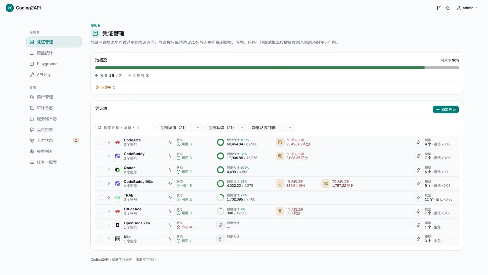
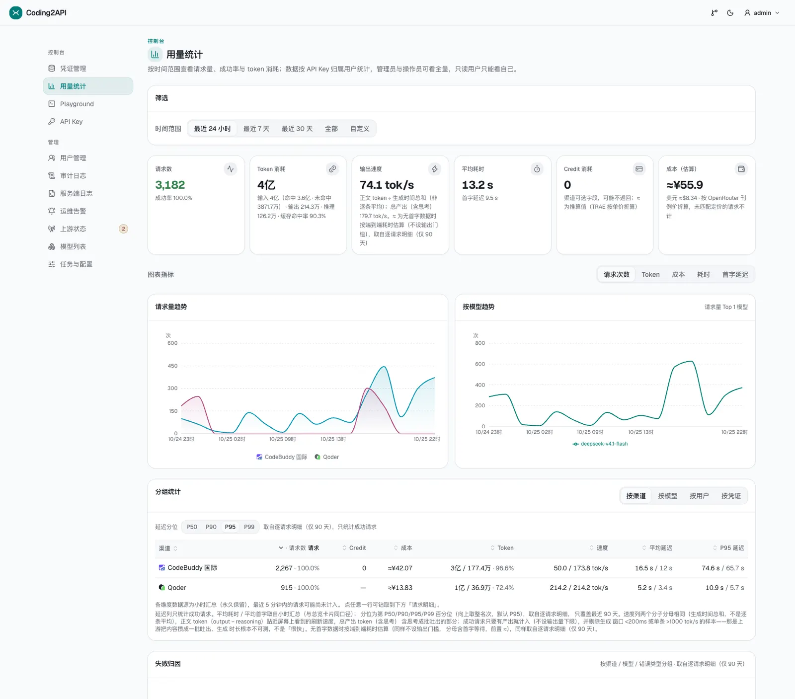
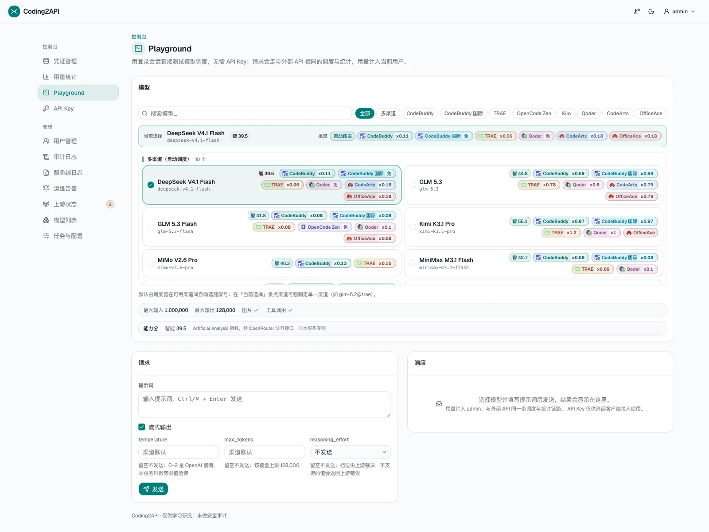
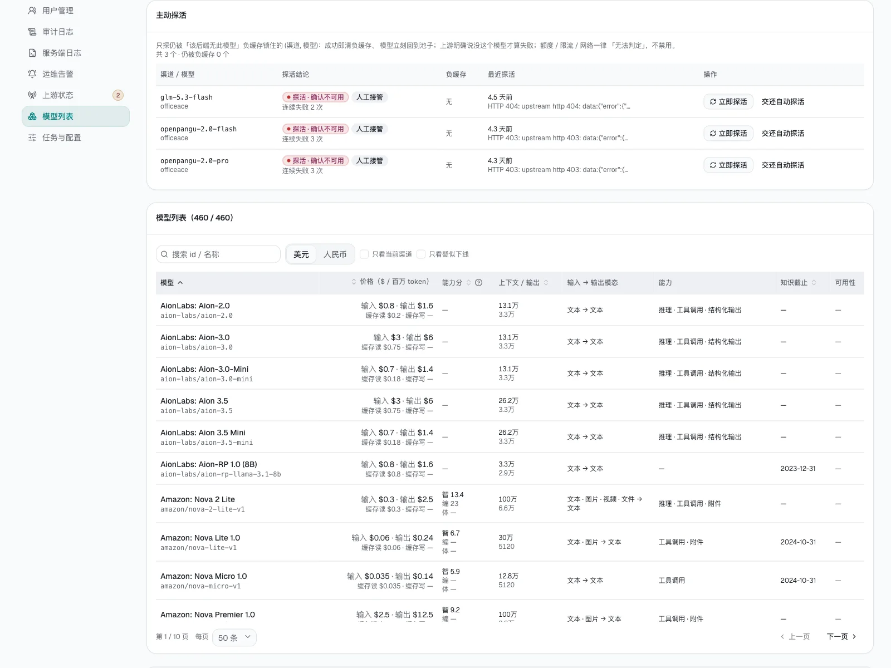
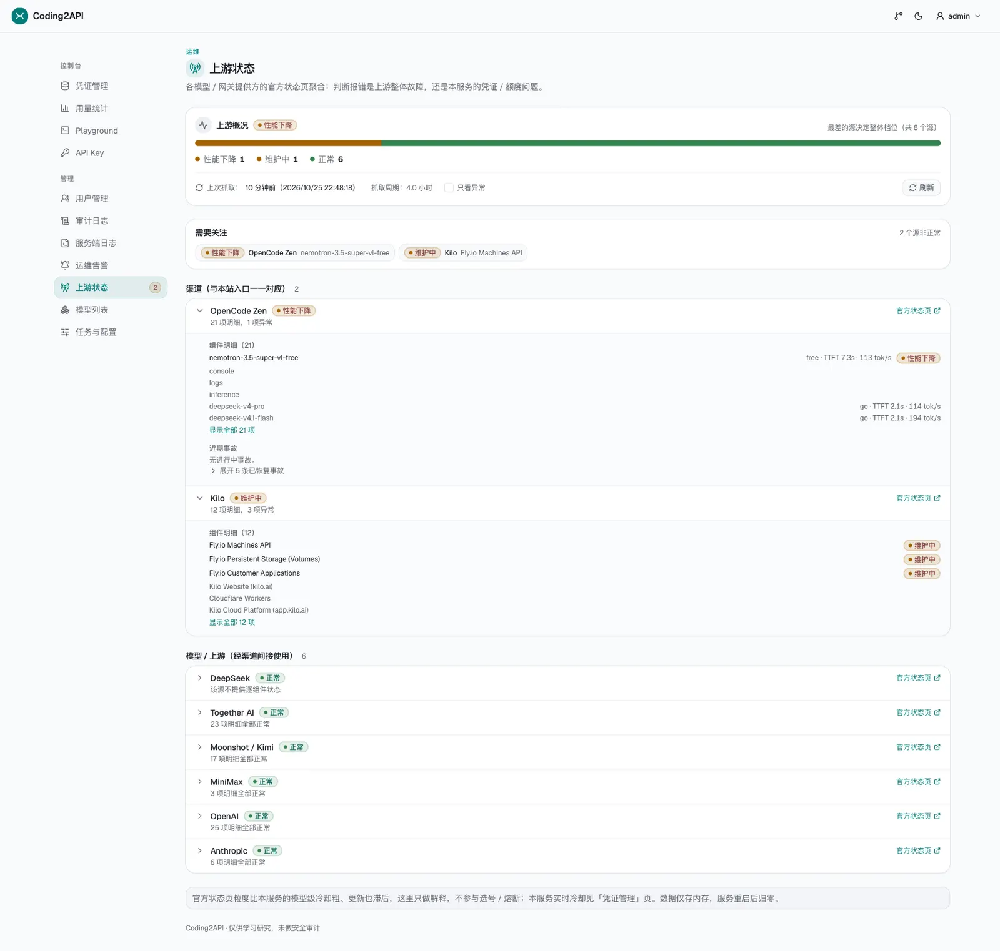
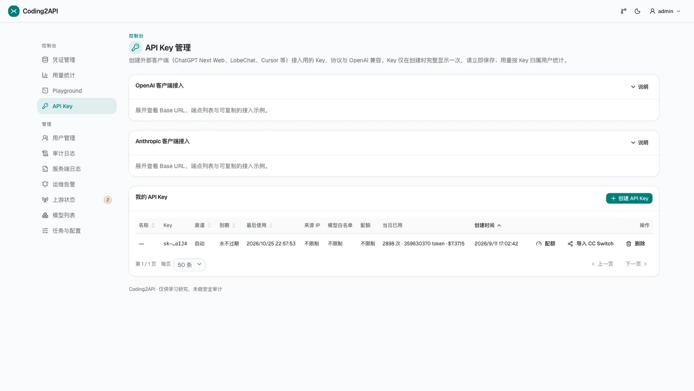
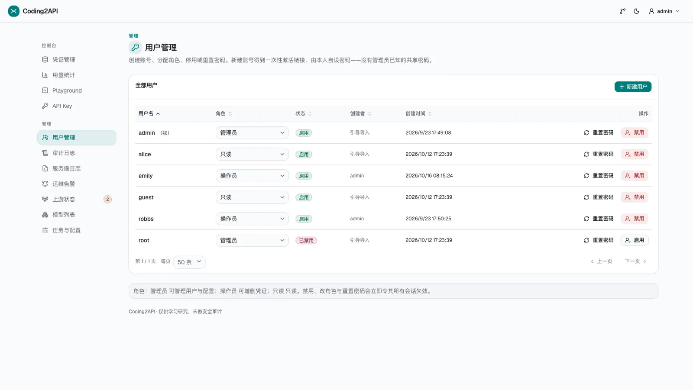
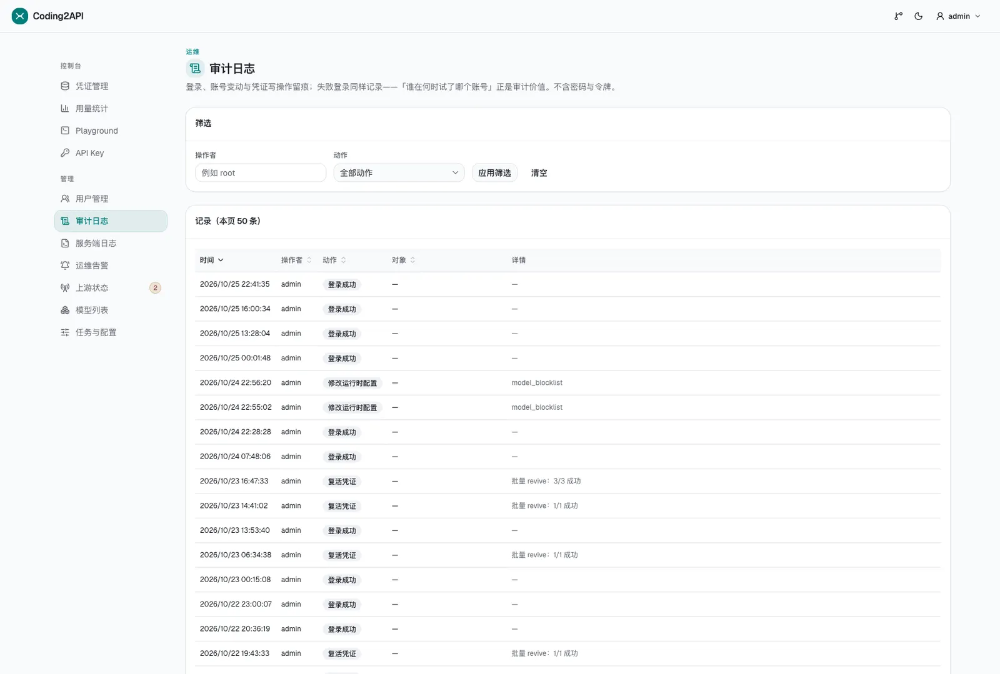

# Coding2API

[](https://github.com/RobbsLuo/Coding2API/actions/workflows/ci.yml)
[](https://github.com/RobbsLuo/Coding2API/releases)
[](LICENSE)
[](https://github.com/RobbsLuo/Coding2API/pkgs/container/coding2api)

把十路渠道——**CodeBuddy**（国内 / 国际两个独立渠道）、**TRAE SOLO**、**OpenCode Zen**、**Kilo**、**Qoder**、**CodeArts**、**OfficeAce**、**小浣熊**、**灵犀**——外加可选的**通用 OpenAI 兼容上游**，封装成 OpenAI 兼容 API：公共凭证池、统一模型名与调度、按人用量统计。

> [!WARNING]
> 逆向接口，仅供学习研究，未做安全审计；公网部署需反向代理 + 鉴权 + IP 白名单。

## 特性

- **多协议出口**：`/v1/chat/completions`（流式 / 非流式）、`/v1/responses`（Codex CLI）、`/v1/messages`（Claude Code）、`/v1beta/models/{m}:generateContent`（Gemini SDK）、`/v1/models`、`/v1/user/balance`、内置检索 `/v1/tools/search` + `/v1/fetch`。
- **统一调度**：扁平名按健康度选号，`模型@渠道` 强制。优先级：免费渠道 → 在途最少 → 到期额度 → 健康度 + 分级冷却 → 余额多者。凭证**权重**（`-1000..1000`）只在同一健康档内重排；目录里的 x0 会被最近 24h 实测扣费校准。模型级限流只避让该模型；多轮对话粘同一凭证，出错才轮换。
- **到期额度优先**：主窗口（默认 36h）先烧将过期额度，打平再比 7 天窗口；单位统一积分。
- **模型列表按凭证加载**：只列有可用凭证的渠道 → 无幽灵模型。目录落盘，重启即用。
- **公共凭证池**：admin 维护、全员共享、`APP_SECRET` 加密入库；设备码 / OAuth 登录、多账号切换、额度探测、签到、token 预刷新。
- **三角色**：`admin` / `operator` / `viewer`（SQLite）；一次性激活链接、首登强制改密、改角色 / 停用即时吊销会话；登录与写操作留审计。
- **成长中心**（仅 CodeBuddy）：领礼、派 Buddy、领任务奖、断登补登、连登兑换、开盲盒。`GROWTH_IRREVERSIBLE_ACTIONS=false` 关停不可逆动作；企业版账号自动跳过。
- **脱敏统计**：不存对话；明细 90 天、小时汇总永久；按人 / 渠道 / 模型 / 凭证可视化；成本按 OpenRouter 刊例价估算；明细走 SSE。
- **月度账单**（`operator` 起）：按月按人 / 按 Key 汇总请求、token 与成本；CSV / JSONL 导出并写审计。
- **工具调用健壮性**：`id` 缺失按 index 补并记忆；DeepSeek DSML 泄漏回读成结构化调用；非流式坏 `arguments` fail-closed（400，不冷却凭证）。
- **失败分流**：`11134` 供应商过载按排队语义（不罚号）；请求级错误换号后不搬会话粘性；全池耗尽 503 带 `Retry-After` 与**池子成因拆解**（`total=25 cooling=20 disabled=3 …`）。
- **加固与运维**：登录限流 / CSRF / 请求体上限 / Host 白名单；出口 IP 粘性（`CREDENTIAL_PROXY_POOL`）；可选出站隐私脱敏（`PRIVACY_RULES`，只改出站副本）；上游状态聚合（只解释不调度）；侧栏待办角标；Prometheus `/metrics`。
- **窄屏适配**：<768px 表格转卡片，DOM 不变。

协议层（私有信封、签名、门禁伪装）见 [`TECHNICAL.md`](TECHNICAL.md)。

## 界面预览

管理台（截图取自本地实例，账号 / IP 已脱敏）：

| 凭证管理：池概况与渠道分组 | 用量统计：请求 / token / 成本 |
|---|---|
|  |  |
| **Playground：模型 × 渠道与倍率** | **模型列表：OpenRouter 刊例价与能力分** |
|  |  |
| **上游状态：区分上游故障与本服务问题** | **API Key：客户端接入说明与配额** |
|  |  |
| **用户管理：三角色与一次性激活** | **审计日志：登录成败都留痕** |
|  |  |

任务与配置（94 项可热更，DB 覆盖值优先于 `.env`）、服务端日志、运维告警见 `assets/screenshots/{settings,logs,alerts}.webp`。

## 快速开始

前置：**Linux 或 macOS**（Windows 用 WSL2 / Docker，见「部署注意」）、Python 3.12+、[uv](https://docs.astral.sh/uv/)、Node.js 24+、pnpm 10+（仅前端构建）。

```bash
uv sync
uv run python scripts/create_user.py admin --role admin   # 建首个管理员
cd web && pnpm install && pnpm build && cd ..
APP_SECRET="换成你自己的随机字符串" uv run python -m src.main
```

开 <http://127.0.0.1:8000> 登录；加人走「用户管理」页。

> 用 `python -m src.main` 而非 `uvicorn src.main:build_app`：前者读 `.env` 的 `HOST`/`PORT` 并持有单实例锁（`data/.instance.lock`）。同一 `DATA_DIR` 只能起一个进程，第二个会打印「另一个实例已在使用 data（PID xxx）」后退出。

`scripts/create_user.py` 直写 SQLite（`--db` 或 `DATA_DIR`，默认 `data/coding2api.sqlite3`）；老部署 `secrets/users.txt` 启动导入一次，不覆盖已存在。

Docker：

```bash
cat > .env <<'EOF'
APP_SECRET=换成你自己的随机字符串
PUBLIC_BASE_URL=http://127.0.0.1:8000
EOF
docker compose up -d --build
docker compose exec coding2api python scripts/create_user.py admin --role admin
```

拉镜像：`docker compose pull`（或 `docker pull ghcr.io/robbsluo/coding2api:v0.15.1`）。tag `v*` 推 main → `.github/workflows/publish.yml` → 发 `<tag>` + `:latest`。有公网 IP 的 VPS 要 https → 见「[公网部署](#公网部署docker--caddy-自动-https)」。

## 用户与角色

账号存 SQLite `users` 表，「用户管理」页（仅 admin）增删改。

| 角色 | 能做什么 |
|---|---|
| `admin` | 用户管理、任务与配置、凭证读写、全部统计、审计日志、服务端日志、上游状态、模型列表 |
| `operator` | 凭证读写（导入 / 删除 / 启停 / 签到 / 成长 / 切换账号）、全部统计、上游状态、模型列表 |
| `viewer` | 只读：仪表盘、凭证列表、统计、Playground |

「月度账单」同 `operator` 门槛（账单是池级数据；`viewer` 只看到本人用量）。

- **加人**：用户名 + 角色 → 一次性激活链接（24h、只显示一次），对方开 `/activate` 自设密码。无初始密码；重置同理。
- **改角色 / 停用**：即时作废该账号全部会话 Cookie。停用 = 可逆的默认「删人」（统计仍归该用户名）；硬删只在 CLI。
- **自助改密**：右上角用户菜单 →「修改密码」。
- **防锁死**：不能停用 / 降级最后一个活跃 admin；不能对自己降级或停用。

CLI 兜底（无 Web / admin 全失联）：

```bash
python3 scripts/create_user.py alice --role admin   # 交互输入密码
python3 scripts/create_user.py --list
python3 scripts/create_user.py alice --delete --force   # 硬删，不可逆
echo "$PASSWORD" | python3 scripts/create_user.py alice --role admin --password-stdin
python3 scripts/create_user.py alice --role admin --init   # 库还不存在时先建库（缺 --init 会拒绝，避免误建空库）
```

`ADMIN_USERNAMES` 与 `secrets/users.txt` 仅引导期生效（判据：库里还没有活跃 admin）；此后角色只来自 DB。

## 审计与服务端日志

- **审计**（`/audit`，仅 admin）：登录（成败都记）+ 写操作，按操作者 / 动作筛选、分页。每条：时间 / 操作者 / 动作 / 对象 / 说明 / 来源 IP。**不含密码 / 令牌明文**（激活令牌只存 SHA-256）。留 90 天。
- **服务端日志**（`/logs`，仅 admin）：进程内实时日志。`GET /api/logs` 取最近 N 行，`GET /api/logs/stream` SSE 先回放再推新行；级别筛选、关键字过滤、跟随、暂停、清空。**无写入入口**。
  - **脱敏是硬前提**：每行发出前过白名单；命中 `token` / `secret` / `authorization` / `cookie` / `password` / `api_key`、`sk-…` 形状或 `Bearer <值>` → 整行丢弃。
  - 内存缓冲 `LOG_BUFFER_LINES`（默认 500，可热更，`0` 关整页）；**落库** `LOG_PERSIST_LINES`（默认 2000，可热更）写 SQLite `log_events` 环形表，重启后可回看，支持 `?request_id=` / `?since=<epoch>` / `?level=ERROR`。容量按最近 N 行裁剪。写库失败只告警一次，不上抛。
  - 单行 ≤4000 字符；带 `seq` / 时间 / 级别 / logger / `request_id`。点行尾 `#前8位` 即按该 request_id 过滤（一次请求的换号 / 冷却 / 降级都同 ID）；`X-Request-ID` 可直接粘进关键字框。订阅者上限 4，超出 429。

## 使用

1. 「凭证管理」添加凭证：
   - **CodeBuddy**（含国际）：设备码登录，或粘 `{"token":"..."}`。
   - **TRAE**：粘凭证 JSON（`accessToken`/`uid`/`refreshToken`）或回调链接（`apiHost` 只收官方地址）。
   - **Qoder / CodeArts**：设备码 / OAuth2 授权码登录（CodeArts 授权后把打不开的本地回调链接粘回页面）。
   - **OfficeAce**：点「登录 OfficeAce」走华为云授权（回调由云端承接）。
   - **小浣熊 / 灵犀**：无登录按钮，只能粘网页会话凭据（小浣熊 `{"access_token":"<xhx_token>"}`，灵犀整段 Cookie 或裸 `wps_sid`）。
   - **通用粘法**：「JSON 导入」接受整段 Cookie，或 DevTools → Network → 右键请求 → **Copy as cURL (bash)**（HttpOnly cookie 也能拿到）；有明确特征（`wps_sid` / `xhx_token` / TRAE 字段 / AK·SK）时自动识别渠道并记住。
   - **OpenCode Zen / Kilo**：无需添加，启动自动出虚拟凭证（删了可在同面板补回）；Zen 已充值时可在同面板粘贴 Console API Key 切付费档。
2. 「API Key」建 `sk-...`（明文仅显示一次）。
3. 调用：

```bash
curl http://127.0.0.1:8000/v1/chat/completions \
  -H "Authorization: Bearer sk-你的key" \
  -H "Content-Type: application/json" \
  -d '{"model":"glm-5.2","messages":[{"role":"user","content":"你好"}]}'
```

`模型@渠道` 强制上游（`glm-5.2@trae`、`mimo-v2.5-free@zen`）；不写自动选。任意 OpenAI 兼容客户端直连（Base URL `http://127.0.0.1:8000/v1`）。「Playground」用登录会话测，无需 API Key。

### 模型名三字段

1. **原代号**（`raw_id`）：渠道真发的 key，永不改动（Qoder `kmodel_latest` = TRAE `kimi-k3-1`；Kilo 可带 `kilo-auto/free`）。
2. **归一键**：剥免费档标记（`-free` / `free` 路径段）与命名空间前缀（含小浣熊 `sn-`）→ slug 化。列表按它判同模型、合并。
3. **展示名**：可读文本（`LongCat 2.5 Preview`）；上游给就用，否则从原代号派生，品牌写法从官方。

`GET /v1/models` 的 `id` 全是归一键；转发自动换回原代号，`by_provider.{渠道}.raw_id` 可见。**三种写法都能请求**；同渠道内归一键重复 → 退回原代号。条目可选带 `cost {input, output, cache_read}`（USD / 百万 token）与 `reasoning_efforts`。上下文 / 输出上限同值双发：本仓字段 `max_input_tokens` / `max_output_tokens` + OpenRouter 风格别名 `context_length` / `max_completion_tokens`（源字段缺省时不发别名）。

- **自定义别名**（`MODEL_ALIASES`，可热更）：`对外名=模型@渠道;对外名2=模型`，`@渠道` 可省。列表与请求解析共用一份，条目带 `custom_alias: true`；撞名 / 目标不存在 / 渠道不持有 → 该段 ERROR 跳过。无别名链。
- **单模型查询**（`GET /v1/models/{id}`）：三种写法 + 别名都认，大小写不敏感。找不到 / 不在 Key 白名单 → 404（`model_not_found`），不泄露池内容。两个 models 路由都接受 `x-api-key` 与 `Authorization: Bearer`。
- **`n` 只接受 1**，否则 400。

### 流式细节

- **usage 收尾帧**：finish chunk 后、`data: [DONE]` 前补一帧 `choices: []` 的 usage；上游没上报就不补，未上报字段一律 `null`。
- **思考 token**：需客户端带 `reasoning_effort`；CodeBuddy 未给补 `medium`（否则思考进正文），显式值原样透传。
- **首帧延迟发头**：流式不立刻发 200，先等上游第一帧（宽限 5s，`api/streaming.STREAM_START_GRACE_SECONDS`）。首帧是**请求级错误**（11128 风控、11115 上下文超限、11135 坏图、11129 工具 schema、4001 模型不属于该上游）→ 回 **400 JSON**（`invalid_request`）；宽限内无帧 → 照旧发 200（不取消在途取帧）；已出帧后的错误维持 `200 + 错误帧`。
- **流式超时（默认关）**：`STREAM_FIRST_EVENT_TIMEOUT_SECONDS`（首事件超时，出帧前可换号，记 `upstream_first_event_timeout`，心跳不重置计时）、`STREAM_IDLE_TIMEOUT_SECONDS`（已出帧只断流不换号）。默认关是刻意的：实测慢上下文首字 40–71s；要用按部署开（推荐 60 / 300）。

### Playground

- 可选 `temperature` / `max_tokens` / `reasoning_effort`，**留空即不发该键**。边界同后端（`temperature` ≤ 1000、`max_tokens` ≤ 4,000,000）。
- **图片输入**：粘贴或选文件（单张 ≤4MB、最多 4 张）；有附件时 `messages[0].content` 发成 OpenAI 多模态块数组，无附件时仍是纯字符串（请求体逐字节不变）。模型不支持由上游拒绝（CodeArts 归 `model_capability`，不罚号）。

## 渠道

> CodeBuddy（含国际）/ TRAE / Qoder / CodeArts / OfficeAce / 小浣熊 / 灵犀 需凭证；**Zen 与 Kilo 无凭证免费层**——池里一条虚拟占位行（调度 / 冷却 / 统计照常），额度列「免费层（无额度接口）」，健康度恒「无探测」。删虚拟行重启复活；永久停用 →「暂停」。

### OpenCode Zen（`zen`）

[opencode.ai/zen](https://opencode.ai) 免费模型，免登录。上游清单混付费、无免费标记 → `-free` 后缀收窄 → 逐个探活 → **只剔除确定不可用**（付费 401 / 下线 400 / 区域 403）；`429` / 5xx / 超时**保留**（判活缓存 30 分钟；免费模型 **x0**）。

**免费层门禁**：上游要伪装官方客户端（UA、会话头、`stream:true`、tools 含门禁工具）→ 自动满足；注入空壳工具，真调用被过滤。门禁是移动靶，全部做成配置（改完重启即换）：`ZEN_USER_AGENT`、`ZEN_API_ROOT`、`ZEN_MODELS_ROOT`、`ZEN_GATE_TOOLS`、`ZEN_CLIENT_PROFILE`（`legacy` 默认 / `v2`）。`v2` 复刻官方 2.x 头集合（4 个 session 副本、`x-opencode-client/project`、`b3`/`traceparent`）并注入 `<env>` 块；2.x 端点拆分时配 `ZEN_API_ROOT=/inference/openai/v1` + `ZEN_MODELS_ROOT=/inference/v1`。付费模型强制 `模型@zen` 也只报不可用。

**付费档（Console 充值 + API Key）**：凭证内容写 `{"api_key": "sk-…"}`（面板「Zen API Key」输入框，或批量导入同名字段）即切付费档——对话走 `/inference/openai/v1`、鉴权 `Bearer <key>`、不再注入门禁工具/`<env>`；模型清单走 `/inference/v1`，**摘掉 `-free` 与零价模型**（这两类带 Key 仍回 429，且那条 429 按账号记，会把付费凭证一起冷却）、不逐个探活。账号没开通任何付费模型时清单为空 → zen 不参与路由（管理台不再显示必撞的免费模型）。zen 是**单槽**渠道：带 Key 导入会更新既有虚拟凭证（不新增第二行），并清掉旧冷却——否则匿名行会先被调度选中、反复撞 429。Key 留空 = 保持匿名免费层。

### Kilo（`kilo`）

[Kilo](https://kilo.ai)（`api.kilo.ai/api/gateway`）免费模型，免登录。标准 OpenAI 协议；上游 `/models` 每条带 `isFree` → 直接过滤，**不探活**（省配额）。网关级约 200 请求/小时/IP；上游 429 与 502/503/504 均模型级 → 只冷却被点名模型。

### Qoder（`qoder`）

[Qoder](https://qoder.com)，需真实账号：点「登录 Qoder」走设备码授权。上游私有 COSY 协议 → 本服务签名 + 解包；对外仍是标准 OpenAI。

- **额度与签到**：`/api/v2/quota/usage`；签到为活动制 `/sash/api/v1/me/campaigns`（积分累积），旧 `daily-check-in` 仅回退。**活动每日 10:00（UTC+8）刷新**，领取后 30 天有效。国际站无签到接口（404）。
- **逐包到期（网页 Cookie）**：`/api/v2/quota/usage` 只给两桶汇总（顶层 `expiresAt` 是周期重置哨兵 `9999-12-31`）。网页账号页 `GET {website}/api/v2/me/usages/big_model_credits` 才有逐包 `expires_at`，但只认网页登录会话（device token 401）。凭证行「更多 → 网页 Cookie」粘贴后改走网页接口：明细按包展开、到期阶梯参与「快过期先用」。Cookie 加密落库、不回显、导出不含；过期（401）时静默回退汇总口径。
- **端点**：默认国内版（`openapi.qoder.com.cn` + `gateway.qoder.com.cn`）；国际站改 `QODER_API_ENDPOINT=https://openapi.qoder.sh` 并加白名单。
- **错误语义**：自身节点故障包成 400（`[FAIL]node:…`）→ 只冷却该模型；流中 `body:"null"` 保活帧跳过；「排队中」包成 403 且标记藏在序列化字符串里 → 等上游点名秒数后原号重开；「每日计费次数用尽」（403 `code 110`）→ 额度类，冷却到次日 04:00，不硬禁用。

### CodeArts（`codearts`）

[华为云 CodeArts](https://codearts.huaweicloud.com)，需真实账号：点「登录 CodeArts」→ 授权后浏览器跳到打不开的本地地址 → **整条链接**粘回页面换 STS 凭证（AK/SK + security_token + refresh_token + DPoP 私钥），加密入库。

- **令牌刷新刚性**：refresh_token 与 `client_id=codearts-agent`、DPoP 私钥三者绑定、一次性；刷新后必须回写。预刷新任务自动完成（DPoP ES256/P-256），窗口封顶 45 分钟。作废 → 标「需重新登录」+ 停重试。
- **签到**：`GET /v1/ops/delivery?channel=IDE` → `POST /v1/ops/claim` → `POST /v1/ops/confirm`。活动按 `type=USER_LOGIN` 挑（`type` 缺失读 `extra.triggerEvent` = `user.login`），**`campaignId` 取当轮响应**（上游 2026-11 把活动从 ID 1 换成 34、面额 1000 → 100；写死会「签到成功、积分不涨」）；响应没给 `campaignId` 判失败重试。`CLAIMED` =「已领未确认」→ 两步一起做；**claim 成功但 confirm 失败按失败处理**。失败按连续次数指数退避（10m → 20m → 40m → 封顶 1h）。
- **重新登录合并**：同 `uid` 再次登录就地更新既有凭证并解除硬禁用；上游点名的冷却（限流 / 余额 / 权益 / 风控）保留。`paused` / `pinned` / 标签 / 统计归属不变；不同账号仍新增。
- **额度＝积分余额**：`GET {snap}/snap-manager/v1/statistics/plugin`（前缀必须带 `snap-manager`，头 `Agent-Type: PromptCenter`），不折算。
- **逐笔到期（网页 Cookie）**：portal `GET /portal/promptcenter/v1/ops/credit/overview` + `.../campaign/{id}?pageNum=&pageSize=` 才有逐笔 `expireAt`；portal 只认控制台会话 Cookie（且需 `X-Requested-With: XMLHttpRequest`）。失效时静默回退 7 天窗口口径。`expiredAmount` / `status` 会滞后，判死只看 `expireAt <= now`；已过期逐笔不再展示。
- **签名 / 累计全文 SSE / 节流**：`SDK-HMAC-SHA256`（AK/SK + `X-Security-Token`）；流式 `text` 为累计全文（替换语义）→ 还原增量。上游硬限每账号并发 3 → `CODEARTS_MAX_CONCURRENCY` + `CODEARTS_REQUEST_WINDOW_SECONDS`。

### OfficeAce（`officeace`）

[华为云 OfficeAce](https://www.huaweicloud.com/product/agentarts.html)，需真实账号：点「登录 OfficeAce」完成华为云授权（回调由云端承接），后端 2.5s 轮询 `/v1/claw/auth/code` 取授权码。

- **开通前提**：账号须先在 OfficeAce 客户端登录并兑换邀请码，否则登录「成功」但拿不到模型密钥 → 点名报「账号未开通 OfficeAce 服务」。
- **两套凭据**：`Basic model_app_key:model_app_secret`（不过期，聊天转发）与临时 AK/SK + `security_token` + `project_id`（约 2 小时，积分查询 / 签到）。混用得 `APIG.0303 app not found`。临时凭据由预刷新续期；`refresh_token` 一次性轮换，绑 `client_id=pdp5_for_agentarts` + DPoP 私钥（与 CodeArts 票不通用）。
- **重新登录合并**：同 `account_id` 就地更新并解除「需重新登录」，冷却保留，不新增重复账号。
- **三处协议特例**：限流走伪 200（`data:{"error":…}`，`81111/81114` 只冷却「该凭据 × 该模型」）；`81004` / `81009` 业务码先于状态码判定 → 模型级负缓存（成功即撤销）；`max_tokens` = 推理 + 正文总预算（`≥16` 自动加 1024 余量再夹到硬上限，`<16` 原样，未给不补）。
- **积分即主账**：单位 `officeace_points`，每笔奖励独立到期不合并 → 「逐笔到期」。
- **签到**：`POST /v1/subscription/bonus/claim`（写操作，body 必须 `{}` 且带 JSON `Content-Type`；上游当日幂等）。收获按剩余量增量算，封账到下个北京时间 0 点。
- **不主动探活 / 不估 credit**：探活要真烧积分，`cost_coefficient × tokens_per_point` 官方未说明；模型级拒绝由真实请求按 `BLOCKED` 负缓存处理。
- **签名与端点**：控制面 `/v1/claw/*` 用 `SDK-HMAC-SHA256`，模型网关只认 `V11-HMAC-SHA256`（用错 → `APIG.0624` 或 401）。白名单只需控制面主机（模型网关每账号不同，由上游签发存凭证）。
- **单账号单用户**（官方《套餐管理》）；换账号用登录旁「换账号」（`force_login=true`）。

### 小浣熊（`raccoon`）

[商汤小浣熊](https://xiaohuanxiong.com)，需真实账号。**没有登录按钮**：凭据是网页会话 JWT，DevTools → Application → Cookies → 复制 `xhx_token`，粘 `{"access_token":"<值>"}`（也接受裸 JWT、整段 cookie、Copy as cURL）。约 30 天到期；**重取后再导入即可**：同 `uid`（JWT `sub`）就地更新并解除硬禁用，不会多出重复行（重复行会被当成两个号并发，翻倍统计又绕过节流）。

- **协议**：标准 OpenAI 兼容（`/api/web/llm/v2/chat/completions`），无签名、无设备指纹；`tool_calls`、`role=tool` 回传、`include_usage` 实测通过（411K token 输入 14.2 秒）。
- **未知模型静默回落默认模型**（实测）→ 两层拦截：发请求前按目录校验，回包首帧比对 `model` 回显，不一致直接失败。
- **额度＝积分**：每笔请求扣 1 分（与 token 无关），每日 00:00 发 300 分（7 天有效）。`billing_effective_multiplier` 当倍率，**0 = 限免**（如 `sn-sensenova-6-8-flash`），调度优先选。
- **额度明细**：上游分四个池（每日 / 奖励 / 月度 / 充值），套餐明细按发放流水逐笔展开（`type=income` 的 `daily_grant` / `reward_grant`）。上游不给逐笔剩余 → 每日积分按「到期早的先消耗」分摊（推断）；奖励积分实测「每日额度用光后才扣」，按发放额列。流水拿不到才退回四池。到期阶梯与明细同源，参与「快过期先用」排序。
- **每日签到**：上游没有领取接口——300 积分在**当天第一次网页登录**时补发一笔 `daily_grant`（旧结论「00:00 自动发放、登录只是延期」已于 2026-11-18 真号复测推翻）。故「签到」= 页面访问 → 摸余额 → 读流水核对，**只认流水不看 HTTP 200**；**今天没有 `daily_grant` 就是失败**；凌晨 00:00~01:30 之间把重试推到 01:30 等账单同步。流水用 `type=income` 过滤（`type=all` 里消费流水会把每日发放挤出窗口）。
- **会话需重登 vs 只差绑定**（`GET /api/web/auth/v1/user_info` 的 `trusted_device`）：`device_bind_state=suspicious`（`reason=device_session_mismatch`）/ `needs_relogin=true` → 会话已绑在别的设备，心跳恒回 `400 200811 device_bind_required`、当天无 `daily_grant`，且**无自愈通道**（`devices_current_bind` 同样 400；`refresh` 只换回同一张 token），签到与活跃上报直接写「需在网页端重新登录后重新导入凭据」。而 `device_bind_state=unbound`（`session_without_bound_device`，此时 `trusted` 必为 `false`）**只差一次绑定**：签到会调 `devices_current_bind` 绑一次，绑完即 `trusted=true`、当天积分随之到账——**这两种状态不能合并判定**，否则新导入账号的 bind 入口被挡死，永远报「需重登」。**重复 bind 会永久锁死账号**：上游首次绑定自行分配 device_id，之后若再拿派生值去 bind 会被判 `device_session_mismatch`（此后 bind/心跳恒 400），故已绑会话一律沿用 `user_info` 里那台设备、不再 bind。
- **按需登录（可选，默认关）**：凭证行「更多操作 → 账号密码」填手机号与密码（也可在导入 JSON 带 `phone`/`password` / `phone_number`），打开 `RACCOON_AUTO_LOGIN` 后，签到发现「今天没发」就调 `POST /api/web/auth/v1/login_with_password` 换新会话并重核。实测口径：`phone`/`password` 走 **AES-CFB（key `senseraccoon2023`、16 字节随机 IV 前置、Base64）**，密码 ≥8 位，**不需要验证码**。限制：每天每凭证最多一次；上游拒绝（`200004 phone_or_password_verify_error`）→ 标「需重新登录」并停手；`password_status=unset` 的账号填了也登不进。接口 `PUT /api/credentials/{id}/login-secret`（都留空 = 清除），密码加密落库、**不回显**、导出不含。登录成功后调 `devices_current_bind` 绑新会话（不绑则 `trusted=false`、心跳恒 400）；绑定失败不判登录失败。`derive_device_id` ≤64 字符（上游对超长回 `500 value too long for character varying(64)`）。
- **活跃上报**：`POST /api/web/auth/v1/devices_current_heartbeat`，补 `x-client-*` 头族即 200、幂等。默认关，与 CodeBuddy 共用 `ACTIVITY_REPORT_ENABLED` / `ACTIVITY_REPORT_HOUR`。
- **并发上限约 5**（第 6 个回 `429 user_model_rate_limited`）→ `RACCOON_MAX_CONCURRENCY` 默认 2，独立节流器。该 429 实为账号×模型频率窗口（恢复中位数 25min），冷却首枪 60s、同链翻倍、封顶 30min。

### 灵犀（`lingxi`）

[WPS 灵犀](https://lingxi.wps.cn)，需真实 WPS 账号。**没有登录按钮**：凭据是 WPS 账号 cookie `wps_sid`（`lingxi.kdocs.cn` 同样可用），登录后复制整段 Cookie 或裸 sid 粘进「登录渠道」页。上游**没有 refresh 接口**，判据是上游 401，过期重贴即可。

- **同一浏览器只保留最近一次登录**：在同一浏览器配置登录另一个账号会让上一次 `wps_sid` 立刻 401（实测）。多账号需不同浏览器配置 / 无痕窗口；旧凭证会在复探中确认 401 并标「需重新登录」。
- **一次对话三条请求**：建 cowork 会话 → 领 credits run → `agent-runtime/chat/completions`（私有 SSE）。上游**按 run 计费** → 会话 + run 按「账号 × 模型」缓存 1 小时（不滑动续期）+ 并发单飞；`SQLNoRows` /「会话不存在」时丢弃缓存重建一次。
- **私有 SSE 与用量口径**：正文在 `choices[].text`（不是 `delta.content`），**不发 `[DONE]`**（靠 `finish_reason` 收尾）；`usage.total_tokens` 是当前上下文大小 → 自算 `prompt+completion`；`cached_tokens` / `reasoning_tokens` 是扁平字段，方向与 OpenAI 相反。
- **工具 schema 必须先压平**：`anyOf` / `oneOf` / `$ref` / 数组型 `type` 会让上游整轮回「AI服务异常」；`max_tokens` 要塞进 `base_llm_arguments`，`reasoning_effort` 顶层与 `llm_arguments` 各一份。
- **额度＝智点**：`total_balance` 直接进余额，赠送批次 `bonus_credits[].expire_time` 进到期阶梯（15 天窗口）；账本记「积分」；`multiplier` 直接当倍率。
- **签到**：任务中心 `daily_check_in`，`status=claimed` 即已签。上游对重复领取回 200 假成功（余额不动）→ 奖励按**领前 / 领后余额差**算，差为 0 时读任务状态，绝不看 HTTP 200。
- **错误分类**：401 → 凭证失效；402 / 额度文案 → 耗尽；403 → 瞬时；404 → 请求无效；429 → 点名模型；`AuditFailed` 换号无用；run 过期 → 重建一次。
- **ToS 灰区**：复用登录态并伪装桌面客户端（`X-Client-Type: lingxi_claw` + `x-kso-app-name/app-version/device-id`），见 `provider/tos.py`。

### 通用上游（`generic`，可选）

接**标准 OpenAI 兼容端点**（Command Code、Kimi Code、MiniMax、智谱免费档、自建 vLLM / LiteLLM 等）：无逆向、无私有协议，端点自填，凭证是本部署持有的真实 key。

```bash
# .env
GENERIC_API_ENDPOINT=https://api.example.com/v1
GENERIC_MODELS=gpt-6.2,kimi-k3.1-pro     # 可选：上游没有 /models 时的静态表
GENERIC_CHAT_MIN_INTERVAL=0               # 可选：压低 RPM
```

- **留空 = 不启用**：`GENERIC_API_ENDPOINT` 为空的部署里没有这条渠道（`/v1/models`、凭证页、ToS 提示都不出现）。
- **凭证**：`{"api_key": "sk-…"}`（也接受裸 key / `token` / `accessToken`），进加密池，可多把轮换。
- **端点校验**：`GENERIC_ALLOWED_ENDPOINTS` 非空只放行名单内；留空放行任意 **https** 端点。`http://` 仅允许回环（`localhost` / `127.0.0.1` / `::1`）——凭证是真实 API key，明文 http 打内网等于把 key 交给同网段任何人。内网自建请配 https（自签可走反代）或只监听回环 + 隧道。任何情况下都拒 `file://` 等非 HTTP scheme。
- **错误分类与 Zen / Kilo 相反**：那两家无凭证，401 只是「要付费 key」→ 跳过渠道；这里 **401/403 = key 废了 → 硬禁用**；402 → 余额不足，429 → 限流，5xx → 其它。
- **能力**：聊天、模型列表。无签到 / 成长 / 活跃上报 / 刷新 / 额度查询，对应任务自动跳过。
- **限制**：一个部署只配一条（渠道 id 固定 `generic`）；要多接几家请拆部署。

### CodeBuddy 国际（`codebuddy_intl`）

[www.codebuddy.ai](https://www.codebuddy.ai)，同国内站协议，但两套独立账号体系 → 独立渠道。登录链路同国内版（设备码）。不合并原因：`CODEBUDDY_API_ENDPOINT` 是进程级单值，切过去会让存量国内站凭证打到国际站。**白名单刻意互不含**（填国内站地址 → 启动报错）。能力差异：聊天、模型列表、额度探测、刷新、活跃上报全启用；**签到、成长中心未启用**。模型列表按套餐探活（`11158` / `11102` 剔除，`429` / 5xx / 超时保留，按账号缓存 6 小时）。两站共有模型在 `/v1/models` 一条挂两渠道，`-x` / `-sg` 这类真不同的各占一条。

### 按渠道出站代理（可选）

```
PROVIDER_PROXIES="codebuddy=http://127.0.0.1:7890;qoder=socks5://127.0.0.1:1080"
```

格式 `渠道=代理URL;渠道2=代理URL2`，协议 `http/https/socks5/socks5h`，留空 = 全直连。作用该渠道全部出站（聊天、额度、模型拉取、后台任务、OAuth）。**启动期项**，改后重启；未知渠道 / 非法协议 / 缺 `=` → 启动失败。`HTTP_PROXY` 等不采信（`trust_env=False`）。容器内 `127.0.0.1` = 容器自身，代理跑宿主写 `host.docker.internal`（compose 已声明 `extra_hosts`）；只校验格式不校验可达。

## 出口协议

### Responses API（Codex CLI）

`POST /v1/responses` 提供 Responses 子集，与 chat 共用选号 / 冷却 / 轮换 / 统计 / 粘性：

```bash
export CODING2API_KEY=sk-你的key
codex -c "model_providers.coding2api={ name='coding2api', base_url='http://127.0.0.1:8000/v1', wire_api='responses', env_key='CODING2API_KEY' }" \
      -c model_provider=coding2api -c model='glm-5.2' '你的任务'
```

支持文本、流式正文、思考摘要、函数工具、`finish_reason=length` → `response.incomplete`；`text.format` → chat `response_format`；part `input_text` / `text` / `output_text` → text，`input_image` → `image_url`。**不支持** `store=true` / `previous_response_id` / `input_file` → 400；`include=["reasoning.encrypted_content"]` 收但忽略。工具表：`function` 直译；`namespace` 只展开默认 `functions` 组（其余丢弃——客户端按 `(namespace, name)` 查表，展平名会被当成不存在的工具）；`web_search` / `tool_search` / `custom`（freeform `apply_patch`）等托管工具**跳过不报错**。

### chat 入站校验

- **`response_format`**：只放行 `{"type":"text"}`、`{"type":"json_object"}`、`{"type":"json_schema","json_schema":{name, schema, description?, strict?}}`，畸形 / 未知 → 400。Responses `text.format` 共用这段。
- **`messages[].role` 白名单**：只放行 `system` / `user` / `assistant` / `tool` / `developer`，其余入口就地 400（`messages[i].role must be one of ...`），不发上游、不冷却、不记失败。`developer` 放行后由各渠道出站归一为 `system`（`provider.base.normalize_developer_role`）。非字符串 `role` 保留 `role must be a string`。

### Anthropic Messages API（Claude Code）

```bash
export ANTHROPIC_BASE_URL=http://127.0.0.1:8000
export ANTHROPIC_AUTH_TOKEN=sk-你的key     # 或 ANTHROPIC_API_KEY（走 x-api-key）
claude
```

- **鉴权**：`x-api-key` 与 `Authorization: Bearer` 都接受（`/v1/models` 同）。
- **流式**：`message_start` → `content_block_*` → `message_delta` → `message_stop`，无 `[DONE]`；thinking 块在 `content_block_stop` 前补 `signature_delta`。
- **缓存命中**：usage 拆两笔——`input_tokens` 只计未命中，命中另记 `cache_read_input_tokens`。
- **`count_tokens`**：本地估算，不转发。**图片**：`image` 块归一为 chat `image_url`。
- **不支持 → 400**：`document` 块、`source.type=file`、Anthropic 服务端工具。
- **`cache_control` 透传**（默认开）：落点同 Anthropic（`system`、内容块、`tool_result` / `tool_calls` 顶层、`tools` 顶层），只校验结构。实测 codebuddy / codebuddy_intl / trae / qoder / codearts / kilo 接受；zen、小浣熊、灵犀未验证。脚本 `scripts/probe_cache_control.py`。

### Gemini（google-genai / REST）

```bash
export GEMINI_API_KEY=sk-你的key
export GOOGLE_GENAI_BASE_URL=http://127.0.0.1:8000   # SDK 自拼 /v1beta
```

- **入口**：`POST /v1beta/models/{model}:generateContent`、`:streamGenerateContent`（`?alt=sse`）、`:countTokens`；`GET /v1beta/models`。鉴权 `x-goog-api-key` → `?key=` → `Authorization: Bearer`。
- **入站映射**：`contents[].parts`（`text` / `inlineData` / `functionCall` / `functionResponse`）、`systemInstruction`、`generationConfig`、`tools[].functionDeclarations`、`toolConfig.functionCallingConfig`。
- **出站**：`candidates[].content.parts`（text / thought / functionCall）+ `finishReason` + `usageMetadata`；流式每帧一个完整响应，终止帧带 `finishReason`（无 `[DONE]`）。
- **不支持 → 400**：服务端工具（`googleSearch` / `codeExecution` / `retrieval`）、`candidateCount != 1`、非 `text/plain` / `application/json` 的 `responseMimeType`。`thinkingConfig` / `topK` 丢弃。

### 内置检索（`/v1/tools/search`、`/v1/fetch`）

上游 CodeBuddy 官方 CLI 自带 web search 与抓取，本服务开成独立出口——**不接第三方搜索 API**，零外部依赖。

```bash
curl -X POST http://127.0.0.1:8000/v1/tools/search \
  -H "Authorization: Bearer sk-你的key" -H 'Content-Type: application/json' \
  -d '{"query":"opencode zen free models","max_results":5}'

curl -X POST http://127.0.0.1:8000/v1/fetch \
  -H "Authorization: Bearer sk-你的key" -H 'Content-Type: application/json' \
  -d '{"url":"https://example.com/post","prompt":"提取要点"}'
```

- **搜索入参**：`query`（必填，≤1000 字）、`max_results`（默认 5，夹到 1–20）、`allowed_domains`、`blocked_domains`（拼成 `-site:`）、`freshness`；出参 `{provider, results:[{title,url,snippet,site?,favicon?}], total_results, response_time_ms}`。
- **抓取入参**：`url`（仅 http/https）、`prompt`、`max_length`（默认 20 万字符）；出参 `{url, content, content_type}`，上游**只接受文本页**。
- **调度与失败**：走同一凭证池，403 自动换号；上游业务码拒绝 → 400 / 429 / 403，无可用凭证 → 503 + `Retry-After`，上游 5xx → 502。
- **不落用量明细**（不消耗 token，落库会污染口径）；仅 CodeBuddy（国内 / 国际）实现。

### CC Switch 一键导入

「API Key 管理」页生成 `ccswitch://` 深链（Claude Code / Codex CLI / OpenCode 各一按钮），入口：建 Key 成功对话框、Key 列表每行。深链含 Key 明文 → 仅主动打开时生成。需 CC Switch v4.0.10+；endpoint 随 `apiFormat`（Anthropic 到根、OpenAI 到 `/v1`），无 Gemini 出口。

### 余额查询

`GET /v1/user/balance` 兼容 DeepSeek 形状，供 Cherry Studio / cc-switch 显示余额；数据来自额度探测缓存：

```json
{
  "is_available": true,
  "balance_infos": [{"currency": "credits", "total_balance": "60.00",
                     "granted_balance": "0.00", "topped_up_balance": "0.00"}],
  "balance_known": true,
  "providers": [{"provider": "codebuddy", "remaining": 50.0, "total": 150.0, "credentials": 2}]
}
```

从未探测成功 → `balance_known` = `false`（未知，不是 0）。

### 池健康检查与指标

- `GET /health`：只回 `{"status":"ok"}`，**存活探针用这个**。
- `GET /healthz`：额外给凭证池计数，`ready == 0` → 503（就绪探针 / 告警）。
- 两端点不鉴权、接受 `HEAD`；四类计数互斥（`ready` / `cooling` / `paused` / `disabled`），合计 = `total`。**升级注意**：`/healthz` 从「恒 200」改为「ready=0 时 503」。
- `GET /metrics`（Prometheus）：默认开；`METRICS_ENABLED=false`（可热更）→ 404。`METRICS_TOKEN` **留空时只放行回环对端**（本机 `127.0.0.1` / `::1` 抓取，公网与内网其它主机一律 401）；设了 token 则要求 `Authorization: Bearer <token>`。公网入口（Caddy / nginx 模板）另已摘掉该路径。
- **OTLP 导出（可选）**：`OTLP_ENDPOINT` 非空即每 `OTLP_EXPORT_SECONDS` 秒 `POST {endpoint}/v1/metrics`（OTLP/HTTP JSON，**不引入 SDK**）。只导 `gen_ai.*` 指标（供应商 / 模型 / token / 延迟 / TTFT / 错误类型），**绝不导出** `gen_ai.input.messages` / `output.messages` / `system_instructions` 或任何正文；非回环端点强制 https，失败只告警一次、不拖垮服务。

| 指标 | 类型 | 标签 | 数据源 |
|---|---|---|---|
| `coding2api_requests_total` | counter | `provider` / `model` / `status` | `usage_hourly` |
| `coding2api_tokens_total` | counter | `provider` / `type` | `usage_hourly` |
| `coding2api_credentials` | gauge | `state` | 凭证池 |
| `coding2api_upstream_errors_total` | counter | `provider` / `kind` | 进程内计数（重启归零） |
| `coding2api_task_failures_total` | counter | `task` | 进程内任务运行态（重启归零） |

不含 `credential_id` / `api_key_id` / `username`（高基数）。`requests_total` / `tokens_total` 读永久小时汇总，跨重启单调。

## 策略与护栏

### API Key

- **渠道绑定**：该 Key 只在该渠道凭证里选号；模型属另一渠道 → 400 并指出实际归属。留空 = 跨渠道自动。
- **来源 IP 白名单**：逗号分隔 IP / CIDR，写入时规范化（`10.0.0.1` → `10.0.0.1/32`），名单外 → 403。默认不采信 `X-Forwarded-For`；仅 `TRUST_PROXY=true` 按 XFF 取最后一条。
- **模型白名单**：逗号分隔模型名或 fnmatch glob（`glm-*,kimi-k3`），大小写不敏感，`模型@渠道` 后缀不参与匹配；名单外 400，`/v1/models` 也只列名单内。
- **到期**：epoch 秒，留空 = 永不过期；到期后 401（与「Key 不存在」同文案）。
- **配额**：六项独立，`0` / 留空 = 不限——`daily_requests` / `daily_tokens` / `daily_cost_usd` / `rpm` / `tpm`（按预估值）/ `max_concurrency`。当日类按北京时间自然日，速率 / 并发为进程内滑动窗口；超限 429 + `quota_exceeded`，`Retry-After` 指向可重试时刻；异常一律放行 + warning。**`daily_cost_usd` 是 fail closed 口径**：窗口内只要存在「有 token 但价表里查不到价」的请求，就按已达上限阻断（成本量不出来时不能假装有配额）——所以给这个限额前先确认价表覆盖你实际在用的模型。
- **自助查询**：`GET /v1/usage?days=1|7|30` 返回自己的用量、剩余额度、当前速率占用。
- **编辑策略**：`PUT /api/api-keys/{id}` 改名称 / 渠道绑定 / 来源 IP 白名单 / 模型白名单 / 到期时间（明文与 id 不可改，换 Key 必须重新签发）。**未提供**的字段保持原值，传空串（`expires_at` 传 `null`）= 清空该项；改的是鉴权每次现读的列，下一个请求即生效，审计 `api_key.update` 带字段 diff（不含明文）。
- **窗口用量**：列表 `?window=today|7d|30d`（默认 `today`），按含今天在内的最近 N 个自然日聚合每把 Key 的请求数 / token / 成本；无明细返回 0。

### 凭证暂停与批量运维

- **暂停** = 摘出对话 + 签到 / 预刷新跳过；其余后台任务（额度探测、成长、活跃上报）照常。适用「不接聊天、积分继续领」。≠「已禁用」（渠道判定会话失效后的系统禁用，需重登后「恢复」）。同一开关 `POST /api/credentials/{id}/toggle`。Zen / Kilo 是虚拟占位行，**暂停是永久停用的唯一方式**；暂停也会把该渠道从模型列表摘掉。
- **批量**：`POST /api/credentials/batch`，`{action: "probe"|"toggle"|"checkin"|"revive", ids: [...], enabled?, force?}`，一次 ≤200 条，重复 id 去重。
- **批量导入**：`POST /api/credentials/batch-import`，`{items: [{provider, credential, nickname?, tags?}]}`，一次 ≤100 条；坏条目进 `failed`（带 `index` 与原因），同渠道解密后内容一致进 `skipped`。支持粘贴 JSON 数组 / JSONL 或选文件。
- **单条导出**：`GET /api/credentials/{id}/export` 返回与导入同形的 JSON（含明文凭证，仅 admin / operator，落 `credential.export` 审计）。
- **「恢复」≠「取消暂停」**：`revive` 解系统硬禁用（需先重新登录），`toggle enabled=true` 才取消暂停。
- **`revive` 默认保留上游点名的冷却**（限流 / 余额 / 权益 / 风控）：清掉只会立刻再撞一次。强制清除走 `force=true`（前端「强制恢复」）。签到失败回 `ok=false` + 可读 `message`，不 500。审计只记一条汇总，写失败只 warning。

### 凭证限额与在途

- **限额护栏**（行内「设置限额」，四项独立，全空 = 不受限，判定在选号前）：保留积分（剩余 ≤ 值 → 整号停用，余额未知不猜）、每日 token 上限、每日积分上限、按模型 token 上限（`{模型: 上限}`，只停该模型）。当日 = 北京时间自然日。写入 `PUT /api/credentials/{id}/limits`（整体替换，即时生效，审计 `credential.limits`）。
- **凭证级模型白名单**（同一对话框）：`allowed_models` = fnmatch glob、逗号分隔，`''` = 不限制，语法与 API Key 的模型白名单一致。**只作用于对话 / 推理选号**：不在列表里的模型不选这个号，但不硬禁用、不写冷却，换个模型立即可用；签到 / 刷新 / 探活 / 额度探测 / 模型列表等后台路径不受限。模型名无法判定（空 / `auto`）时放行，避免把池子摘空。
- **并发编辑冲突**：编辑端点带 `expected_updated_at`（列表每行已返回），不匹配回 `409 credential_conflict` 并附当前行快照；管理台提示「已被他人修改，请刷新」。版本号只在**人工编辑**时推进，后台轮询/冷却写入不推进，所以打开着的编辑页不会被自己刷成过期。
- **在途上限** `MAX_INFLIGHT_PER_CREDENTIAL`（默认 0 = 不限，可热更）：同一凭证并发达到该值后不再参与选号；计数进程内，租约在请求结束时释放，另有 600s TTL 兜底。**兼作负载键**：插在「免费优先」之后、到期额度之前 → 并发自动摊到空闲号。
- **耗尽语义**：候选全因限额 / 在途跳过 → `no_healthy_credential` 503；模型级冷却 → `model_unavailable`；上游限流 / 额度类冷却统计记 `rate_limit`（对外码仍是 `no_healthy_credential`）。

### 凭证池界面

- **筛选**：搜索（昵称 / 渠道 / id）× 渠道 × 状态 × 标签，四者 AND，纯前端；标签不参与搜索词匹配。
- **标签**：逗号分隔，≤16 个、单个 ≤24 字符，仅筛选 / 展示，不参与选号。
- **组排序**：只重排渠道组，默认额度降序，可切回固定渠道顺序；无额度接口的免费层垫底。
- **按渠道分组**：组头 = 紧凑仪表盘（图标、渠道名、账号数、模型数与最低倍率、状态分布、额度合计、到期积分、今日签到）。默认全折叠，筛选生效展开。列头在各展开组内部渲染并吸顶，表格限高 70vh。「成长中心」列仅 CodeBuddy 出现。

## 模型列表

`GET /v1/models` 与 Playground 下拉只合并**当前有可用凭证**的渠道（冷却中仍算）。顺序：CodeBuddy（国内 → 国际）、TRAE、Qoder、CodeArts、OfficeAce、小浣熊、灵犀，Zen / Kilo 垫底；组内按名字典序；多渠道模型归最高优先级渠道（`src/api/model_merge.py` 的 `_PROVIDER_RANK`）。

- **请求路由只认这份缓存**：目录能证明归属 → 候选只有那些渠道，全不可用 → 503；模型完全不在目录 → 仍按全部候选路由；直连指定与 Key 渠道绑定不受影响。
- **落盘与启动即用**：进程内 TTL 缓存（只有服务层一层，TTL 见 `MODEL_LIST_TTL_SECONDS`）之外，每次拉取成功写 `DATA_DIR/model_catalog.json`，启动时同步读回；快照损坏或超 7 天只丢缓存。`MODEL_CATALOG_MINUTES` 任务兜底。
- **stale-while-revalidate**：有缓存立刻回旧列表，TTL 到期后台刷新；连续失败按 2^(n-1)×TTL 退避（封顶 2 小时），日志只在首次失败打 WARNING。
- **静态表兜底是可见的降级**：TRAE / CodeBuddy 在动态拉取失败时会回退内置静态表并照常返回。该渠道会被记为失败（带原因），`/metrics` 出 `coding2api_model_list_degraded{provider}`，`GET /api/models/probes` 的 `degraded` 字段列出渠道与原因——否则「这个渠道一直没拿到上游真值」只能靠翻日志发现。
- **管理台「模型列表」页**（`GET /api/model-catalog`）：只读展示 OpenRouter 公开目录（刊例价、上下文 / 输出上限、模态、能力、知识截止、AA 三项指数，非本服务实测），带 `available` 与「只看当前渠道」开关。浮动别名取同族最新快照的分（按 `canonical_slug` 日期）。
- **疑似下线视图**（`GET /api/models/availability`，operator）：最近 N 天（默认 7）的 `upstream_blocked` / `model_not_found` / `invalid_request` 按 `(渠道, 模型)` 聚合，行内可「加入黑名单」→ `model_blocklist` + 审计。
- **主动探活**（`GET /api/models/probes`，operator）：探「仍被 `blocked` 负缓存锁住」与「已判死（`state='failed'`）」两类。**成功** → 清负缓存、回列表（唯一恢复入口）；**`failed`** → 留负缓存 + 累加；**`inconclusive`**（额度 / 限流 / 网络 / 超时 / 空流）→ 绝不禁用，连续失败归零。探活直连 `provider.stream_chat`，不写 `usage_events`、不动冷却表。判死模型只从该 (渠道, 模型) 摘掉，**隐藏没有到期时间**——恢复只靠复探成功（周期 `MODEL_PROBE_MINUTES` 默认 0 = 关）。**人工接管**（`POST /api/models/probes/manual`）让自动探活跳过该行但不改负缓存。
- **token 到期展示**：凭证列表「token 剩余」列，低于 `TOKEN_EXPIRY_WARNING_SECONDS`（默认 1 小时）标红。优先 `expires_at`，缺失回落 JWT `exp`，都取不到 → `—`。

### 上游状态页

`GET /api/upstream-status`（admin / operator）聚合官方状态页，回答「这报错是上游挂了，还是我这边凭证 / 额度问题」：OpenCode Zen、Kilo、Moonshot / Kimi、MiniMax、OpenAI、Anthropic、Together AI、DeepSeek。归一化六档（`operational` / `degraded` / `partial` / `major` / `maintenance` / `unknown`），整体取最差源。**只解释、不决策**，只存内存；`UPSTREAM_STATUS_MINUTES`（默认 5）抓取，单源失败只标该行。不覆盖纯 HTML 源（Groq、腾讯云、阿里云、华为云、SiliconFlow、Qoder、智谱、TRAE）。

### 侧栏数据提醒

单个聚合端点 `GET /api/nav-badges`，侧栏 60s 轮询：

| 导航项 | 门槛 | 角标口径 |
|---|---|---|
| 凭证管理 | operator+ | `disabled` 或 `health < 0` 的凭证数 |
| 运维告警 | admin | 仍在告警中的条数 |
| 任务与配置 | admin | 上次执行失败的任务数 |
| 上游状态 | operator+ | 异常源数（含维护中） |
| 用户管理 | admin | 有激活令牌的账号数 |
| API Key | 全员（仅本人） | 已过期或 7 天内到期的 Key 数 |
| 模型列表 | operator+ | 快照陈旧（布尔文字） |

- **按角色裁剪**：后端只下发有权看的键，缺失 = 无权看（不是 0）；凭证角标不下发 viewer。
- **只数待办**：告警页 `total` 含已恢复历史，角标只数未恢复；任务用「上次失败」。
- **凭证角标 ≠ `/healthz` 可用数**（后者不看 health，额度耗尽仍算 `ready`）。告警角标启动时从库里未恢复行重建。
- **目录陈旧**：从未拉取不算；超 2 倍 `OPENROUTER_CATALOG_MINUTES` 未刷新才算。

## 统计

### 口径

默认**最近 24 小时**（另有 7 / 30 天、全部、自定义）。自定义 = 两个 `datetime-local`，可只填一边；起点不早于终点 → 整窗作废。端点全收 `until`（epoch 秒，半开 `[since, until)`）。

- **失败类型**（`CONTROLLED_ERROR_TYPES`）：收尾行取**最后一次错误的真实归因**——`model_unavailable` / `rate_limit` / `upstream_timeout` / `network_error`（本机 DNS / 连接失败，不冷却凭证）/ `context_overflow`（11115）/ `model_capability`（CodeArts 001001020）/ `model_not_found`（模型下线，与「请求无效」分开）。只有**一次都没选中凭证**才回落 `no_healthy_credential`。对外码相同，仅统计口径不同。
- **请求 ID**：响应带 `X-Request-ID`，入站合法沿用否则自生成（`[A-Za-z0-9._:-]`、1–128 字符）；落 `usage_events.request_id`，**不透传上游**。
- **尝试链响应头**（`EXPOSE_UPSTREAM_HEADERS=true` 才开，默认关）：`X-Upstream-Attempts` = 本次请求实际用过的凭证数，`X-Upstream-Degraded` = 是否走了 `MODEL_FALLBACK_GROUPS` 回退。关闭时中间件主动剥离同名头（含上游或中间盒回传的伪造值）。默认关的原因：这两个头等于把账号池规模、成本与路由指纹递给调用方。流式场景只反映**发响应头之前**的尝试，首帧之后的轮换无法回改已发出的头。
- **内容拒绝冻结**：上游内容安全拒绝（当前只识别 CodeBuddy `11128`）不换号、不冷却，按发起者（用户名优先，无用户名用 API Key id）记一次。`ACCESS_FREEZE_THRESHOLD=N`（默认 `0` = 只记录）达到后对该「发起者 × 渠道」在发往上游前回 `403 provider_access_frozen`；`GET /api/access-freezes` 看命中与冻结状态，`POST /api/access-freezes/unfreeze` 解冻（operator+，写审计）。
- **Credit**：CodeBuddy = 上游真值；TRAE 按官方单价推算并标 `≈`（`src/provider/trae/pricing.py`，未收录不推算）。历史用 `scripts/backfill_trae_credit.py` 补。
- **TRAE 缓存不再上报**：TRAE 自 2026-10 起 `cache_read_input_tokens` 恒 0 / `prompt_cache_pool_record` 恒 null，但**缓存折扣仍生效**。本服务把这类「未上报」记为 NULL（不撒谎），报表缓存率显示 **`≈` 推算值**（数据仍是 NULL，不算作已上报），积分 / 成本按**可校准的假定命中率**估算（`TRAE_ASSUMED_CACHE_RATIO`，默认 `0.95`，来自生产 `credit_events` 余额差实测）。后台「缓存命中率校准」任务每 `CACHE_RATIO_INTERVAL_MINUTES`（默认 6h）用近 7 天余额差对 token **整窗合并**反推实际命中率（按 UTC 天切会让余额差与 token 错位），漂移 ≥0.01 才回写配置。**历史明细**用 `scripts/normalize_trae_cache.py` 一次性把分界之后的 0 置 NULL（预览默认，`--apply` 写库），再跑 `backfill_trae_credit.py --apply` / `backfill_cost.py --provider trae --apply` 按假定比例重算过去高估的积分与成本（限定渠道，避免顺带按今天口径改写其他渠道历史成本）。
- **成本（估算 ≈）**：token × 公开刊例价，非上游真实扣费。`(输入−命中)×输入价 + 命中×缓存价 + 输出×输出价` 折 USD → 写入时按 `USD_CNY_RATE` 折 CNY，历史不重算。匹配不到就不计（成本是下限），渠道分发代号按显式等价规则归到基础模型。
- **缓存命中率**：命中 token ÷ **已上报缓存明细的输入 token**（1 位小数）。未上报的渠道 / 请求不进分母（否则一篇大输入就把全场命中率拉成 0），全部未上报或分母 0 → `—`。
- **输出速度** = `token 总量 ÷ 生成时间总和`（非逐条比值平均）。两口径：**正文速度** `output_tokens - reasoning_tokens`、**总产出速度**含思考。仅算经本服务路由、产出 ≥1 token 的成功请求；生成时间 = `latency_ms - ttfb_ms`，剔除窗口 <200ms 或单条 >1000 tok/s。无样本 → 估算口径（前置 `≈`），两口径皆无 → `—`。
- **图表**：请求次数 / Token / 成本 / 单请求成本 / 耗时 / 首字延迟 / 成功率 / 缓存命中率。派生指标按 `sum ÷ sum` 算，无样本给 `—`（断线）不画 0；耗时 / 首字另配分位图（P50 + P95，读明细，仅 90 天）。时间轴按小时补齐。`metric` 取值域外显式 400；自定义范围非法时暂停取数。
- **压缩收益面板**：触发次数（tool 输出 / 上下文体裁剪）、省下的字符与 token（下界估算）、同期前缀缓存命中率、两个压缩开关状态，同屏展示。省 token 必须与缓存代价一起看，否则无法判断「该开还是该关」；`GET /api/stats/compression?since=&until=`（operator+，按小时桶汇总，与总览同时间窗；不传两端为终身累计）。小时桶与终身累计落盘到 `DATA_DIR/compress_buckets.json`（60s 节流、退出补写），重启续接、保留 90 天。

### 积分与签到记录

- **变动流水**（额度数字后下箭头）= **两次额度探测之间的净变化**，非动作归因（签到、成长、对话都改余额而上游不打日志 → 界面一律写「净变化」）。首次探测只建基线，余额没变不记，变「未知」仍记但不填变化量；留 90 天。
- **按账本分流**：流水带 `ledger`（`pool` / `credits`）；CodeArts 与小浣熊记 `credits`，其余 `pool`。`GET /api/credentials/{id}/credit-events?ledger=`。
- **签到记录**（「更多操作 → 签到记录」）= 签到审计日志，每轮一行（时间 / 结果 / 领取积分 / 上游业务码 / 文案 / 触发方式），保留 90 天；`GET /api/credentials/{id}/checkin-events?limit=`。这是**动作的逐次结果**，不依赖余额 diff，故「显示成功却没加积分」可直接对上游答复定位。
- **可用性时间线**（凭证详情 →「查看时间线」）= 状态迁移历史（冷却开始 / 冷却结束 / 硬失败 / 恢复 / 启停），每行带模型（模型级冷却时）、脱敏原因、可读说明与触发请求 ID；`GET /api/credentials/{id}/timeline?since=&until=&limit=`（operator+），保留 30 天。与 `credential_model_cooldowns` 的**当前态**互补：回答「昨天 14:00 这个号为什么不可用」不必再翻服务端日志。
- **今日签到汇总**：`GET /api/credentials` 每条附 `checkin_today`（本地审计里今天最近一条，今日无记录 `null`）。`null` = 还没有结论（任务未轮到 / 暂停 / 无签到能力），不是失败。

### 分组维度

四维 tabs（渠道 / 模型 / 用户 / 凭证）共用一表（渠道 / 请求 / Credit / 成本 / Token / 速度 / 平均延迟 / P95 延迟），端点 `GET /api/stats/by-provider|by-model|by-user|by-credential`。**延迟分位 P50 / P90 / P95 / P99**（默认 P95，nearest-rank）。用户 / 凭证维度仅 admin / operator。

- **口径差异**：渠道 / 模型 / 用户读小时汇总（永久，近 5 分钟未计入）；凭证读明细表（仅 90 天）。
- **延迟**：只统计成功请求。平均 = `latency_sum ÷ 成功数`；分位从明细算（仅 90 天）。`ttfb_ms` 为 `NULL` 的两列各自独立排名。
- **失败归因**（`GET /api/stats/errors`，operator+）：按 `(渠道, 模型, 错误类型)` 聚合 `ok=0`，返回失败次数 / **未救回数** / 最近失败时刻（`limit` ≤5000）。**落行口径**：硬失败（`credential_unavailable` / `account_restricted` / `invalid_request` / `model_capability`）每次尝试各一行；其余分类每次请求只落收尾一行。同用户同 `request_id` 另有成功行 = 已救回。特殊判据：凭证 401 落 `credential_unavailable`，**额度耗尽证据成立时**（officeace `401 APIG.1009`）改判 `CREDIT`（冷却到次日 04:00、不硬禁用）；`11140` → `account_restricted`（2h 账号级冷却，同渠道第二个凭证也中招才整渠道退避 24h）；`11102` / `11158` → `model_not_found`（负缓存，不冷却账号）；`11115` → `context_overflow`、`001001020` → `model_capability`（不惩罚凭证）；`001001044` → `invalid_request`。一次凭证都没选中时明细落**候选渠道**。完整分类与冷却时长见 TECHNICAL.md §3.2。
- **钻取**：点分组表任一行 → 明细按该行过滤，条件可叠加；`GET /api/stats/events` 接受 `provider` / `model` / `credential_id`（AND）+ `ok=0`。
- **列合并**：Token、延迟、速度、渠道 / 凭证各并一列，悬停展开；合并列头可下拉选子列排序（`sort=cache_rate` / `tps_visible` / `tps` / `provider` / `credential`）。
- **导出 CSV**：`GET /api/stats/events?format=csv`，UTF-8 BOM、`\r\n`、ISO 8601 UTC；`= + - @` 开头加前导单引号防公式注入。单次 ≤10000 行，超出截断 + `X-Export-Truncated: 1`。
- **实时流**：`GET /api/stats/events/stream`（SSE）推刚落库的请求，前端留最近 50 条。广播 payload 不含凭证昵称（admin / operator 由服务端补）；每订阅者有界 200 条，并发上限 8（超出 429），15s 注释帧保活。
- **历史重算**：`python3 scripts/rollup_hourly.py --apply`（默认预览、写库前备份、幂等）。

### 列表排序与分页

- **排序**：列头可点，首次用自然方向（数值降序、文本升序），再点翻转；后端接受 `sort`（白名单）+ `order`，非法值回落默认不报错。适用 `/api/credentials`、`/api/users`、`/api/api-keys`、`/api/audit`、`/api/alerts`、`/api/model-catalog`、`/api/credentials/{id}/credit-events`、`/api/credentials/{id}/accounts`、`/api/stats/by-*`、`/api/stats/events`。
- **分页**：`第 N / M 页`、每页 10 / 20 / 50 / 100（默认 50）；后端 `limit` + `offset` + 筛选后 `total`。分组类表（凭证页、统计分组表）不分页。

## 后台任务与告警

14 类任务由 `TaskRunner` 调度，失败互不影响：额度探测、token 预刷新、签到、成长中心、活跃上报、明细清理、DB 备份、渠道模型列表刷新、模型目录刷新、运维告警、上游状态聚合、模型主动探活、OTLP 指标导出、缓存命中率校准。「任务与配置」页看上次执行 / 结果 / 错误（30s 刷新，运行态只在本次进程）；每卡片「立即运行」（admin + CSRF）绕过时点窗口但绕不过开关，已在跑则 `busy=true` 不排队。

- **活跃上报**（默认关）：`ACTIVITY_REPORT_ENABLED=true` → 每天 `ACTIVITY_REPORT_HOUR`（默认 10 点）为每账号补发一条 `chat_request_send` 续连登，与积分 / 调度无关，适用 CodeBuddy 与国际站。**风险**：官方条款禁止脚本篡改活动数据（处罚 = 取消资格 + 追回礼品），默认关闭自行评估。
- **成长中心**仅 CodeBuddy，周期 `GROWTH_INTERVAL_MINUTES`（默认 60）。

### 运维告警

九类规则 → `alert_events`（`/alerts`，admin-only）：

| 规则 | 触发条件 |
|---|---|
| `pool_empty` | 可用数少于 `ALERT_POOL_READY_MIN` |
| `task_failed` | 某任务连续失败达到 `ALERT_TASK_FAILURES` 次 |
| `token_expiring` | token 剩余寿命落在 `ALERT_TOKEN_EXPIRY_HOURS` 内 |
| `error_rate` | 统计窗内失败占比达到阈值且样本足够 |
| `key_burst` | 单 Key 窗口内 token 用量达到阈值（滥用 / 泄露信号） |
| `off_hours` | 工作时间之外请求数达到阈值 |
| `budget` | 当月成本达 `ALERT_BUDGET_CNY` 的某一档，只报最高档，100% 为 critical |
| `channel_dead` | 统计窗内某渠道请求数达阈值且**一次都没成功**（抓「整条渠道挂了」，不被 fallback 稀释） |
| `checkin_failing` | 同一凭证最近连续 N 轮签到都失败（补「任务跑成功、上游业务返回失败」的盲区） |

- **静默窗**：同一 `(规则, 对象)` 窗口内只落库 / 推送一次。
- **迟滞**：连续命中 N 轮才告警，连续未命中 M 轮才确认恢复；恢复时给该 `(规则, 对象)` 全部未恢复行写 `resolved_at` 并外推 `status="resolved"`。
- **多出口**：通用 Webhook（完整 JSON + 签名）+ 飞书机器人 + Slack Incoming Webhook 可同时配；任一失败不影响其它，但整体记未投递。
- **重启自愈**：迟滞计数进程内维护，「哪些未恢复」从库重建。人工「标记恢复」需 admin + CSRF + 审计。保留期同明细（90 天）。

### 数据库备份与恢复

**自动备份**（`BACKUP_INTERVAL_MINUTES`，默认每日）写一致性快照到 `DATA_DIR/backups/`，只留最近 `BACKUP_KEEP` 份（默认 7）。用 `VACUUM INTO`（WAL 下直接 `cp` 会丢未 checkpoint 事务），落盘即 `PRAGMA integrity_check`，不过 → 删半成品；产物 `0600`、目录 `0700`；失败只记日志。**启动时立即跑一轮**（不等第一个周期）：否则每天重启的部署永远轮不到 1440 分钟的第一次执行，等于没有自动备份。

```bash
python3 scripts/backup_db.py                 # 备份，保留 7 份
python3 scripts/backup_db.py --keep 14       # 保留 14 份（0 = 不清理）
python3 scripts/backup_db.py --out /path/dir
```

恢复（**先停服**）：

```bash
python3 scripts/restore_db.py data/backups/coding2api-20261014-030000.sqlite3            # 预览：只校验
python3 scripts/restore_db.py data/backups/coding2api-20261014-030000.sqlite3 --apply    # 校验 → 安全副本 → 原子替换
```

流程：校验完整性 → 主库 `.pre-restore-<时间戳>` 副本 → 原子替换 → 删 `-wal`/`-shm`。**恢复后重启服务。** 管理台「备份与恢复」页（admin）提供同一能力：`GET /api/backups`、`POST /api/backups`、`GET|DELETE /api/backups/{name}`、`POST /api/backups/restore?filename=…`（上传 → 校验 → 暂存 `DATA_DIR/restore/pending.sqlite3`，**运行中不换库**，重启启动时在建连接前原子替换；待恢复文件校验不过留 `.rejected-*` 并继续用当前库）。

## 配置

完整项见 `src/config.py`（权威），每项都透传 `docker-compose.yml`。容器内改监听地址用 `HOST`/`PORT`。

| 变量 | 默认 | 说明 |
|---|---|---|
| `APP_SECRET` | **必填** | 凭证加密密钥，**建议 ≥32 字符随机串**（如 `python -c "import secrets; print(secrets.token_urlsafe(32))"`）；低于 16 字符或低熵/已知占位值拒绝启动。丢失 = 凭证全废。**换密钥后旧凭证解不开**：先用 `scripts/rotate_app_secret.py` 重加密（停机 + 备份） |
| `ADMIN_USERNAMES` | 空 | 仅引导期（库里还没有活跃 admin）：首次启动提权 `admin`。**代码默认空，但 `.env.example` 与 `docker-compose.yml` 给 `admin`**——bootstrap 要求至少一个活跃 admin，模板留空会让首次启动直接失败 |
| `USERS_FILE` | `secrets/users.txt` | 仅引导期：老式用户文件，启动导入一次 |
| `PUBLIC_BASE_URL` | `http://127.0.0.1:8000` | 浏览器可达地址；TRAE 登录回调用；https 下发 HSTS。不决定会话 Cookie 的 `Secure`。配回环 / `0.0.0.0` → 回调基址取当前请求 origin |
| `DATA_DIR` | `./data` | SQLite 与运行数据目录 |
| `DEFAULT_MODEL` | `deepseek-v4.1-flash` | 模型为空 / `auto` 时默认 |
| `QUOTA_PROBE_MINUTES` | `60` | 额度探测周期（下限 1） |
| `REFRESH_INTERVAL_MINUTES` | `30` | token 预刷新轮询周期（下限 5） |
| `MODEL_CATALOG_MINUTES` | `30` | 渠道模型列表兜底刷新周期（下限 5） |
| `OPENROUTER_CATALOG_MINUTES` | `1440` | 模型目录刷新周期（下限 60） |
| `OPENROUTER_MODELS_URL` | `https://openrouter.ai/api/v1/models` | 目录来源（匿名可读）；改后重启 |
| `TOOL_OUTPUT_COMPRESS_ENABLED` | `false` | 压缩 `role=tool` 超长纯文本（去 ANSI + 折叠重复行）；可热更 |
| `TOOL_OUTPUT_COMPRESS_MAX_CHARS` | `8000` | 触发压缩阈值，`≤0` 关闭；可热更 |
| `USD_CNY_RATE` | `6.70` | 成本估算汇率；可热更，只影响之后写入 |
| `GROWTH_INTERVAL_MINUTES` | `60` | 成长中心周期（下限 5） |
| `GROWTH_IRREVERSIBLE_ACTIONS` | `true` | 允许抽奖 / 连登兑换 / 开盲盒 / 消耗补登卡 |
| `ACTIVITY_REPORT_ENABLED` | `false` | 活跃上报，默认关闭 |
| `ACTIVITY_REPORT_HOUR` | `10` | 活跃上报本地整点窗口 |
| `CHECKIN_TIMES` | `""` | 签到时点 `HH:MM` 逗号分隔；留空 = 全天每 10 分钟查。可热更 |
| `CHECKIN_JITTER_MINUTES` | `0` | 签到抖动（分钟）；可热更 |
| `CHECKIN_SKIP_PROVIDERS` | `""` | 跳过签到的渠道（如 `raccoon`）：只停签到，聊天不受影响。可热更 |
| `LOG_BUFFER_LINES` | `500` | 服务端日志页缓冲行数；`0` 关该页。可热更 |
| `LOG_PERSIST_LINES` | `2000` | 日志落库行数（`log_events` 环形表）；`0` = 不落库。可热更 |
| `ALERT_ENABLED` | `true` | 运维告警开关 |
| `ALERT_WEBHOOK_URL` | 空 | 通用 Webhook，逗号分隔（≤16，仅 http(s)，拒内网 / 回环防 SSRF），带 `X-Coding2API-Signature` |
| `ALERT_FEISHU_WEBHOOK_URL` | 空 | 飞书群机器人（`msg_type=text`），URL 校验同上 |
| `ALERT_SLACK_WEBHOOK_URL` | 空 | Slack Incoming Webhook（`{text}`），URL 校验同上 |
| `ALERT_INTERVAL_MINUTES` | `5` | 告警评估周期 |
| `ALERT_SILENCE_MINUTES` | `30` | 同 `(规则, 对象)` 静默窗；`0` 关闭 |
| `ALERT_FOR_TICKS` | `1` | 进入迟滞轮数 |
| `ALERT_CLEAR_TICKS` | `2` | 恢复迟滞轮数 |
| `ALERT_POOL_READY_MIN` | `1` | 池耗尽阈值；`0` 关闭 |
| `ALERT_TASK_FAILURES` | `3` | 任务连续失败次数阈值；`0` 关闭 |
| `ALERT_TOKEN_EXPIRY_HOURS` | `24` | token 剩余小时阈值；`0` 关闭 |
| `ALERT_ERROR_RATE_THRESHOLD` | `0.5` | 错误率阈值；`0` 关闭 |
| `ALERT_ERROR_RATE_MIN_REQUESTS` | `20` | 错误率最小样本 |
| `ALERT_ERROR_RATE_WINDOW_MINUTES` | `15` | 错误率统计窗 |
| `ALERT_KEY_BURST_TOKENS` | `0` | 单 Key 用量暴涨阈值（token）；`0` 关闭 |
| `ALERT_KEY_BURST_WINDOW_MINUTES` | `15` | 单 Key 用量统计窗；`0` 关闭 |
| `ALERT_CHANNEL_DEAD_MIN_REQUESTS` | `20` | 渠道零成功告警最小样本；`0` 关闭 |
| `ALERT_CHANNEL_DEAD_WINDOW_MINUTES` | `60` | 渠道零成功统计窗 |
| `ALERT_CHECKIN_FAIL_MIN_STREAK` | `3` | 签到连续失败轮数阈值；`0` 关闭 |
| `ALERT_CHECKIN_FAIL_WINDOW_HOURS` | `24` | 签到失败回看窗 |
| `ALERT_OFF_HOURS_START` / `_END` | `0` / `0` | 工作时间 `[start, end)`（本地时区，可跨零点）；相等 = 关闭 |
| `ALERT_OFF_HOURS_MIN_REQUESTS` | `0` | 非工作时段请求数阈值；`0` 关闭 |
| `ALERT_BUDGET_CNY` | `0` | 当月成本预算（元）；`0` 关闭。仅计可定价明细 |
| `ALERT_BUDGET_LEVELS` | `50,80,95,100` | 预算分层档位；只报最高档，100% 为 critical |
| `BACKUP_INTERVAL_MINUTES` | `1440` | 备份周期（下限 60） |
| `BACKUP_KEEP` | `7` | 备份保留份数；`0` = 不清理 |
| `UPSTREAM_STATUS_ENABLED` | `true` | 上游状态页开关 |
| `UPSTREAM_STATUS_MINUTES` | `5` | 状态抓取周期（下限 1） |
| `UPSTREAM_STATUS_TIMEOUT_SECONDS` | `10.0` | 单源 HTTP 超时 |
| `MODEL_PROBE_MINUTES` | `0` | 主动探活周期（`0` = 关）。成功即恢复展示并清负缓存，其余绝不禁用。可热更 |
| `QUOTA_EXPIRY_WINDOW_SECONDS` | `129600` | 主到期排序窗口；`≤0` 关闭 |
| `QUOTA_EXPIRY_SECONDARY_WINDOW_SECONDS` | `604800` | 次到期窗口；`≤0` 关闭 |
| `CONVERSATION_STICKY_SECONDS` | `3600` | 会话粘性 TTL。优先级：请求体会话标识 > 请求头 > 消息前缀指纹；pin 最高。`≤0` 关 |
| `MODEL_BLOCKLIST` | 见 `src/config.py` | 列表黑名单（fnmatch，仅影响展示），按归一后写法匹配 |
| `TRAE_ACCOUNT_IDENTITIES` | `0` | TRAE 本账号拥有的访问身份（`0`=免费档，`1/2/3/5/100`=各档付费/团队/内部）。白名单不含本账号身份的会员模型选中必回 1005，故拉取时过滤；留空 = 不过滤。可热更 |
| `TRAE_ASSUMED_CACHE_RATIO` | `0.95` | TRAE 未上报缓存命中时的假定命中率（`[0,1]`），只影响积分 / 成本估算，报表仍记 NULL。可热更，校准任务自动回写 |
| `CACHE_RATIO_INTERVAL_MINUTES` | `360` | 缓存命中率校准周期（下限 60）。用近 7 天余额差整窗反推实际命中率，漂移 ≥0.01 才回写。可热更 |
| `MODEL_FALLBACK_GROUPS` | `""` | 跨渠道 fallback 组：`组名=成员1,成员2;…`。留空不启用 |
| `ALLOWED_HOSTS` | 空 | Host 白名单，防 DNS rebinding |
| `ALLOW_TEST_HOST` | `false` | 放行 `testserver`，仅测试用 |
| `TRUST_PROXY` | `false` | 是否采信 `X-Forwarded-For`；仅「前恰好一层受信反代」时开 |
| `TRUSTED_PROXIES` | 空 | `TRUST_PROXY=true` 时只对名单内（IP/CIDR，逗号分隔）的对端解析 XFF；留空 = 任意对端 |
| `REQUIRE_TRUSTED_PROXIES` | `false` | 置 `true` 后「`TRUST_PROXY=true` 且名单为空/写坏」直接启动失败。默认 `false` 是为了不打断存量「名单留空」的部署，只由 doctor 给 WARN 提示 |
| `ENABLE_DOCS` | `false` | 暴露 `/docs` 与 `/openapi.json` |
| `DUMP_REQUEST_BODIES` | `false` | `/v1` 原始请求体落盘（含对话，仅排查）。可热更，目录 0700 / 文件 0600 / ≤200 份且不超 24h；改动进审计 |
| `GATEWAY_PAUSED` | `false` | 全站暂停（kill switch）：所有 Key 鉴权的 `/v1` 端点返 503（`code=service_paused`），管理台照常。可热更，改动进审计并记 WARNING |
| `GATEWAY_PAUSE_REASON` | 空 | 暂停原因，只进日志与审计（不回显给调用方） |
| `LOG_LEVEL` | `INFO` | 日志级别；审计日志是 INFO，调到 WARNING 一并关 |
| `HOST` / `PORT` | `127.0.0.1` / `8000` | 监听地址与端口（compose 默认 `0.0.0.0`）；`PORT` 同时决定宿主映射 |
| `CODEBUDDY_API_ENDPOINT` | `https://copilot.tencent.com` | 上游地址；改动须同步白名单 |
| `CODEBUDDY_ALLOWED_ENDPOINTS` | 官方两站（见 compose） | 端点白名单；真实 Token 只发名单内 |
| `CODEBUDDY_INTL_API_ENDPOINT` | `https://www.codebuddy.ai` | 国际站地址 |
| `CODEBUDDY_INTL_ALLOWED_ENDPOINTS` | `https://www.codebuddy.ai` | 国际站白名单，刻意不含国内站 |
| `ZEN_API_ENDPOINT` | `https://opencode.ai` | Zen 上游地址 |
| `ZEN_ALLOWED_ENDPOINTS` | `https://opencode.ai` | Zen 白名单 |
| `ZEN_OPENCODE_VERSION` | `1.18.0` | 门禁伪装 UA 版本（低于阈值 → 426） |
| `ZEN_API_ROOT` | `/zen/v1` | 上游 API 根；可切 `/inference/v1` |
| `ZEN_MODELS_ROOT` | 空 | 模型清单根；空 = 跟随 `ZEN_API_ROOT`。2.x 端点拆分时配 `/inference/v1` |
| `ZEN_CLIENT_PROFILE` | `legacy` | 客户端指纹档位：`legacy`（1.x）/ `v2`（2.x） |
| `ZEN_GATE_TOOLS` | `bash,read` | 门禁 tools 集合；可切 `bash,glob,grep,read`（v2 实测只需 `read`） |
| `ZEN_USER_AGENT` | 空 | UA 模板（`{version}` 代入）；空 = legacy `opencode/<version>`、v2 `opencode/latest/<version>/cli` |
| `KILO_API_ENDPOINT` | `https://api.kilo.ai/api/gateway` | Kilo 上游地址 |
| `KILO_ALLOWED_ENDPOINTS` | `https://api.kilo.ai/api/gateway` | Kilo 白名单 |
| `QODER_API_ENDPOINT` | `https://openapi.qoder.com.cn` | Qoder openapi（额度 / 登录）；国际站 `https://openapi.qoder.sh` |
| `QODER_GATEWAY_ENDPOINT` | `https://gateway.qoder.com.cn` | Qoder 推理网关；国际站 `https://api1.qoder.sh` |
| `QODER_ALLOWED_ENDPOINTS` | 国内 + 国际站（见 compose） | Qoder 白名单 |
| `CODEARTS_API_ENDPOINT` | `https://snap-access.cn-north-4.myhuaweicloud.com` | CodeArts snap 引擎 |
| `CODEARTS_ALLOWED_ENDPOINTS` | snap 引擎 + STS + 门户（见 compose） | CodeArts 白名单 |
| `OFFICEACE_API_ENDPOINT` | `https://agentarts.cn-southwest-2.myhuaweicloud.com` | OfficeAce 控制面 |
| `OFFICEACE_ALLOWED_ENDPOINTS` | `https://agentarts.cn-southwest-2.myhuaweicloud.com` | 只需控制面（模型网关由上游下发） |
| `OFFICEACE_CHAT_MIN_INTERVAL` | `0` | OfficeAce 聊天最小间隔；可热更 |
| `GENERIC_API_ENDPOINT` | `""` | 通用 OpenAI 兼容上游；留空 = 不启用该渠道 |
| `GENERIC_ALLOWED_ENDPOINTS` | `""` | 通用上游白名单；留空 = 放行任意 **https**（`http://` 仅回环） |
| `GENERIC_MODELS` | `""` | 上游无 `/models` 时的静态模型表（逗号分隔） |
| `GENERIC_USER_AGENT` | `""` | 覆盖出站 UA；空 = 不发自定义 UA |
| `GENERIC_CHAT_MIN_INTERVAL` | `0` | 通用上游聊天最小间隔；可热更 |
| `PROVIDER_PROXIES` | `""` | 按渠道出站代理；启动期项 |
| `CREDENTIAL_PROXY_POOL` | `""` | 出口 IP 粘性：全局代理池（分号分隔），按凭证 id 稳定哈希分配；启动期项 |
| `PRIVACY_RULES` | `""` | 出站隐私脱敏规则（连接串 userinfo / 邮箱 / 手机号 / 内网 IP），只改出站副本；`request.raw`、`tool_calls` 参数与 JSON Schema 不动，占位符不还原。`""` = 关闭 |
| `CODEBUDDY_CHAT_MIN_INTERVAL` | `5` | CB 聊天节流（按凭证分桶）；可热更 |
| `CODEBUDDY_INTL_CHAT_MIN_INTERVAL` | `5` | CB 国际节流，独立；可热更 |
| `ZEN_CHAT_MIN_INTERVAL` | `0` | Zen 节流；可热更 |
| `KILO_CHAT_MIN_INTERVAL` | `0` | Kilo 节流；可热更 |
| `RACCOON_API_ENDPOINT` | `https://xiaohuanxiong.com` | 小浣熊上游地址 |
| `RACCOON_ALLOWED_ENDPOINTS` | `https://xiaohuanxiong.com` | 小浣熊白名单 |
| `RACCOON_CHAT_MIN_INTERVAL` | `0` | 小浣熊聊天最小间隔；可热更 |
| `RACCOON_MAX_CONCURRENCY` | `2` | 小浣熊每账号在途并发上限；`0` 关闭；可热更 |
| `RACCOON_AUTO_LOGIN` | `false` | 按需登录：当天没拿到每日积分时用凭证里的 `phone`/`password` 登录一次。每天每凭证最多一次，被拒即停手。可热更；开启等于把账号密码纳入 `APP_SECRET` 信任面 |
| `LINGXI_API_ENDPOINT` | `https://lingxi.wps.cn` | 灵犀上游地址 |
| `LINGXI_ALLOWED_ENDPOINTS` | `https://lingxi.wps.cn,https://lingxi.kdocs.cn` | 灵犀白名单（对话面按两域顺序回落） |
| `LINGXI_CHAT_MIN_INTERVAL` | `0` | 灵犀聊天最小间隔；可热更 |
| `QODER_CHAT_MIN_INTERVAL` | `5` | Qoder 节流；可热更 |
| `CODEARTS_CHAT_MIN_INTERVAL` | `5` | CodeArts 节流；可热更 |
| `CODEARTS_MAX_CONCURRENCY` | `3` | CodeArts 每账号在途并发上限；`0` 关闭；可热更 |
| `CODEARTS_REQUEST_WINDOW_SECONDS` | `60` | CodeArts 账号滑动窗口；`0` 关闭；可热更 |
| `CODEBUDDY_SANITIZE_CHANNEL_MARKERS` | `true` | 出站正文命中「伪装官方客户端」指纹 → 替换（上游 11128 风控） |
| `REFRESH_SKEW_HOURS` | `24` | token 到期前该窗口预刷新；短寿命渠道自封顶 |
| `TOKEN_EXPIRY_WARNING_SECONDS` | `3600` | 到期预警阈值；`≤0` 关。纯展示 |
| `PACER_MIN_SECONDS` / `PACER_MAX_SECONDS` | `5` / `20` | 全局节流随机等待区间 |
| `AUTO_CONTINUE_MAX` | `10` | `finish_reason=length` 时同凭证自动续写次数；`0` 关闭 |
| `CONTEXT_COMPRESS_ENABLED` | `true` | 按模型输入上限裁剪过长对话 |
| `CONTEXT_COMPRESS_RESERVE_TOKENS` | `4096` | 为回复预留的输出 token |
| `CONTEXT_COMPRESS_MIN_KEEP_MESSAGES` | `4` | 无论多长都保留的最近消息条数 |
| `CONTEXT_COMPRESS_SAFETY_RATIO` | `0.95` | 压缩预算占模型上限比例 |
| `CONTEXT_COMPRESS_STICKY_ENABLED` | `true` | 粘性裁剪：一次裁到预算 60% 并锁定窗口起点，跨轮前缀不变以命中上游缓存 |
| `PREFIX_DEBUG_ENABLED` | `false` | 前缀缓存诊断：每请求一行载荷指纹（只记摘要）。可热更 |
| `UPSTREAM_COMPLETE_TIMEOUT_SECONDS` | `600` | 非流式聚合整体超时；`≤0` 关闭 |
| `STREAM_FIRST_EVENT_TIMEOUT_SECONDS` | `0` | 首事件超时（出帧前可换号）。**默认必须保持关闭**，推荐 60。可热更 |
| `STREAM_IDLE_TIMEOUT_SECONDS` | `0` | 流内空闲超时（已出帧只断流不换号），推荐 300。可热更 |
| `SHORT_COOLDOWN_WAIT_SECONDS` | `60`（compose 显式设 `0`） | 全池短冷却时原地等最短剩余冷却（≤ 该值），等到的号解禁后重取一次；`0` = 快速失败。可热更；非流式建议同时开 `NONSTREAM_KEEPALIVE_SECONDS=15` |
| `NONSTREAM_KEEPALIVE_SECONDS` | `0` | 非流式出口 N 秒未完成 → 转 chunked 吐空白心跳；`0` = 关，仅 CDN 后需要，推荐 15。可热更 |
| `MODEL_ALIASES` | `""` | 自定义别名；留空不启用。可热更 |
| `MAX_INFLIGHT_PER_CREDENTIAL` | `0` | 单账号在途上限；`0` = 不限。600s TTL 兜底 |
| `METRICS_ENABLED` | `true` | 暴露 `/metrics`。可热更 |
| `METRICS_TOKEN` | 空 | 设置后 `/metrics` 要求 `Authorization: Bearer <token>`；**空 = 只放行回环对端**（非回环 401）。启动期项 |
| `EXPOSE_UPSTREAM_HEADERS` | `false` | 响应头 `X-Upstream-Attempts` / `X-Upstream-Degraded`。**默认关**：泄露账号池规模、成本与路由指纹；关闭时主动剥离同名头。可热更 |
| `ACCESS_FREEZE_THRESHOLD` | `0` | 内容拒绝（CodeBuddy 11128）冻结阈值：同一发起者 × 渠道累计命中多少次后前置 403 `provider_access_frozen`；`0` = 只记录不冻结。可热更 |
| `OTLP_ENDPOINT` | 空 | OTLP/HTTP JSON 指标出口（`POST {endpoint}/v1/metrics`）；空 = 关闭零出站。只导 `gen_ai.*` 指标，不含提示词/回答。非回环强制 https。启动期项 |
| `OTLP_EXPORT_SECONDS` | `60` | OTLP 导出周期秒（下限 15） |
| `OTLP_HEADERS` | 空 | OTLP 自定义头，`k:v;k2:v2` |
| `REQUEST_LOG_ENABLED` | `true` | 请求级结构化日志（logfmt）；不写 query / 请求体 / 用户名。可热更 |
| `FORCE_DISABLE_THINKING` | `false` | 出站剥离思考内容；只过滤响应。可热更 |
| `REASONING_EFFORT_MAP` | `""` | 出站档位映射 `渠道=from:to;*=from:to`（渠道取 `KNOWN_PROVIDERS`）；`none` = 删键。可热更 |
| `ANTHROPIC_THINKING_EFFORTS` | `""` | Anthropic `thinking.budget_tokens` → 上游 `reasoning_effort`。可热更 |

### 管理台热更

上表只给常用项标了「可热更」；管理台共 **89 项**（`src/runtime_settings.py` 的 `HOT_SETTINGS`）可不改 `.env`、不重启直接改。

**优先级 `DB 覆盖值 > .env`**：覆盖后 `.env` 失效，页面标「DB 覆盖」；点「恢复默认」删覆盖行才回落。值存 `runtime_settings`（新增项免迁移）；白名单外 key、非法类型 / 越界值写入前即拒。启动期项不在白名单：`APP_SECRET` / `PORT` / `DATA_DIR` / `USERS_FILE` / `OPENROUTER_MODELS_URL` / 上游端点白名单。`GET /api/settings` 读快照，`PUT /api/settings` 写（admin + CSRF，`null` 恢复默认）。

## 部署注意

- **平台范围：仅 Linux / macOS**。单实例锁（`src/instance_lock.py`）依赖 `flock`，Windows 直接跑会以可读中文退出；请用 WSL2 / Docker。`data/` 的 `0700` 信任边界在 Windows 下由 `src/security/private_files.py` 改用 `icacls` 收紧 ACL。
- **挂载属主**：容器内 uid 1001（`appuser`）→ `mkdir -p data secrets && sudo chown -R 1001:1001 data secrets`。
- **时区**：镜像默认 `TZ=Asia/Shanghai`；签到 / 额度周期按「今天 9 点」判断 → 必须与宿主一致。
- **TRAE 回调地址**：`PUBLIC_BASE_URL` 默认只在本机可用，远程 / 容器部署改成浏览器能开的地址。忘改也不会静默失败：基址落回环 / `0.0.0.0` → 回调改用当前请求 origin；「添加凭证」显示实际地址。浏览器侧打不开回调时（NAS / 远程常见「网络错误」），把地址栏整条链接粘回 TRAE 粘贴框即可完成登录。
- **端口**：compose 里 `PORT` 同时决定容器内监听与宿主映射。
- **改代码后重建镜像**：`docker compose up -d` 不带 `--build` 会跑旧代码；改 `src/` 或前端后必须 `docker compose up -d --build`。

### 启动前自检（doctor）

```bash
python3 scripts/doctor.py                 # 全量检查，PASS/WARN/FAIL + 退出码
python3 scripts/doctor.py --skip-upstream # 离线 / 内网：跳过上游连通性
python3 scripts/doctor.py --json          # 机读输出（CI / 部署门禁）
```

覆盖：Python 版本与关键依赖、`APP_SECRET` 强度、`DATA_DIR` 可写与权限、`PUBLIC_BASE_URL` 形态（必须 `http(s)://主机`）与 `ALLOWED_HOSTS` 一致性（`HOST` 绑通配而基址仍是回环 → FAIL）、SQLite `integrity_check` + 待执行迁移、端口 `bind`、`web/dist/index.html` 引用的 js/css 是否存在、各渠道端点连通性（不带凭证）。**只读**（不迁移、不写 `runtime_settings`、不落凭证明文）；退出码 `0` = 无 FAIL（WARN 不拦），`1` = 有 FAIL；上游 `401/403` 判为通过（链路通，鉴权由服务承担）。

### 文件权限

同一套实现（`src/security/private_files.py`）被 `data/`、`backups/`、`dumps/` 共用：POSIX 下 `chmod` 后**读回校验** `mode & 0o077 == 0`；Windows 下 `icacls /inheritance:r` 换成「仅当前用户 + SYSTEM」再读回校验。**为什么不能只靠 `os.chmod`**：Windows 上它只改只读位不改 ACL，而 `data/` 与 `.env` 常从上级目录继承 `Everyone:(F)`——密文凭证与 `APP_SECRET` 一起可读等于明文。

- **`data/`（信任边界）**：校验不过则**启动失败**，报错给出手工修复口径。
- **backups / dumps 等旁路产物**：失败只 `logger.warning`。

`scripts/doctor.py` 启动前只读复核 `data/` 权限（与服务同口径）。

### 轮换 APP_SECRET（仅怀疑密钥外泄时）

`APP_SECRET` 是 Fernet 密钥的唯一来源（无盐 SHA-256），**直接换值会让已存凭证全部不可解**，必须重加密：

```bash
python3 scripts/backup_db.py                      # 1. 一致性备份
sudo systemctl stop coding2api                    # 2. 停机
python3 scripts/rotate_app_secret.py \
    --db data/coding2api.sqlite3 \
    --old-secret-file /path/to/old.env \
    --new-secret-file /path/to/new.env            # 3. 全解 → 校验 → 单事务重写
# 4. .env 换新值、chmod 600 .env、重启
```

任一条解不开就整体回滚。脚本接受 `.env` 或只含密钥的单行文件；不要把密钥写在命令行（会进 history 与 `ps`）。脚本自己会取 `DATA_DIR` 的**实例锁**——服务仍在运行时直接以退出码 2 拒绝（运行中的 refresh/checkin 会用旧钥回写，导致新旧密文混存），重写完成后对库执行 `VACUUM` 清掉旧密文残留。

### 升级后必须重启后端

**改 `src/` 后必须重启进程**，否则「新前端 + 旧后端」错配：页面能开，新端点全 404。前端不需重启（后端每次请求现读 `web/dist`）。

```bash
docker compose up -d --force-recreate   # Docker / compose
sudo systemctl restart coding2api       # systemd
```

确认生效：

```bash
sqlite3 data/coding2api.sqlite3 "PRAGMA user_version; SELECT username, role, enabled FROM users;"
curl -s -o /dev/null -w '%{http_code}\n' http://127.0.0.1:8000/api/users   # 期望 401；404 = 旧后端
```

**前端产物与后端同端口**：后端把 `web/dist` 放 `/` 直接服务（每次请求现读磁盘），只改前端时构建完刷新即可；`localhost:5173` 是 Vite 开发态。构建用 `./scripts/build-web.sh`（`--force` 无条件重建）。

> **`web/.npmrc` 不能删**：它关掉 `auto-install-peers`（否则 `@lobehub/icons` 拖进 `@lobehub/ui` / `antd`），且与 lockfile 的 `settings.autoInstallPeers` 强耦合；`Dockerfile` 必须 `COPY web/.npmrc`，否则 `--frozen-lockfile` 报 `ERR_PNPM_LOCKFILE_CONFIG_MISMATCH`。

> **部署操作见本地文档**：进程管理、路径、工具版本 → `docs/local-environment.md`（已 gitignore）。

## 公网部署（Docker + Caddy 自动 HTTPS）

有公网 IP 的 VPS 用这条：一条 compose 起「Caddy 入口 + 应用」，证书自动申请 / 续期，应用端口不外露。

```
客户端 ──443/TLS──> Caddy（终止 TLS）──compose 内网──> coding2api:8000
```

前提：Docker Compose ≥ 2.24（覆盖文件用了 `!override`）、域名 A / AAAA 已指向本机、80 与 443（tcp + udp）空闲（80 留给 ACME HTTP-01）。

```bash
PUBLIC_DOMAIN=ai-api.example.com     # 必填：证书按它签发
ACME_EMAIL=ops@example.com           # 域名模式必填：Let's Encrypt 到期通知
# TLS_MODE=                          # 留空 = 自动申请证书；公网 IP 自签填 internal
# ALLOWED_HOSTS 留空即可：空 = 放行本地回环 + PUBLIC_BASE_URL 的主机名
```

```bash
docker compose -f docker-compose.yml -f docker-compose.public.yml up -d --build
docker compose -f docker-compose.yml -f docker-compose.public.yml logs -f caddy
curl -fsS https://ai-api.example.com/health
```

覆盖文件（`docker-compose.public.yml`）改了什么：

| 改动 | 为什么 |
|---|---|
| 应用端口改绑 `127.0.0.1:${PORT}` | 不给明文 http 留旁路，入口只能走 Caddy |
| `TRUST_PROXY=true` | 前面恰好一层 Caddy，Key 的 `allowed_ips` 才看得到真实来源 IP |
| `ALLOWED_HOSTS` 补域名 + `127.0.0.1` | 非空即完全替换语义：`.env` 已有值会顶掉域名（全站 400）；漏回环会让容器 healthcheck 判 400 |
| `HOST=0.0.0.0` | `.env.example` 的 `HOST=127.0.0.1` 会让容器只监听回环，Caddy 连不上 |
| 新增 Caddy 服务（`deploy/caddy/`） | 自动 HTTPS + HTTP→HTTPS 308；`flush_interval -1` 保流式逐帧；覆盖式写 `X-Forwarded-For`；反代不设超时（交给应用的 `STREAM_*` / `UPSTREAM_COMPLETE_TIMEOUT_SECONDS`） |
| `TLS_MODE` | `acme`（默认，域名）自动申请；`internal`（公网 IP）用 Caddy 自带 CA 自签 |
| `/metrics` 返 404 | 该端点默认无鉴权，公网入口直接摘掉；需要时在宿主 `curl 127.0.0.1:${PORT}/metrics` |

### 只有公网 IP、没有域名

Caddy 的 ACME 只认域名，不给裸 IP 签发。两条路：

1. **要浏览器直接认的证书** → 用 sslip.io / nip.io 这类公共通配 DNS 名当域名：`203-0-113-10.sslip.io`（或 `203.0.113.10.sslip.io`、`.nip.io`）会自动解析到该 IP。`PUBLIC_DOMAIN` 填它、`ACME_EMAIL` 照填，走常规 ACME。代价：证书按「注册域」限流，两个域被所有使用者共享——签不出来就换另一个或退回自签。
2. **只给 API 客户端用** → `PUBLIC_DOMAIN=<公网 IP>` + `TLS_MODE=internal`。Caddy 自签：链路照样加密，证书不在公共信任库（`curl` 要 `-k`，或把根证书装进客户端信任：`docker compose ... exec caddy cat /data/pki/authorities/local/root.crt`）。

> 自签模式依赖 Caddyfile 里的 `default_sni {$PUBLIC_DOMAIN}`：浏览器与 curl 对 **IP 字面量不发 SNI**（RFC 6066 只允许主机名），没有这行 Caddy 选不出证书，客户端只看到 `tlsv1 alert internal error`。已默认写入。

- **证书落具名卷 `caddy_data`**：别 `down -v`，否则重签撞 Let's Encrypt 每域名每周 5 次限额。
- **改 `src/` 后必须重建应用容器**（只重启 Caddy 无效）。
- 家宽 CGNAT 无入站地址走不了这条 → 用下一节。

## 公网入口（VPS + frp 反向隧道）

家宽 CGNAT 后无入站地址 → 公网入口只能内网侧主动连出。Cloudflare Tunnel 免费版把大陆流量绕洛杉矶（实测 1.1–2.4s、丢包约 60%）；「境外 VPS 入口 + frp 隧道回源」降到 80–150ms。只改入站；出站仍走 `PROVIDER_PROXIES`。

```
客户端 ──443/TLS──> VPS(nginx) ──frp 隧道──> 家中 Mac:8000
```

产物：`deploy/frp/`、`deploy/nginx/`、`deploy/systemd/frps.service`、`deploy/launchd/com.coding2api.frpc.plist`（frp v0.71.1 TOML）。

VPS 侧：

```bash
sudo apt install -y nginx certbot python3-certbot-nginx
sudo install -m 755 frps /usr/local/bin/frps          # 从 frp release 解出
sudo useradd --system --no-create-home --shell /usr/sbin/nologin frps
sudo install -d -m 755 /etc/frp && sudo install -m 644 deploy/frp/frps.toml /etc/frp/
openssl rand -hex 32 | sudo tee /etc/frp/frps-token >/dev/null
sudo chmod 600 /etc/frp/frps-token && sudo chown frps:frps /etc/frp/frps-token
sudo install -m 644 deploy/systemd/frps.service /etc/systemd/system/
sudo systemctl daemon-reload && sudo systemctl enable --now frps
sed 's/__TUNNEL_DOMAIN__/ai-api.example.com/g' deploy/nginx/coding2api.conf \
    | sudo tee /etc/nginx/sites-available/coding2api.conf >/dev/null
sudo ln -sf /etc/nginx/sites-available/coding2api.conf /etc/nginx/sites-enabled/
sudo nginx -t && sudo systemctl reload nginx
sudo certbot --nginx -d ai-api.example.com
```

DNS 把域名 A 记录指向 VPS 公网 IP；境外 VPS 无需 ICP 备案。

家中 Mac 侧：

```bash
brew install frp
./scripts/install-frpc.sh --server <VPS 公网地址> --token <与 VPS 一致的 token>
launchctl print gui/$(id -u)/com.coding2api.frpc | grep -E 'state|pid'
./scripts/install-frpc.sh --uninstall
```

`frpc.toml` 用 `{{ .Envs.FRP_SERVER_ADDR }}` 模板取值；地址与 token 由 plist 注入，token 落 `secrets/frpc-token`（600，已 gitignore）。

`.env` 同步三处：

| 变量 | 值 | 漏了会怎样 |
|---|---|---|
| `ALLOWED_HOSTS` | 追加隧道域名 | 隧道侧全部 400 `invalid host header` |
| `PUBLIC_BASE_URL` | `https://<隧道域名>` | TRAE 回调基址错、不下发 HSTS |
| `HOST` | 保持 `127.0.0.1` | 隧道回源到本机回环即可 |

`TRUST_PROXY`：VPS 上恰好一层 nginx 可置 `true` → Key 的 `allowed_ips` 看到真实 IP；仍需局域网直连入口则保持 `false`。

## 日志

应用只写 **stdout / stderr**，不写文件、不轮转。

| 部署形态 | 日志到哪 | 轮转 | 需做什么 |
|---|---|---|---|
| Docker / compose | `docker logs coding2api` | json-file（10m × 5） | 无需操作 |
| Linux（systemd） | `journalctl -u coding2api` | journald 自带 | 无需操作 |
| Linux（非 systemd） | 重定向到文件 | `logrotate` | `sudo cp deploy/logrotate/coding2api /etc/logrotate.d/` |
| macOS（launchd） | `logs/launchd.{out,err}.log` | `scripts/rotate-logs.sh` | `./scripts/install-logrotate.sh` |
| 裸跑 | 终端 stderr | 无 | 自行重定向并轮转 |

> **macOS 不要用 newsyslog**：它只做 rename 式轮转，launchd 给进程的 fd 仍指向旧 inode——轮转后继续写进已归档文件，新路径直到下次重启才出现（本机实测丢过 21.7h）。`rotate-logs.sh` 走「拷贝 → 压缩 → 截断」，与 Linux 侧 `copytruncate` 同语义。

级别用 `LOG_LEVEL`（默认 `INFO`）；**审计日志 = INFO 级**，调到 `WARNING` 一并关掉。

### 请求级结构化日志

每个业务请求（`/api/*`、`/v1/*`、`/authorize`）额外一行 logfmt：

```
event=request request_id=9f2c… method=POST route=/v1/chat/completions status=200 duration_ms=1234
```

`route` = 路由模板（资源 ID 不进日志），未匹配回落清洗过的原始路径；不写 query string、请求体、响应体、请求头、用户名（身份靠 `request_id` 关联 `usage_events`）。`request_id` 与响应头 `X-Request-ID` 同值；`5xx` → WARNING，其余 INFO；不记静态资源与探针；uvicorn access log 已关。

> 容器里 `data/dumps/`（`DUMP_REQUEST_BODIES=true` 写入）不在 docker 日志体系；应用自行保持 ≤200 份且不超过 24 小时（按 mtime），目录 0700、文件 0600——这是唯一把对话写进磁盘的开关，排查完请立刻关闭。

## 开发

```bash
# 后端：lint + 测试（行/分支覆盖门槛 100%）
uv run ruff check src tests scripts
uv run pytest -q --cov=src --cov-report=term --cov-fail-under=100

# 前端
cd web
pnpm exec tsc --noEmit
pnpm exec vitest run
pnpm build
```

参与贡献（提 issue / PR 门槛 / schema 约束）见 [`CONTRIBUTING.md`](CONTRIBUTING.md)。

## 文档

| 文档 | 内容 |
|---|---|
| [`PROPOSAL.md`](PROPOSAL.md) | 目标与非目标、上游可行性、架构、数据模型、安全边界 |
| [`TECHNICAL.md`](TECHNICAL.md) | 技术栈、模块规格、Provider 协议、请求时序、测试策略 |
| [`diagrams/coding2api-architecture.html`](diagrams/coding2api-architecture.html) | 系统架构图 |
| [`diagrams/coding2api-request-flow.html`](diagrams/coding2api-request-flow.html) | 请求主链路（`/v1/responses`、`/v1/messages` 共用） |
| [`diagrams/coding2api-account-flow.html`](diagrams/coding2api-account-flow.html) | 账号与 API Key 生命周期 |
| [`diagrams/coding2api-data-model.html`](diagrams/coding2api-data-model.html) | 数据模型与归属关系（以 `src/db/schema.sql` 为准，共 15 张表） |
| [`diagrams/coding2api-permission-matrix.html`](diagrams/coding2api-permission-matrix.html) | 三角色权限矩阵 |
| [`diagrams/coding2api-request-sequence.html`](diagrams/coding2api-request-sequence.html) | 请求主链路时序图 |
| [`diagrams/coding2api-credential-lifecycle.html`](diagrams/coding2api-credential-lifecycle.html) | 凭证调度状态机 |
| [`CONTRIBUTING.md`](CONTRIBUTING.md) | 提 issue / PR 的流程与门槛 |
| [`SECURITY.md`](SECURITY.md) | 漏洞报告渠道与部署方信任边界 |
| [`CITATION.cff`](CITATION.cff) | 引用信息（GitHub「Cite this repository」） |

## 授权协议

MIT，见 [LICENSE](LICENSE)。上游署名见 [NOTICE](NOTICE)。
